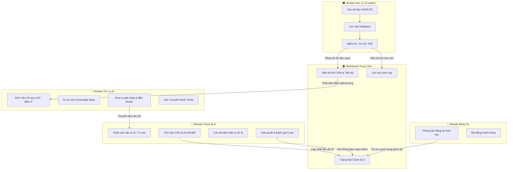

# 🎨 TÀI LIỆU THIẾT KẾ & ĐỒNG BỘ GIAO DIỆN TOÀN HỆ THỐNG (MASTER UI/UX SPECIFICATION)
# QAUTE PORTAL - HCMUTE STUDENT SUPPORT PORTAL

> **Phiên bản:** 2.0.0-UNIFIED  
> **Áp dụng cho:** Toàn bộ hệ thống giao diện Thymeleaf Templates (`src/main/resources/templates/**`), CSS/JS (`src/main/resources/static/**`), Phân hệ Public, Student Portal, Staff Workspace và Admin Console.  
> **Mục tiêu tối thượng:** Xóa bỏ hoàn toàn tình trạng phân mảnh giao diện (khác màu, lệch bố cục, sidebar bị vỡ trên di động, các chức năng hoạt động như các ứng dụng rời rạc). Thiết lập một **Hệ sinh thái số đồng nhất (Unified Digital Campus)** với ngôn ngữ thiết kế **HCMUTE Royal Elite**, luồng dữ liệu liên hoàn giữa Học vụ $\leftrightarrow$ Trợ lý AI $\leftrightarrow$ Ticket SLA $\leftrightarrow$ Bảng tin sinh viên.

---

## 📑 MỤC LỤC
1. [Tầm Nhìn & 4 Nguyên Tắc Thiết Kế Cốt Lõi](#1-tầm-nhìn--4-nguyên-tắc-thiết-kế-cốt-lõi)
2. [Hiện Trạng & Danh Sách Lỗi Phân Mảnh Cần Khắc Phục](#2-hiện-trạng--danh-sách-lỗi-phân-mảnh-cần-khắc-phục)
3. [Hệ Thống Design Tokens Chuẩn (HCMUTE Design System Tokens)](#3-hệ-thống-design-tokens-chuẩn-hcmute-design-system-tokens)
4. [Kiến Trúc Khung Bố Cục Dùng Chung (Master Layouts & Fragments)](#4-kiến-trúc-khung-bố-cục-dùng-chung-master-layouts--fragments)
5. [Thư Viện Thành Phần UI Chuẩn Hóa (Component Library Specs)](#5-thư-viện-thành-phần-ui-chuẩn-hóa-component-library-specs)
6. [Đặc Tả Chi Tiết Từng Phân Hệ & Màn Hình (Screen Blueprints)](#6-đặc-tả-chi-tiết-từng-phân-hệ--màn-hình-screen-blueprints)
   - 6.1. [Phân Hệ Đăng Nhập & Xác Thực (Auth Screens)](#61-phân-hệ-đăng-nhập--xác-thực-auth-screens)
   - 6.2. [Dashboard Tổng Quan Sinh Viên (Unified Dashboard)](#62-dashboard-tổng-quan-sinh-viên-unified-dashboard)
   - 6.3. [Học Vụ Số & Đồng Bộ Dữ Liệu (Academic Sync Portal)](#63-học-vụ-số--đồng-bộ-dữ-liệu-academic-sync-portal)
   - 6.4. [Trợ Lý AI Tư Vấn & Cơ Chế Chuyển Tiếp (AI Counseling Chat)](#64-trợ-lý-ai-tư-vấn--cơ-chế-chuyển-tiếp-ai-counseling-chat)
   - 6.5. [Hệ Thống Yêu Cầu Hỗ Trợ & Cam Kết SLA (Ticket & SLA Engine)](#65-hệ-thống-yêu-cầu-hỗ-trợ--cam-kết-sla-ticket--sla-engine)
   - 6.6. [Bảng Tin & Diễn Đàn Khoa/Trường (Social Feed & Groups)](#66-bảng-tin--diễn-đàn-khoatrường-social-feed--groups)
   - 6.7. [Hồ Sơ Cá Nhân & Cài Đặt (Profile & Security)](#67-hồ-sơ-cá-nhân--cài-đặt-profile--security)
   - 6.8. [Cổng Thông Tin Công Khai (Public Portal Screens)](#68-cổng-thông-tin-công-khai-public-portal-screens)
7. [Ma Trận Liên Kết Xuyên Suốt Giữa Các Tính Năng (Cross-Module Integration)](#7-ma-trận-liên-kết-xuyên-suốt-giữa-các-tính-năng-cross-module-integration)
8. [Quy Chuẩn Code CSS & Javascript Phía Client](#8-quy-chuẩn-code-css--javascript-phía-client)
9. [Lộ Trình Từng Bước Cho Dev B (Step-by-Step Execution Plan)](#9-lộ-trình-từng-bước-cho-dev-b-step-by-step-execution-plan)

---

## 1. TẦM NHÌN & 4 NGUYÊN TẮC THIẾT KẾ CỐT LÕI

### 1.1. Tầm nhìn sản phẩm
QAUTE Portal là **Nền tảng Hỗ trợ Học vụ & Tư vấn Sinh viên Một Cửa (One-Stop Student Counseling & Support Platform)** của Trường Đại học Sư phạm Kỹ thuật TP.HCM.  
Sinh viên không còn phải mở 4-5 tab trình duyệt khác nhau để vừa xem điểm thi, vừa kiểm tra lịch học, vừa tra cứu sổ tay sinh viên, vừa gửi email cầu cứu thầy cô. Toàn bộ nhu cầu học đường được tích hợp vào một không gian trực quan, mượt mà và thông minh.

### 1.2. 4 Nguyên tắc thiết kế bất biến
1. **Nhất quán Tuyệt đối về Bản sắc Thương hiệu (HCMUTE Brand Consistency):**
   - Loại bỏ hoàn toàn gam màu đỏ Crimson `#A51C30` (của Harvard) đang bị gán tạm bợ trong `style.css` và `portal.css`.
   - Lấy gam màu **Xanh Royal Navy HCMUTE (`#0f172a`, `#1d4ed8`)** kết hợp vàng hổ phách học thuật (`#f59e0b`) làm linh hồn thị giác.
2. **Không Cô lập Chức năng (No Isolated Modules):**
   - Mọi module phải có "cửa sổ giao tiếp" với module khác. Ví dụ: Xem điểm F ở màn hình Học vụ $\rightarrow$ gợi ý bấm hỏi AI về quy chế hoãn/thi lại $\rightarrow$ AI tư vấn xong có nút 1-click tạo Ticket gửi Phòng Đào tạo $\rightarrow$ Trạng thái Ticket hiển thị ngay trên Dashboard.
3. **Thân thiện trên Di động & Thao tác Chạm (Mobile-First & Touch-Ready):**
   - Tuyệt đối loại bỏ hiệu ứng `.sidebar:hover { width: 260px }` gây giật lag và không thể sử dụng trên điện thoại thông minh.
   - Chuyển sang mô hình: Desktop thu gọn/mở rộng bằng nút Toggle; Mobile ẩn hoàn toàn và mở dạng **Offcanvas Drawer** có lớp nền mờ (Backdrop Blur).
4. **Không Ngõ Cụt (Zero Dead-End UX):**
   - Không để bất kỳ màn hình nào rơi vào trạng thái trống rỗng (Empty State) với một thông báo vô hồn. Mọi trạng thái trống đều phải có hình minh họa tinh tế, mô tả rõ lý do và ít nhất 1 nút hành động gợi ý (Call-to-Action).

---

## 2. HIỆN TRẠNG & DANH SÁCH LỖI PHÂN MẢNH CẦN KHẮC PHỤC

| Thành phần / Màn hình | Hiện trạng thực tế trong mã nguồn | Hệ quả người dùng gặp phải | Giải pháp chuẩn hóa (Unified Fix) |
| :--- | :--- | :--- | :--- |
| **Bảng màu chủ đạo** | `style.css` và `portal.css` định nghĩa `--crimson: #A51C30`; trong khi `academic-sync.html` dùng xanh `#1d4ed8`. | Người dùng cảm giác đang nhảy qua lại giữa 2 trang web khác nhau của 2 trường khác nhau. | Đổi 100% token sang **HCMUTE Royal Navy (`#0f172a`, `#1d4ed8`)**, loại bỏ vĩnh viễn `#A51C30`. |
| **Thanh Sidebar** | Dùng CSS `.sidebar:hover { width: 260px }`, độ rộng mặc định `80px`. Không có nút Toggle JS. | Khi dùng trên điện thoại hoặc chuột rê ngang, Sidebar bung nở bất chợt gây giật giật layout. | Desktop: Mặc định `260px`, có nút co lại `72px`. Mobile: Ẩn hoàn toàn, trượt ra dạng **Offcanvas Drawer** khi bấm icon Menu trên Topbar. |
| **Cấu trúc Fragment** | `ticket-list.html`, `feed.html`, `academic-sync.html` tự viết lại `<aside class="sidebar">` và `<header class="topbar">` trực tiếp, không dùng `th:replace`. | Khi sửa đổi menu hoặc avatar, phải sửa trên hàng chục file HTML khác nhau $\rightarrow$ Dẫn đến tình trạng trang có link này, trang thiếu link kia. | Chuẩn hóa 100% các trang Portal dùng chung: `th:replace="~{fragments/sidebar :: sidebar('currentTab')}"` và `th:replace="~{fragments/topbar :: topbar}"`. |
| **Khung Topbar** | Topbar hardcode avatar `background=A51C30`, tên "Nguyễn Văn A" cố định, không có Breadcrumbs, không có nút mở menu trên mobile. | Không hiển thị đúng thông tin sinh viên đang đăng nhập; thiếu công cụ định vị vị trí hiện tại. | Tích hợp hiển thị dữ liệu động `${#authentication.name}`, nút Hamburger Mobile, Breadcrumbs động, Avatar động. |
| **Dashboard Tổng quan** | `dashboard.html` chỉ có 4 thẻ thống kê tĩnh và 1 placeholder trống "Chưa có hoạt động mới". | Không mang lại giá trị thực tiễn cho sinh viên khi vừa đăng nhập; không thấy lịch học hay tiến độ học tập. | Tái thiết kế thành **Bàn làm việc thông minh (Smart Workspace)**: Widget lịch học hôm nay, Widget GPA tích lũy, Widget Ticket SLA đang xử lý, và các gợi ý chat AI. |
| **Liên kết AI Chat $\rightarrow$ Ticket** | `ai-chat.html` hoạt động độc lập; sinh viên hỏi thủ tục xong phải tự thoát ra tìm trang Ticket để gõ lại từ đầu. | Trải nghiệm bị đứt đoạn, tăng tỷ lệ bỏ cuộc của sinh viên. | Bổ sung nút **"Chuyển thành Ticket gửi Thầy/Cô"** ở mỗi câu trả lời của AI. Bấm vào tự mở Modal điền sẵn tiêu đề và nội dung tư vấn. |

---

## 3. HỆ THỐNG DESIGN TOKENS CHUẨN (HCMUTE DESIGN SYSTEM TOKENS)

Toàn bộ stylesheet của hệ thống (`static/css/portal.css` và `static/css/style.css`) phải khai báo và tuân thủ chặt chẽ bộ biến `:root` sau:

```css
:root {
    /* ==========================================================================
       1. BỘ MÀU NHẬN DIỆN THƯƠNG HIỆU (HCMUTE BRAND IDENTITY)
       ========================================================================== */
    --hcmute-navy: #0f172a;           /* Xanh đen thương hiệu: Header, Sidebar nền tối, text tiêu đề */
    --hcmute-slate: #1e293b;          /* Xanh đá phiến: Hero Card, phân chia khối đậm */
    --hcmute-primary: #1d4ed8;        /* Xanh Royal HCMUTE: Nút chính, Tab active, Link trọng tâm */
    --hcmute-primary-hover: #1e40af;  /* Tông hover cho nút chính */
    --hcmute-primary-light: #eff6ff;  /* Xanh nhạt nền: Thẻ active, Badge thông tin */
    --hcmute-primary-border: #bfdbfe; /* Viền thẻ xanh */
    --hcmute-gold: #f59e0b;           /* Vàng học thuật: Điểm nhấn sao đánh giá, thành tích */
    --hcmute-gold-light: #fef3c7;

    /* ==========================================================================
       2. MÀU TRẠNG THÁI NGHIỆP VỤ & CAM KẾT SLA (SEMANTIC & SLA TOKENS)
       ========================================================================== */
    --sla-urgent: #ef4444;            /* Đỏ cảnh báo: Hạn chót < 24h, Quá hạn (OVERDUE), Điểm F */
    --sla-urgent-bg: #fef2f2;
    --sla-urgent-border: #fecaca;

    --sla-warning: #f59e0b;           /* Vàng hổ phách: Đang xử lý (IN_PROGRESS), Sắp đến hạn */
    --sla-warning-bg: #fffbeb;
    --sla-warning-border: #fde68a;

    --sla-success: #10b981;           /* Xanh ngọc: Đã giải quyết (RESOLVED), Tín chỉ đạt */
    --sla-success-bg: #ecfdf5;
    --sla-success-border: #a7f3d0;

    --sla-info: #0284c7;              /* Xanh da trời: Mới mở (OPEN), Chờ tiếp nhận */
    --sla-info-bg: #f0f9ff;
    --sla-info-border: #bae6fd;

    /* ==========================================================================
       3. MÀU TRUNG TÍNH & BỀ MẶT (NEUTRALS & SURFACES)
       ========================================================================== */
    --bg-page: #f8fafc;               /* Nền trang: Xám xanh nhạt dịu mắt */
    --bg-surface: #ffffff;            /* Nền thẻ box, bảng dữ liệu, modal */
    --bg-sidebar: #0f172a;            /* Nền sidebar phong cách tối sang trọng */
    --bg-sidebar-hover: #1e293b;
    --bg-input: #ffffff;              /* Nền input form */
    --bg-input-focus: #f8fafc;

    --text-main: #0f172a;             /* Chữ chính: Tương phản cao, dễ đọc */
    --text-body: #334155;             /* Chữ nội dung thông thường */
    --text-muted: #64748b;            /* Chữ phụ chú, timestamp, placeholder */
    --text-light: #94a3b8;            /* Chữ mờ trên nền tối */

    --border-color: #e2e8f0;          /* Viền ngăn cách tiêu chuẩn */
    --border-hover: #cbd5e1;
    --border-focus: #3b82f6;

    /* ==========================================================================
       4. KÍCH THƯỚC KHUNG BỐ CỤC (LAYOUT GEOMETRY)
       ========================================================================== */
    --sidebar-width: 260px;
    --sidebar-collapsed-width: 72px;
    --topbar-height: 68px;
    --content-max-width: 1400px;

    /* ==========================================================================
       5. ĐỘ BO GÓC & ĐỔ BÓNG (SHAPE & ELEVATION)
       ========================================================================== */
    --radius-sm: 6px;
    --radius-md: 10px;
    --radius-lg: 14px;
    --radius-xl: 20px;
    --radius-full: 9999px;

    --shadow-subtle: 0 1px 3px rgba(0, 0, 0, 0.04), 0 1px 2px rgba(0, 0, 0, 0.03);
    --shadow-card: 0 4px 6px -1px rgba(15, 23, 42, 0.05), 0 2px 4px -2px rgba(15, 23, 42, 0.05);
    --shadow-elevated: 0 12px 24px -4px rgba(15, 23, 42, 0.08), 0 4px 8px -2px rgba(15, 23, 42, 0.03);
    --shadow-modal: 0 25px 50px -12px rgba(15, 23, 42, 0.25);

    /* ==========================================================================
       6. TYPOGRAPHY
       ========================================================================== */
    --font-sans: 'Inter', -apple-system, BlinkMacSystemFont, 'Segoe UI', Roboto, sans-serif;
    --font-heading: 'Outfit', 'Inter', sans-serif;
}
```

---

## 4. KIẾN TRÚC KHUNG BỐ CỤC DÙNG CHUNG (MASTER LAYOUTS & FRAGMENTS)

Để đồng bộ 100% giao diện, toàn bộ dự án chỉ sử dụng **2 Master Layouts**. Không một file nào được phép tự viết lại khung Sidebar hoặc Navbar!

### 4.1. Master Layout 1: Cổng Công Khai (Public Web Layout)
- **Áp dụng cho:** `index.html`, `admission.html`, `explore.html`, `about.html`, `research.html`, `news-detail.html`.
- **Đặc trưng:**
  - Header dùng `th:replace="~{fragments/navbar :: navbar('activeTab')}"`.
  - Footer dùng `th:replace="~{fragments/footer :: footer}"`.
  - Có nút **"Đăng nhập Cổng Sinh Viên"** nổi bật ở góc phải Header.
  - Luôn đính kèm **Widget AI Mini Nổi (Floating Counseling Bot)** ở góc dưới bên phải màn hình để hỗ trợ khách vãng lai và tân sinh viên.

### 4.2. Master Layout 2: Cổng Dịch Vụ Sinh Viên (Portal Application Layout)
- **Áp dụng cho:** `dashboard.html`, `academic-sync.html`, `ai-chat.html`, `ticket-list.html`, `ticket-detail.html`, `feed.html`, `create-post.html`, `group.html`, `profile.html`.
- **Cấu trúc DOM chuẩn bắt buộc:**

```html
<!DOCTYPE html>
<html lang="vi" xmlns:th="http://www.thymeleaf.org">
<head>
    <th:block th:replace="~{fragments/head :: portalHead('Tiêu đề trang')}"></th:block>
</head>
<body class="portal-body">

    <!-- 1. LỚP NỀN MỜ PHỦ KHI BẬT MENU TRÊN MOBILE (OFFCANVAS BACKDROP) -->
    <div id="sidebarBackdrop" class="sidebar-backdrop" onclick="toggleMobileSidebar()"></div>

    <!-- 2. SIDEBAR CHUẨN DÙNG CHUNG -->
    <aside th:replace="~{fragments/sidebar :: sidebar('tên-tab-active')}"></aside>

    <!-- 3. KHUNG NỘI DUNG CHÍNH (MAIN WRAPPER) -->
    <div class="main-wrapper" id="mainWrapper">
        
        <!-- 4. TOPBAR CHUẨN DÙNG CHUNG -->
        <header th:replace="~{fragments/topbar :: topbar}"></header>

        <!-- 5. VÙNG HIỂN THỊ NỘI DUNG CỦA TRANG (PAGE CONTENT) -->
        <main class="page-content">
            <!-- Breadcrumbs dẫn đường -->
            <nav class="portal-breadcrumbs">
                <a th:href="@{/dashboard}"><i class='bx bx-home-alt'></i> Cổng thông tin</a>
                <i class='bx bx-chevron-right separator'></i>
                <span class="current">Tên Chức Năng Hiện Tại</span>
            </nav>

            <!-- Nội dung đặc thù của từng trang nằm tại đây -->
            ...
        </main>
    </div>

    <!-- SCRIPT ĐIỀU KHIỂN CHUNG CHO PORTAL (TOGGLE SIDEBAR, USER DROPDOWN) -->
    <script th:src="@{/js/portal-layout.js}"></script>
</body>
</html>
```

### 4.3. Đặc tả Thanh Điều Hướng Bên (Sidebar Fragment: `fragments/sidebar.html`)
Sidebar phải thể hiện đầy đủ 7 phân hệ chính, có icon Boxicons và trạng thái `.active`:

```
+------------------------------------------------------+
| [Logo HCMUTE]  QAUTE PORTAL        [Icon Thu Gọn <<] |
+------------------------------------------------------+
|  MENU CHÍNH                                          |
|  [🏠]  Tổng quan (Dashboard)                         |
|  [🎓]  Học vụ số (Academic Sync)          [Mới]      |
|  [🤖]  Trợ lý AI (Counseling Chat)        [AI]       |
|  [🎫]  Yêu cầu hỗ trợ (Tickets & SLA)     [Số badge] |
|  [📰]  Bảng tin sinh viên (Feed)                     |
|  [👥]  Cộng đồng Khoa (Groups)                       |
|  [👤]  Hồ sơ cá nhân (Profile)                       |
+------------------------------------------------------+
|  LIÊN KẾT NHANH                                      |
|  [🌐]  Trang chủ trường (Portal Public)              |
|  [🚪]  Đăng xuất                                     |
+------------------------------------------------------+
```

### 4.4. Đặc tả Thanh Điều Hướng Trên (Topbar Fragment: `fragments/topbar.html`)
Topbar chứa 4 thành phần thiết yếu:
1. **Nút Toggle Menu (`#sidebarToggle`):** Bấm trên Desktop $\rightarrow$ thu gọn Sidebar thành `72px`; Bấm trên Mobile $\rightarrow$ mở ngăn kéo Drawer.
2. **Thanh Tìm Kiếm Toàn Cục (`.global-search`):** Tìm nhanh mã môn học, mã Ticket, câu hỏi trợ giúp.
3. **Chuông Thông Báo Động (`.notification-dropdown`):** Đếm số thông báo chưa đọc, hiển thị danh sách thông báo nổi bật.
4. **Hồ Sơ Thu Gọn (User Profile Dropdown):** Avatar lấy từ thông tin đồng bộ (`avatarUrl`) hoặc tạo avatar chữ cái; Tên sinh viên, MSSV, Khoa; Dropdown có link vào Profile và nút Đăng xuất.

---

## 5. THƯ VIỆN THÀNH PHẦN UI CHUẨN HÓA (COMPONENT LIBRARY SPECS)

Mọi màn hình phải sử dụng các Class thành phần chuẩn hóa sau đây để đảm bảo giao diện đồng nhất:

### 5.1. Thẻ Hộp Chứa (Cards)
- `.card-box`: Hộp nền trắng (`#ffffff`), bo viền `16px`, viền `1px solid var(--border-color)`, padding `24px`, đổ bóng `var(--shadow-card)`.
- `.hero-banner-card`: Thẻ lớn đầu trang màu xanh đen gradient (`linear-gradient(135deg, #0f172a 0%, #1e293b 100%)`), chữ trắng tinh tế, có họa tiết bo tròn mờ trang trí phía nền.

### 5.2. Khối Thống Kê KPI (KPI Grid & KPI Cards)
- Khung lưới `.kpi-grid`: Tự động chia 4 cột trên Desktop (`grid-template-columns: repeat(4, 1fr)`), 2 cột trên Tablet, 1 cột trên Mobile.
- Thẻ `.kpi-card`:
  - Chứa icon kích thước `52px x 52px` bo góc `12px`.
  - Giá trị số lớn (`font-size: 1.6rem, font-weight: 800`).
  - Nhãn tiêu đề nhỏ gọn và dòng chú thích tiến độ (ví dụ: *"+0.15 so với HK trước"*).

### 5.3. Hệ Thống Nút Bấm (Button System)
- `.btn-portal`: Nút cơ sở có padding `10px 20px`, bo góc `10px`, font chữ `Inter` `600`, hiệu ứng chuyển động mượt mà.
- `.btn-portal-primary`: Nền xanh gradient (`linear-gradient(135deg, #1d4ed8, #2563eb)`), chữ trắng, hiệu ứng nổi lên khi rê chuột (`transform: translateY(-2px)`).
- `.btn-portal-secondary`: Nền trắng viền xám (`1px solid var(--border-color)`), chữ xám đậm.
- `.btn-portal-success`: Nền xanh lá (`#10b981`), dùng khi nộp đơn thành công, giải quyết yêu cầu.
- `.btn-portal-warning`: Nền vàng hổ phách (`#f59e0b`), dùng cho các cảnh báo quan trọng.
- `.btn-portal-danger`: Nền đỏ hồng (`#ef4444`), dùng cho hủy bỏ hoặc xóa dữ liệu.

### 5.4. Huy Hiệu Trạng Thái & Hạn Chót SLA (Badges & SLA Countdown)
- **Huy hiệu SLA Ticket:**
  - `.badge-sla.urgent`: Nền đỏ nhạt `#fef2f2`, chữ đỏ đậm `#b91c1c`, viền `#fecaca`. Hiển thị: *"Khẩn cấp - Còn 4h"*.
  - `.badge-sla.warning`: Nền vàng nhạt `#fffbeb`, chữ vàng đậm `#b45309`, viền `#fde68a`. Hiển thị: *"Bình thường - Còn 36h"*.
  - `.badge-sla.resolved`: Nền xanh lá `#ecfdf5`, chữ xanh ngọc `#047857`, viền `#a7f3d0`. Hiển thị: *"Đã giải quyết"*.
- **Huy hiệu Học phần:**
  - `.badge-grade.pass`: Xanh ngọc - Học phần Đạt.
  - `.badge-grade.fail`: Đỏ tươi - Chưa tích lũy (Cần học lại).

### 5.5. Bảng Dữ Liệu Tương Tác (Data Tables)
- `.table-responsive`: Khung cuộn ngang mượt mà cho bảng khi màn hình nhỏ hơn chiều rộng bảng.
- `.portal-table`: Bảng hiện đại với Header màu xám nhạt thanh lịch (`#f8fafc`), chữ hoa nhẹ (`font-size: 0.8rem, font-weight: 600`), hàng cách đều, có hiệu ứng highlight khi di chuột (`tr:hover { background-color: #f1f5f9; }`).

---

## 6. ĐẶC TẢ CHI TIẾT TỪNG PHÂN HỆ & MÀN HÌNH (SCREEN BLUEPRINTS)

### 6.1. Phân Hệ Đăng Nhập & Xác Thực (Auth Screens)
- **Màn hình liên quan:** `login.html`, `register.html`, `activate.html`, `forgot-password.html`.
- **Bố cục chuẩn (Split-Screen Modern):**
  - **Cột trái (50% Desktop):** Hình ảnh khuôn viên HCMUTE, biểu trưng Tòa nhà Trung tâm, khẩu hiệu *"Đại học Sư phạm Kỹ thuật TP.HCM - Khởi nguồn Tri thức & Sáng tạo"*.
  - **Cột phải (50% Desktop):** Form đăng nhập/đăng ký gọn gàng, nền trắng, logo HCMUTE, các ô nhập liệu Floating Label, nút Đăng nhập to rõ, liên kết *"Quên mật khẩu?"* và liên kết quay về Trang chủ.
  - **Màn hình OTP (`activate.html`):** Thiết kế 6 ô vuông nhập mã số tự động nhảy con trỏ chuột sang ô kế tiếp khi gõ phím.

---

### 6.2. Dashboard Tổng Quan Sinh Viên (Unified Dashboard: `dashboard.html`)
Màn hình trung tâm sau khi đăng nhập. Triệt tiêu hoàn toàn ô trống cũ; thay bằng cấu trúc 4 tầng thông tin thiết thực:

```
+---------------------------------------------------------------------------------------+
| HERO WELCOME CARD                                                                     |
| "Xin chào, Nguyễn Văn A! 👋 (MSSV: 22110001 - K22 CNTT)"                                |
| Trạng thái học vụ: BÌNH THƯỜNG | Cập nhật lần cuối: 10 phút trước                       |
| [ 🔄 Đồng bộ học vụ mới nhất ]   [ 🤖 Đặt câu hỏi cho Trợ lý AI ]                     |
+---------------------------------------------------------------------------------------+

+--------------------+  +--------------------+  +--------------------+  +--------------------+
| GPA TÍCH LŨY       |  | TÍN CHỈ TÍCH LŨY   |  | YÊU CẦU ĐANG XỬ LÝ |  | THÔNG BÁO MỚI      |
| 3.42 / 4.00        |  | 98 / 132 TC        |  | 01 Đang giải quyết |  | 03 Tin quan trọng  |
| Xếp loại: GIỎI     |  | Đạt tiến độ 74%    |  | Hạn SLA: Còn 18h   |  | Phòng Đào tạo      |
+--------------------+  +--------------------+  +--------------------+  +--------------------+

+------------------------------------------------------+  +-----------------------------+
| LỊCH HỌC HÔM NAY (Thời khóa biểu thời gian thực)      |  | LỐI TẮT HỖ TRỢ AI & TICKET  |
| - 07:00 - 09:30: Lập trình Java Nâng cao (Phòng A1-302)|  | 💡 Bạn đang thắc mắc:       |
| - 09:45 - 11:30: Trí tuệ Nhân tạo (Phòng B2-205)       |  | - Thủ tục xin hoãn thi      |
|                                                      |  | - Cấp lại bảng điểm         |
| ---------------------------------------------------- |  | - Hướng dẫn nộp học phí     |
| YÊU CẦU HỖ TRỢ GẦN NHẤT CỦA BẠN                      |  |                             |
| Mã #TK-1045: Xin cấp lại bảng điểm Tiếng Anh         |  | [ 💬 Mở khung chat AI ngay ]|
| Phòng ban: Phòng Đào tạo | Trạng thái: Đang xử lý    |  | [ 🎫 Tạo Ticket hỗ trợ mới ]|
+------------------------------------------------------+  +-----------------------------+
```

---

### 6.3. Học Vụ Số & Đồng Bộ Dữ Liệu (Academic Sync Portal: `academic-sync.html`)
- **Tích hợp:** Đóng gói hoàn chỉnh trong Master Portal Layout (dùng chung `sidebar` và `topbar`).
- **Nội dung:**
  1. **Khung Đồng Bộ Nhanh:** Ô nhập MSSV và Mật khẩu HCMUTE, nút đồng bộ có Spinner khi chạy, và nút **"🧪 Điền nhanh tài khoản Demo (Offline)"** phục vụ thuyết trình / chấm điểm đồ án.
  2. **Thẻ Profile Sinh Viên:** Họ tên, MSSV, Avatar cào từ cổng Portal, Khoa, Ngành, Lớp, Cố vấn học tập.
  3. **4 Thẻ KPI Học Vụ:** GPA 10, GPA 4, Tổng tín chỉ tích lũy, Xếp loại học lực.
  4. **Hệ Thống 4 Tab Chức Năng:**
     - **Tab 1: Hồ sơ chi tiết:** Bảng thông tin cá nhân và học vụ đầy đủ 18 trường dữ liệu.
     - **Tab 2: Bảng điểm học tập:** Bộ lọc chọn Học kỳ, bảng điểm các môn có Badge chữ (A+, A, B, C, F), trạng thái Đạt/Chưa đạt.
     - **Tab 3: Thời khóa biểu:** Lưới lịch học theo tuần, mã phòng học, giảng viên phụ trách.
     - **Tab 4: Khung chương trình đào tạo:** Danh sách môn bắt buộc/tự chọn, thanh tiến độ hoàn thành CTĐT.

---

### 6.4. Trợ Lý AI Tư Vấn & Cơ Chế Chuyển Tiếp (AI Counseling Chat: `ai-chat.html`)
Màn hình tư vấn học vụ thông minh:
1. **Bộ Chuyển Đổi Mô Hình (Model Selector):**
   - Nút gạt chuyển giữa **Google Gemini (Cloud Pro)** và **Ollama (Local Offline)**.
2. **Khung Trò Chuyện Trực Quan:**
   - Bong bóng sinh viên: Nền Xanh Royal Navy (`#0f172a`), chữ trắng, căn lề phải.
   - Bong bóng AI: Nền trắng, viền mảnh `#e2e8f0`, chữ đậm `#1e293b`, căn lề trái.
   - **Thẻ Trích Dẫn Căn Cứ Học Vụ (Source Citation Card):** Hiển thị rõ: *"Căn cứ theo Điều 14, Khoản 2 - Quy chế Đào tạo tín chỉ HCMUTE"*.
3. **⭐ TÍNH NĂNG ĐỒNG BỘ CỐT LÕI - Nút 1-Click "Chuyển thành Ticket gửi Thầy/Cô":**
   - Đặt ngay dưới mỗi câu trả lời tư vấn của AI.
   - Khi sinh viên thấy AI giải thích xong nhưng cần sự can thiệp thực tế của cán bộ $\rightarrow$ Bấm nút.
   - Hệ thống mở **Modal Tạo Ticket Tự Động**, trích xuất sẵn:
     * *Tiêu đề:* Tóm tắt câu hỏi vừa chat.
     * *Phòng ban tiếp nhận:* Tự động chọn Phòng Đào tạo hoặc Khoa liên quan.
     * *Nội dung chi tiết:* Toàn bộ tóm tắt câu trả lời của AI và ghi chú bổ sung của sinh viên.
     * *Mức độ ưu tiên SLA:* Tự động gán theo phân loại bài toán.

---

### 6.5. Hệ Thống Yêu Cầu Hỗ Trợ & Cam Kết SLA (Ticket & SLA Engine: `ticket-list.html`, `ticket-detail.html`)
- **`ticket-list.html`:**
  - Nút chính: **"+ Tạo Yêu Cầu Hỗ Trợ Mới"** (Mở Modal tạo vé có đính kèm file ảnh/PDF).
  - Bộ lọc trạng thái: Tất cả | Đang chờ tiếp nhận | Đang xử lý | Đã giải quyết | Quá hạn SLA.
  - Bảng danh sách Ticket có **Đồng hồ đếm ngược SLA** thời gian thực (ví dụ: *"Còn 12h 45m"*).
- **`ticket-detail.html`:**
  - Bố cục 2 cột (70% - 30%):
    - **Cột trái:** Luồng thời gian (Timeline) trao đổi giữa Sinh viên và Cán bộ thụ lý, khung gửi phản hồi bổ sung, trình xem ảnh minh chứng trực tiếp.
    - **Cột phải:** Thẻ thông tin thụ lý (Cán bộ phụ trách, Khoa/Phòng tiếp nhận, Thời hạn cam kết SLA, Lịch sử đổi trạng thái).
    - **Khung Đánh Giá CSAT:** Sau khi Ticket chuyển sang `RESOLVED`, hiển thị form cho sinh viên chấm 1 - 5 sao và để lại nhận xét về chất lượng phục vụ.

---

### 6.6. Bảng Tin & Diễn Đàn Khoa/Trường (Social Feed & Groups: `feed.html`, `create-post.html`, `group.html`)
- **Phân tách 2 luồng tin rõ ràng:**
  - **Tab 1: Thông báo chính thức của Nhà trường:** Chỉ Cán bộ/Admin mới được đăng. Hỗ trợ xem trực tiếp file PDF quyết định học bổng, video clip thông báo MP4.
  - **Tab 2: Diễn đàn trao đổi sinh viên:** Sinh viên đăng bài thảo luận, tìm bạn cùng nhóm, hỏi bài giảng. Có kiểm duyệt tự động hoặc gắn cờ báo cáo vi phạm (`Report`).
- **Thẻ bài viết hiện đại:**
  - Avatar, tên tác giả, huy hiệu đơn vị (ví dụ: `[Phòng CTSV]`, `[K22 CNTT]`).
  - Nội dung bài viết có định dạng văn bản giàu (Rich text).
  - Tương tác: Thả tim (Like), Bình luận nhiều cấp (Comments), Chia sẻ (Share).

---

### 6.7. Hồ Sơ Cá Nhân & Cài Đặt (Profile & Security: `profile.html`)
- Thông tin cá nhân kết nối trực tiếp với dữ liệu học vụ cào được từ HCMUTE.
- Quản lý bảo mật: Đổi mật khẩu, kích hoạt xác thực 2 lớp qua OTP Email.
- Cài đặt nhận thông báo: Tùy chọn nhận email khi có cập nhật Ticket SLA mới.

---

### 6.8. Cổng Thông Tin Công Khai (Public Portal Screens: `index.html`, `admission.html`, `explore.html`, `about.html`, `research.html`, `news-detail.html`)
- Thiết kế chuẩn phong cách Đại học Quốc tế: Banner lớn, các khối tin tức tuyển sinh, thông tin các khoa, video giới thiệu trường.
- Tích hợp Widget AI Mini ở góc màn hình: Cho phép học sinh THPT và phụ huynh hỏi nhanh về chỉ tiêu tuyển sinh, học phí, ngành đào tạo mà không cần đăng nhập.

---

## 7. MA TRẬN LIÊN KẾT XUYÊN SUỐT GIỮA CÁC TÍNH NĂNG (CROSS-MODULE INTEGRATION)

Sơ đồ tuần hoàn dữ liệu chứng minh các chức năng hoạt động như một thể thống nhất:



---

## 8. QUY CHUẨN CODE CSS & JAVASCRIPT PHÍA CLIENT

### 8.1. Cơ chế Responsive Sidebar & Offcanvas Drawer (`static/js/portal-layout.js`)
File Javascript dùng chung duy nhất cho toàn bộ khung Portal:

```javascript
/**
 * portal-layout.js - Quản lý tương tác khung giao diện Portal
 */
document.addEventListener('DOMContentLoaded', function () {
    const sidebar = document.getElementById('portalSidebar');
    const mainWrapper = document.getElementById('mainWrapper');
    const toggleBtn = document.getElementById('sidebarToggle');
    const backdrop = document.getElementById('sidebarBackdrop');

    if (!sidebar || !toggleBtn) return;

    // 1. Thao tác Toggle Sidebar
    toggleBtn.addEventListener('click', function () {
        if (window.innerWidth >= 992) {
            // Trên Desktop: Thu nhỏ thành 72px hoặc mở rộng 260px
            sidebar.classList.toggle('collapsed');
            mainWrapper.classList.toggle('expanded');
            localStorage.setItem('sidebar_collapsed', sidebar.classList.contains('collapsed'));
        } else {
            // Trên Mobile: Trượt Offcanvas Drawer ra vào
            sidebar.classList.toggle('mobile-open');
            if (backdrop) backdrop.classList.toggle('active');
        }
    });

    // 2. Bấm vào nền mờ để đóng Drawer trên Mobile
    if (backdrop) {
        backdrop.addEventListener('click', function () {
            sidebar.classList.remove('mobile-open');
            backdrop.classList.remove('active');
        });
    }

    // 3. Khôi phục trạng thái thu gọn trên Desktop từ localStorage
    if (window.innerWidth >= 992 && localStorage.getItem('sidebar_collapsed') === 'true') {
        sidebar.classList.add('collapsed');
        mainWrapper.classList.add('expanded');
    }
});
```

### 8.2. CSS Quy Chuẩn Cho Sidebar Tránh Lỗi Hover (`static/css/portal.css`)
```css
/* Sidebar cố định, không dùng hover mở rộng */
.sidebar {
    width: var(--sidebar-width);
    background: var(--bg-sidebar);
    height: 100vh;
    position: fixed;
    top: 0;
    left: 0;
    z-index: 1050;
    transition: all 0.3s cubic-bezier(0.4, 0, 0.2, 1);
    display: flex;
    flex-direction: column;
}

/* Khi thu gọn trên Desktop */
.sidebar.collapsed {
    width: var(--sidebar-collapsed-width);
}
.sidebar.collapsed .logo-text,
.sidebar.collapsed .sidebar-menu span,
.sidebar.collapsed .sidebar-footer span {
    display: none;
}

/* Wrapper nội dung chính */
.main-wrapper {
    margin-left: var(--sidebar-width);
    min-height: 100vh;
    transition: margin-left 0.3s ease;
    background-color: var(--bg-page);
}
.main-wrapper.expanded {
    margin-left: var(--sidebar-collapsed-width);
}

/* Màn hình Mobile (< 992px) */
@media (max-width: 991.98px) {
    .sidebar {
        transform: translateX(-100%);
    }
    .sidebar.mobile-open {
        transform: translateX(0);
        box-shadow: var(--shadow-modal);
    }
    .main-wrapper {
        margin-left: 0 !important;
    }
    .sidebar-backdrop {
        position: fixed;
        top: 0;
        left: 0;
        width: 100vw;
        height: 100vh;
        background: rgba(15, 23, 42, 0.5);
        backdrop-filter: blur(4px);
        z-index: 1040;
        display: none;
    }
    .sidebar-backdrop.active {
        display: block;
    }
}
```

---

## 9. LỘ TRÌNH TỪNG BƯỚC CHO DEV B (STEP-BY-STEP EXECUTION PLAN)

Để chuyển đổi toàn bộ hệ thống sang giao diện đồng bộ một cách an toàn, Dev B thực hiện tuần tự theo 4 giai đoạn sau:

### 🚀 Giai đoạn 1: Chuẩn hóa Tokens & Layout Dùng Chung (Foundation)
- [ ] **Bước 1.1:** Mở `static/css/portal.css` và `static/css/style.css`, thay thế toàn bộ mã màu Crimson `#A51C30` bằng bộ token biến `:root` HCMUTE Royal Navy (`#0f172a`, `#1d4ed8`).
- [ ] **Bước 1.2:** Cập nhật `src/main/resources/templates/fragments/sidebar.html` theo đặc tả tại Mục 4.3 (đầy đủ 7 liên kết, không lỗi hover).
- [ ] **Bước 1.3:** Cập nhật `src/main/resources/templates/fragments/topbar.html` theo đặc tả tại Mục 4.4 (nút toggle hamburger, breadcrumb, avatar động).
- [ ] **Bước 1.4:** Tạo file `static/js/portal-layout.js` điều khiển mở/đóng menu trên Desktop và Mobile.

### 🚀 Giai đoạn 2: Tái thiết kế Dashboard & Học Vụ Số (Core Student Hub)
- [ ] **Bước 2.1:** Viết lại `dashboard.html` theo wireframe tại Mục 6.2 (Thẻ Hero cá nhân, 4 thẻ KPI, Widget lịch học hôm nay, Widget Ticket SLA).
- [ ] **Bước 2.2:** Nhúng `academic-sync.html` vào khung chung `fragments/sidebar` và `fragments/topbar`.

### 🚀 Giai đoạn 3: Đồng bộ AI Counseling & Hệ Thống Ticket SLA (Support Loop)
- [ ] **Bước 2.3:** Nâng cấp `ai-chat.html`: Thêm nút *"Chuyển thành Ticket gửi Thầy/Cô"* dưới câu trả lời của AI và Modal tạo Ticket điền sẵn dữ liệu.
- [ ] **Bước 2.4:** Chuẩn hóa `ticket-list.html`: Xóa bỏ code `<aside>` và `<header>` viết lặp, thay bằng `th:replace`, thêm Badge đếm ngược hạn chót SLA.
- [ ] **Bước 2.5:** Nâng cấp `ticket-detail.html`: Timeline trao đổi, xem đính kèm, form đánh giá CSAT 5 sao.

### 🚀 Giai đoạn 4: Đồng bộ Bảng Tin, Nhóm Khoa & Phân Hệ Công Khai (Community & Public)
- [ ] **Bước 4.1:** Chuẩn hóa `feed.html` và `group.html` dùng chung `fragments/sidebar` và `fragments/topbar`.
- [ ] **Bước 4.2:** Thêm nút gạt xem Thông báo trường (PDF/Video) vs Thảo luận sinh viên.
- [ ] **Bước 4.3:** Kiểm thử giao diện trên trình duyệt Responsive (iPhone, iPad, Màn hình Full HD) đảm bảo không vỡ layout.

---

> 📌 **Cam kết phân định quyền hạn:**  
> Bản tài liệu này được biên soạn bởi **Dev A (Backend Lead & Architect)** nhằm cung cấp bức tranh kiến trúc giao diện toàn diện và rõ ràng nhất. **Dev B (Frontend Lead)** sẽ sử dụng tài liệu này làm căn cứ chính xác để tiến hành chỉnh sửa các file View và CSS mà không sợ bị lệch pha với tầng dữ liệu Backend!
