<div align="center">

  

  # 🎓 QAUTE Portal — HCMUTE Student Support & Counseling Portal
  ### Hệ Thống Tư Vấn Sinh Viên, Quản Lý Ticket SLA Đa Phòng Ban, Cổng Học Vụ & Trợ Lý Trí Tuệ Nhân Tạo AI Hybrid RAG 24/7

  [](https://www.oracle.com/java/)
  [](https://spring.io/projects/spring-boot)
  [](https://spring.io/projects/spring-security)
  [](https://tidbcloud.com/)
  [](https://qdrant.tech/)
  [](https://ai.google.dev/)
  [](https://cloudinary.com/)
  [](https://aws.amazon.com/)
  [](https://www.docker.com/)

  <p align="center">
    <b>Đại học Sư phạm Kỹ thuật TP. Hồ Chí Minh (HCMUTE)</b><br>
    <i>   Link Web: </i> <br>
    <i>AWS CE2: http://3.107.163.8:8080</i> <br>
    <i>Render: https://hcmute-support-portal.onrender.com</i> <br>
    <i>Đồ án Phân hệ Web Doanh nghiệp & Nền tảng Hỗ trợ Sinh viên Toàn diện</i>
  </p>

</div>

---

## 📑 Mục Lục

1. [📌 Giới Thiệu Dự Án & Giá Trị Cốt Lõi](#-1-giới-thiệu-dự-án--giá-trị-cốt-lõi)
2. [🖼️ Trực Quan Hóa Giao Diện Người Dùng (UI/UX Showcase)](#-2-trực-quan-hóa-giao-diện-người-dùng-uiux-showcase)
   * [2.1 Trang Chủ & Tìm Kiếm Tri Thức (Hero Search)](#21-trang-chủ--tìm-kiếm-tri-thức-học-vụ-hero-search)
   * [2.2 Trợ Lý Trí Tuệ Nhân Tạo AI Hybrid RAG 24/7](#22-trợ-lý-trí-tuệ-nhân-tạo-ai-hybrid-rag-247)
   * [2.3 Động Cơ Quản Lý Ticket & SLA Đa Phòng Ban](#23-động-cơ-quản-lý-ticket--cam-kết-sla-đa-phòng-ban)
   * [2.4 Cổng Học Vụ Sinh Viên: Bảng Điểm GPA & Tiến Độ Tích Lũy](#24-cổng-học-vụ-sinh-viên-bảng-điểm-gpa--tiến-độ-tích-lũy)
   * [2.5 Thời Khóa Biểu Tuần Trực Quan](#25-thời-khóa-biểu-tuần-trực-quan)
   * [2.6 Bảng Tin Công Văn & Diễn Đàn Sinh Viên](#26-bảng-tin-công-văn-đa-phương-tiện--diễn-đàn-sinh-viên)
   * [2.7 Bảng Điều Khiển Quản Trị Hệ Thống (Admin Workspace)](#27-bảng-điều-khiển-quản-trị-hệ-thống-admin-workspace)
   * [2.8 Trang Đăng Nhập & Phân Quyền Người Dùng (RBAC / SSO)](#28-trang-đăng-nhập--phân-quyền-người-dùng-rbac--sso)
3. [🏛️ Kiến Trúc Hệ Thống (System Architecture)](#-3-kiến-trúc-hệ-thống-system-architecture)
4. [🧩 Chi Tiết Các Phân Hệ Nghiệp Vụ Cốt Lõi](#-4-chi-tiết-các-phân-hệ-nghiệp-vụ-cốt-lõi)
5. [👥 Ma Trận Phân Quyền & Tài Khoản Thử Nghiệm](#-5-ma-trận-phân-quyền--tài-khoản-thử-nghiệm)
6. [🚀 Hướng Dẫn Cài Đặt & Khởi Chạy (Quick Start Guide)](#-6-hướng-dẫn-cài-đặt--khởi-chạy-quick-start-guide)
7. [🛠️ Danh Mục Công Nghệ Sử Dụng (Tech Stack)](#-7-danh-mục-công-nghệ-sử-dụng-tech-stack)

---

## 📌 1. Giới Thiệu Dự Án & Giá Trị Cốt Lõi

**QAUTE Portal** là nền tảng Cổng thông tin và Hỗ trợ học vụ hợp nhất dành cho hơn **25.000+ sinh viên và cán bộ giảng viên** tại trường Đại học Sư phạm Kỹ thuật TP.HCM (HCMUTE). Hệ thống giải quyết triệt để sự phân mảnh giữa các cổng thông tin cũ:

* 🤖 **Giải phóng 80% áp lực tư vấn lặp lại:** Trợ lý ảo AI Hybrid RAG đọc hiểu hơn **4.400+ đoạn quy chế, biểu phí và 2.600+ câu hỏi thực tế**, dẫn chứng văn bản gốc có giá trị pháp lý (số quyết định, trang tài liệu).
* 🎫 **Minh bạch hóa xử lý thủ tục qua Ticket SLA:** Cam kết thời hạn phản hồi đa cấp theo Khoa/Phòng (`URGENT: 24h`, `HIGH: 48h`, `MEDIUM: 72h`, `LOW: 7d`), hỗ trợ chuyển tiếp liên phòng ban có lưu vết (`Transfer History`).
* 📊 **Đồng bộ học vụ thông minh:** Kết nối dữ liệu điểm số, tự động tính toán GPA thang điểm 4/10, xếp loại học lực, phân tích tiến độ tín chỉ và hiển thị Thời khóa biểu tuần trực quan.
* 📰 **Truyền thông 2 luồng:** Tách bạch Bảng tin chính thức (công văn PDF, video MP4 trên Cloudinary) và Diễn đàn thảo luận sinh viên có kiểm duyệt từ khóa nhạy cảm.
* ⚡ **Hiệu năng cao:** Kiến trúc Dual Database (TiDB Cloud Serverless + MySQL), bộ đệm L1 Caffeine Cache, nén HTTP Gzip và triển khai tối ưu trên đám mây AWS EC2.

---

## 🖼️ 2. Trực Quan Hóa Giao Diện Người Dùng (UI/UX Showcase)


### 2.1. Trang Chủ & Tìm Kiếm Tri Thức Học Vụ (Hero Search)
Giao diện cổng thông tin học đường hiện đại với thanh tìm kiếm thời gian thực, dẫn hướng nhanh đến các thủ tục học vụ, bảng tin khẩn cấp và widget tư vấn AI.

<div align="center">

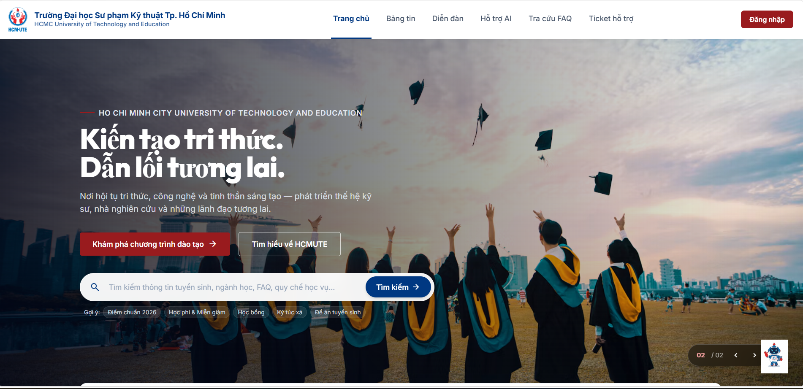


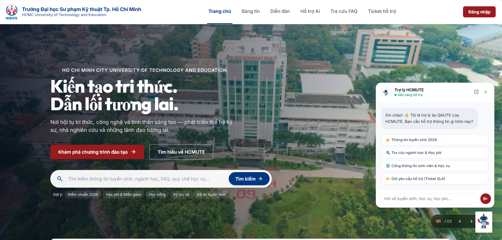
*Hình 2.1: Giao diện Trang chủ Cổng thông tin sinh viên QAUTE Portal*
</div>

---

### 2.2. Trợ Lý Trí Tuệ Nhân Tạo AI Hybrid RAG 24/7
Trợ lý AI đa năng tích hợp bộ điều phối 4 mô hình: **Gemini 2.5 Flash**, **Dify AI Agent**, **Ollama Llama-3.2** và **Smart FAQ Matcher**. Trích dẫn chính xác số hiệu quyết định học phí và văn bản quy chế đào tạo.

<div align="center">

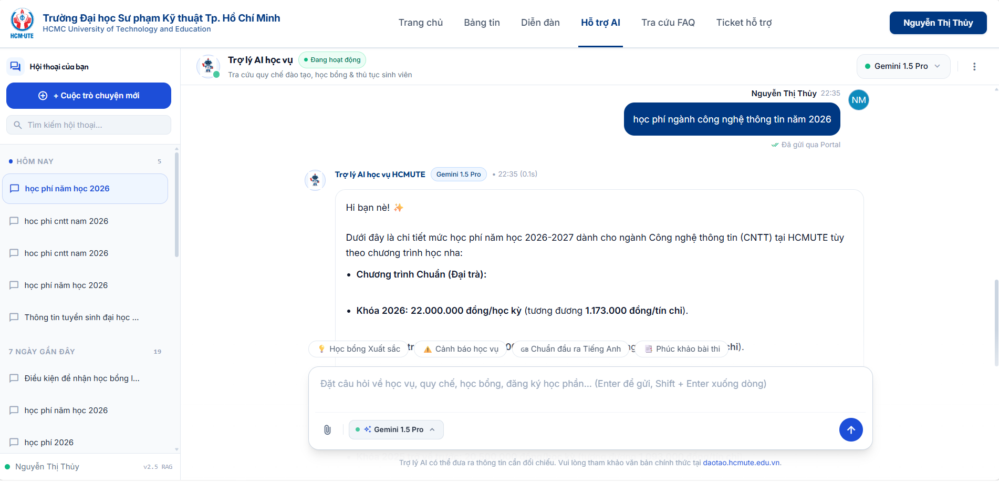

*Hình 2.2: Không gian trò chuyện đa lượt (Multi-turn), tự động gợi ý câu hỏi và trích dẫn nguồn PDF pháp lý*
</div>

---

### 2.3. Động Cơ Quản Lý Ticket & Cam Kết SLA Đa Phòng Ban
Trung tâm điều phối yêu cầu hỗ trợ sinh viên với thanh lọc trạng thái Kanban/Cards, đo lường KPI xử lý, đính kèm tệp và chức năng chuyển tiếp hồ sơ giữa các Khoa/Phòng (Đào tạo, Tuyển sinh, Kế toán, CNTT...).

<div align="center">

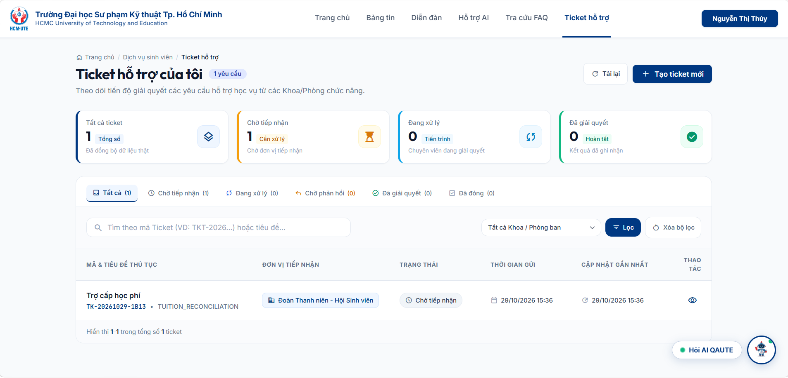

*Hình 2.3: Danh sách Ticket trực quan với huy hiệu trạng thái (Open, In Progress, Resolved) và bộ đếm ngược SLA*
</div>

---

### 2.4. Cổng Học Vụ Sinh Viên: Bảng Điểm GPA & Tiến Độ Tích Lũy
Theo dõi toàn diện quá trình học tập: Điểm số từng môn, phân loại thang điểm chữ (A, B, C, D, F), biểu đồ tín chỉ tích lũy và dự báo xếp loại tốt nghiệp.

<div align="center">

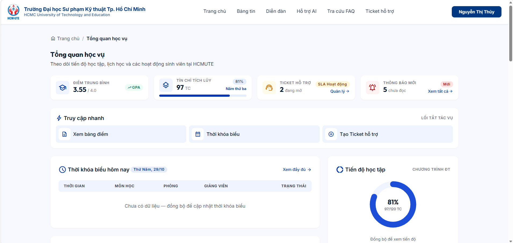

*Hình 2.4: Bảng điểm học vụ, tính toán GPA/CPA tự động và đồng bộ trực tiếp*
</div>

---

### 2.5. Thời Khóa Biểu Tuần Trực Quan
Ma trận lịch học và lịch thi dạng lưới từ Thứ 2 đến Chủ nhật, làm nổi bật tiết học hôm nay, phòng học, giảng viên phụ trách và trạng thái tuần học hiện tại.

<div align="center">

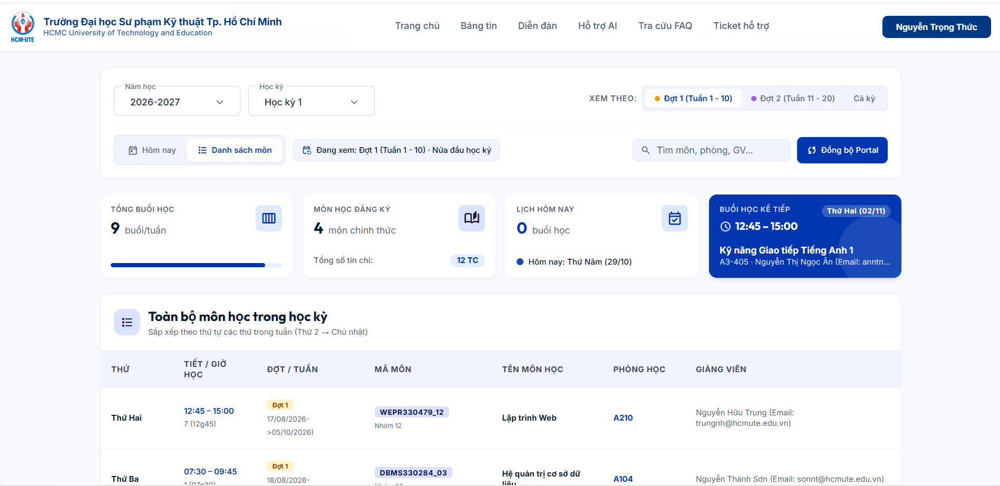
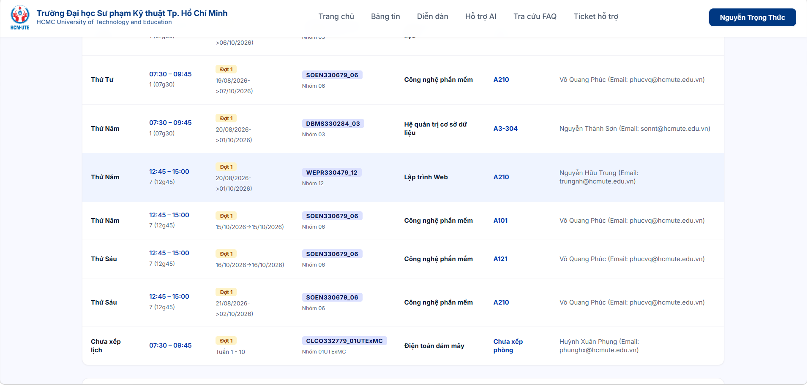
*Hình 2.5: Thời khóa biểu trực quan theo tuần với phân bổ phòng học và ca học*
</div>

---

### 2.6. Bảng Tin Công Văn Đa Phương Tiện & Diễn Đàn Sinh Viên
* **Bảng tin chính thức:** Tích hợp bộ đọc tài liệu PDF trực tuyến, tải file văn bản và streaming video qua CDN Cloudinary.
* **Diễn đàn sinh viên:** Giao diện dạng Feed tương tác (Like, Bình luận, Báo cáo vi phạm) với hệ thống kiểm duyệt bài viết tự động.

<div align="center">

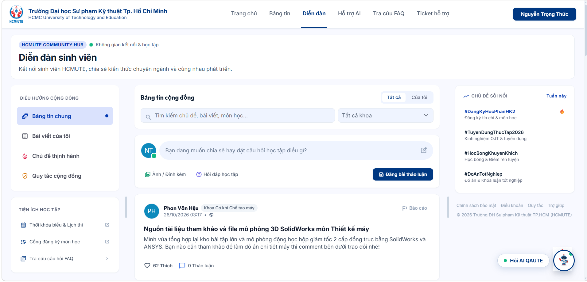

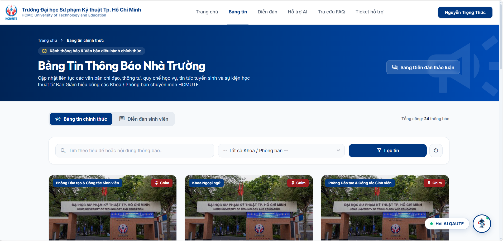
*Hình 2.6: Cổng bảng tin thông báo chính thức và không gian thảo luận sinh viên*
</div>

---

### 2.7. Bảng Điều Khiển Quản Trị Hệ Thống (Admin Workspace)
Khu vực dành riêng cho Quản trị viên và Cán bộ Khoa/Phòng: Báo cáo thống kê hiệu suất SLA, tỷ lệ giải quyết khiếu nại, phân quyền nhân sự và cấu hình danh mục hệ thống.

<div align="center">

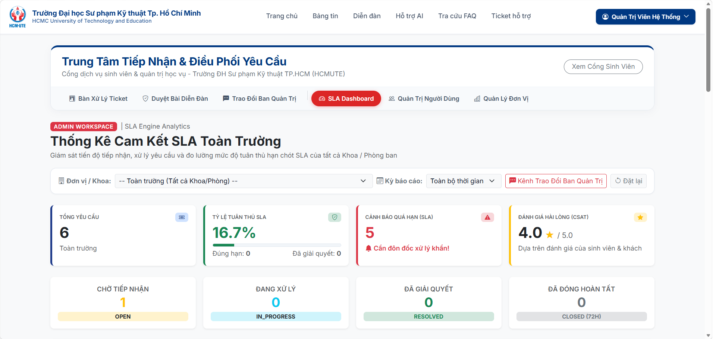

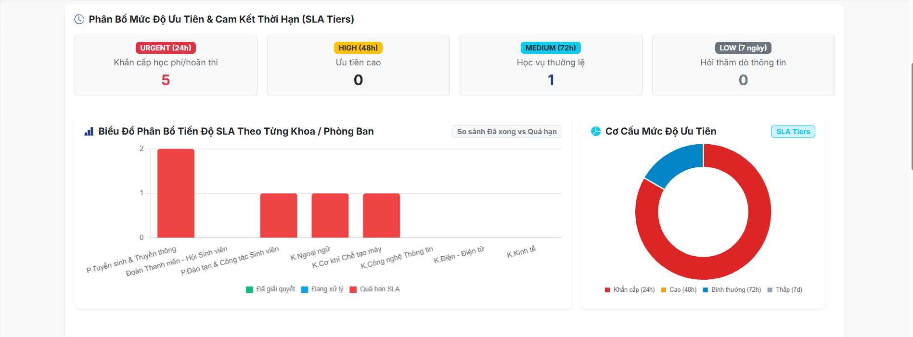

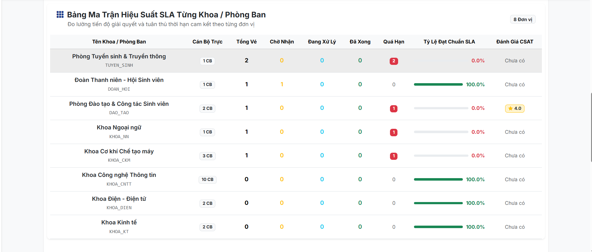

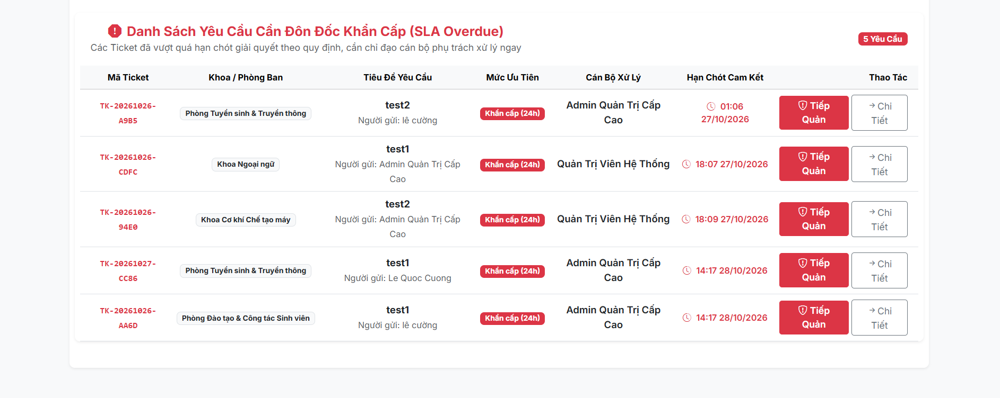

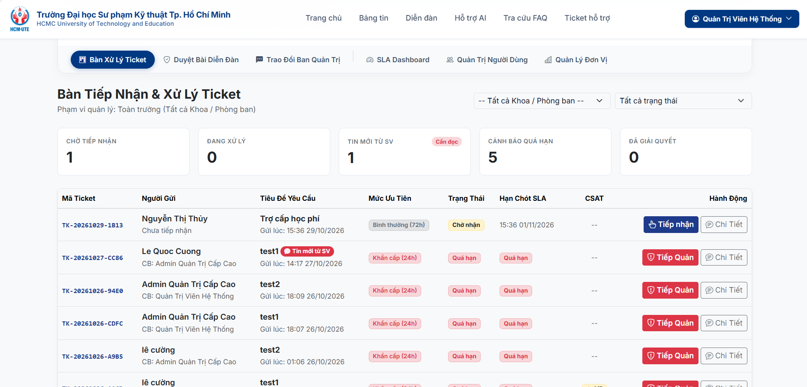

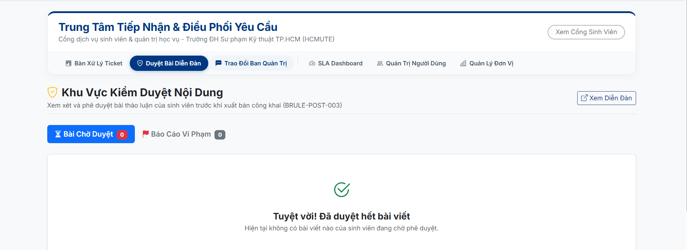

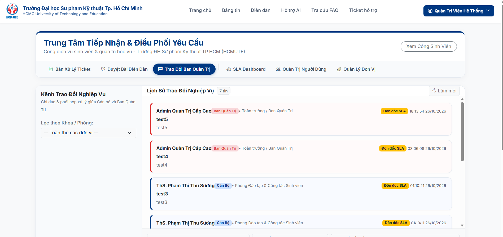

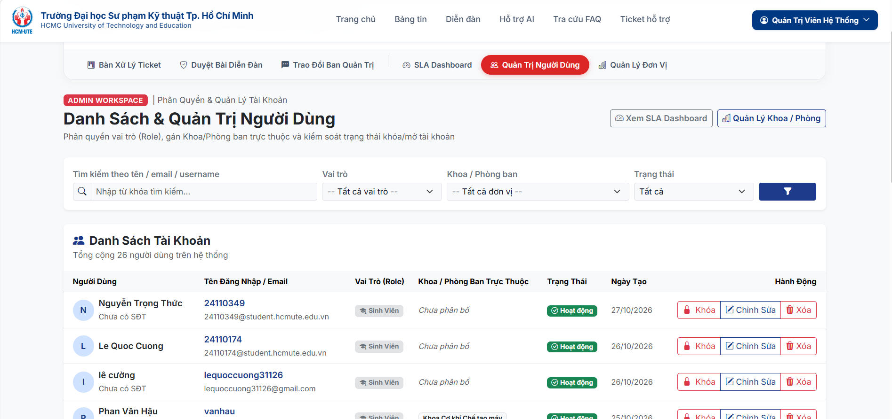

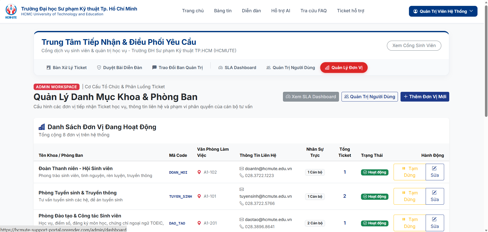

*Hình 2.7: Bảng điều khiển quản trị tập trung và thống kê chỉ số đo lường hiệu quả (KPIs)*
</div>

---

### 2.8. Trang Đăng Nhập & Phân Quyền Người Dùng (RBAC / SSO)
Bảo mật đa tầng với Spring Security 6, mã hóa mật khẩu BCrypt, hỗ trợ đăng nhập nhanh bằng tài khoản trường, Google Workspace và lưu phiên an toàn (`JSESSIONID HttpOnly`).

<div align="center">

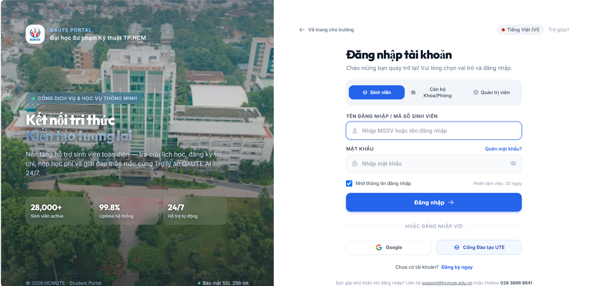


*Hình 2.8: Giao diện Đăng nhập xác thực đa vai trò (Sinh viên, Cán bộ, Quản trị viên)*
</div>

---

## 🏛️ 3. Kiến Trúc Hệ Thống (System Architecture)

Dự án áp dụng mô hình **Modular Monolith kết hợp AI Microservice**, phân tách rõ ràng trách nhiệm để đạt hiệu năng tối đa trên hạ tầng đám mây:

<div align="center">
  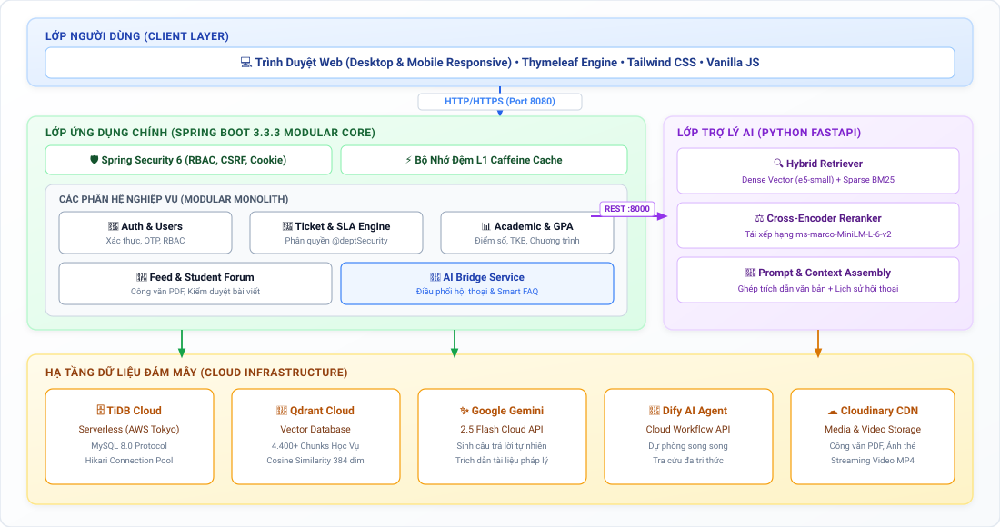
  <br>
  <em>Hình 3.1: Sơ đồ Kiến trúc Phân tầng Hệ thống QAUTE Portal (Modular Monolith & AI Microservice)</em>
</div>
<br>

<details>
<summary>🔍 <b>Bấm để xem mã nguồn sơ đồ kỹ thuật (Mermaid Flowchart)</b></summary>

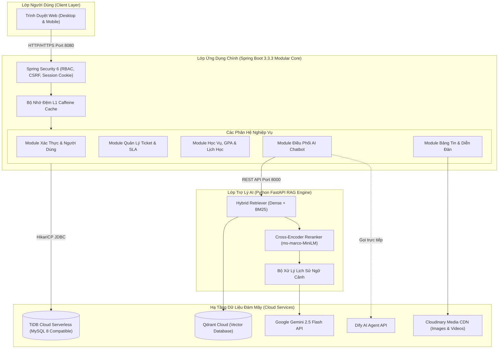
</details>

---

## 🧩 4. Chi Tiết Các Phân Hệ Nghiệp Vụ Cốt Lõi

| Phân hệ | Thành phần kỹ thuật chính | Giá trị nghiệp vụ mang lại |
| :--- | :--- | :--- |
| **🤖 Trợ lý AI Hybrid RAG** | `intfloat/multilingual-e5-small`, `ms-marco-MiniLM-L-6-v2`, `Qdrant`, `Gemini` | Tự động đọc hiểu tài liệu học phí, quy chế đào tạo, tự động chuyển câu hỏi thành Ticket khi cần cán bộ can thiệp. |
| **🎫 Quản lý Ticket & SLA** | `@deptSecurity`, Event Listener, JPA Auditing, Ticket Lifecycle Engine | Tự động tính Deadline theo độ ưu tiên, ngăn chặn can thiệp trái thẩm quyền giữa các Khoa/Phòng, lưu vết chuyển tiếp. |
| **📊 Cổng Học Vụ & GPA** | `HcmuteCrawlerService`, `StudentGradeRepository`, `CourseScheduleRepository` | Tự động tổng hợp điểm thi, tính điểm trung bình tích lũy hệ 4/10, cảnh báo học vụ và dựng lưới Thời khóa biểu tuần. |
| **📰 Bảng Tin & Diễn Đàn** | Thymeleaf, Apache Tika, Cloudinary SDK, Banned Words Filter | Kiểm duyệt nội dung sinh viên, chặn từ khóa tiêu cực, phát hành thông báo đính kèm tệp văn bản và video chuẩn CDN. |
| **🛡️ Bảo mật & Quản trị** | Spring Security 6, BCrypt, Session Lax, Role-Based Access Control | Phân quyền 3 cấp (Admin, Staff, Student), bảo vệ CSRF trên các biểu mẫu, chống tấn công XSS và SQL Injection. |

---

## 👥 5. Ma Trận Phân Quyền & Tài Khoản Thử Nghiệm

Hệ thống được nạp sẵn dữ liệu phân quyền mẫu hoàn chỉnh phục vụ kiểm thử và đánh giá:

| Tên Đăng Nhập | Mật Khẩu | Vai Trò (Role) | Đơn Vị Quản Lý / Mục Đích |
| :--- | :--- | :--- | :--- |
| **`admin`** | `123456` *(hoặc `Password123@`)* | `ROLE_ADMIN` | Toàn quyền quản trị hệ thống, quản lý tài khoản, danh mục Khoa/Phòng |
| **`staff_daotao`** | `123456` *(hoặc `Password123@`)* | `ROLE_STAFF` | Cán bộ Phòng Đào tạo & CTSV (Xử lý Ticket học vụ, công văn đào tạo) |
| **`staff_tuyensinh`** | `123456` *(hoặc `Password123@`)* | `ROLE_STAFF` | Cán bộ Phòng Tuyển sinh & Truyền thông |
| **`staff_cntt`** | `123456` *(hoặc `Password123@`)* | `ROLE_STAFF` | Cán bộ Văn phòng Khoa Công nghệ Thông tin |
| **`student`** | `123456` *(hoặc `Password123@`)* | `ROLE_STUDENT` | Sinh viên chính quy (Xem điểm, lịch học, hỏi AI, gửi Ticket, đăng diễn đàn) |
| **`student01`** | `Password123@` | `ROLE_STUDENT` | Sinh viên dự phòng (Dữ liệu học vụ đầy đủ) |

---

## 🚀 6. Hướng Dẫn Cài Đặt & Khởi Chạy (Quick Start Guide)

### 6.1. Yêu Cầu Môi Trường
* **Java:** JDK 17 (OpenJDK hoặc Oracle JDK).
* **Build Tool:** Apache Maven 3.8+.
* **Database:** TiDB Cloud Serverless (Khuyên dùng) hoặc MySQL 8.0+.
* **Python (Cho AI Service):** Python 3.10 – 3.12.

---

### 6.2. Phương Án 1: Khởi chạy Khuyên Dùng (Kết nối TiDB Cloud & AWS EC2)
Vì Cơ sở dữ liệu đã chạy trên **TiDB Cloud** và AI Service đã deploy trên **AWS EC2**, bạn chỉ cần chạy Web Portal trên máy:

```bash
# 1. Clone repository
git clone https://github.com/Yhucyor/HCMUTE-Support-Portal.git
cd HCMUTE-Support-Portal

# 2. Tạo file biến môi trường .env từ mẫu
cp .env.example .env

# 3. Chạy ứng dụng Spring Boot
mvn spring-boot:run
```
* Cổng thông tin sẽ sẵn sàng tại: **`http://localhost:8080`** (hoặc `http://localhost:8088`).

---

### 6.3. Phương Án 2: Khởi chạy Trọn Gói bằng Docker Compose
Nếu muốn khởi chạy toàn bộ 3 dịch vụ (**MySQL 8 + Python AI Service + Spring Boot App**) độc lập trên máy:

```bash
docker compose up -d
```
* **Web Portal:** `http://localhost:8088`
* **AI Service API (Swagger UI):** `http://localhost:8000/docs`
* **Cơ sở dữ liệu MySQL:** `localhost:3307`

---

## 🛠️ 7. Danh Mục Công Nghệ Sử Dụng (Tech Stack)

* **Backend Framework:** Spring Boot 3.3.3, Spring Data JPA, Spring Security 6, Jakarta Servlet API 6.0.
* **Frontend Architecture:** Thymeleaf Template Engine, HTML5 Semantic, Tailwind CSS / Bootstrap 5, Vanilla JS.
* **AI Engine & NLP:** Python FastAPI, PyTorch (CPU Optimized), `intfloat/multilingual-e5-small`, `cross-encoder/ms-marco-MiniLM-L-6-v2`, BM25 Keyword Ranker.
* **Database & Cloud Storage:** TiDB Cloud Serverless (AWS Tokyo), Qdrant Cloud Vector Database, Cloudinary Media CDN.
* **Hạ Tầng Triển Khai:** AWS EC2 (`t3.micro` Ubuntu 24.04 LTS), Docker, Docker Compose, Systemd Service.

---

<div align="center">
  <sub>QAUTE Portal © 2026 — Được phát triển với mục tiêu nâng cao trải nghiệm học đường cho Sinh viên HCMUTE.</sub>
</div>
