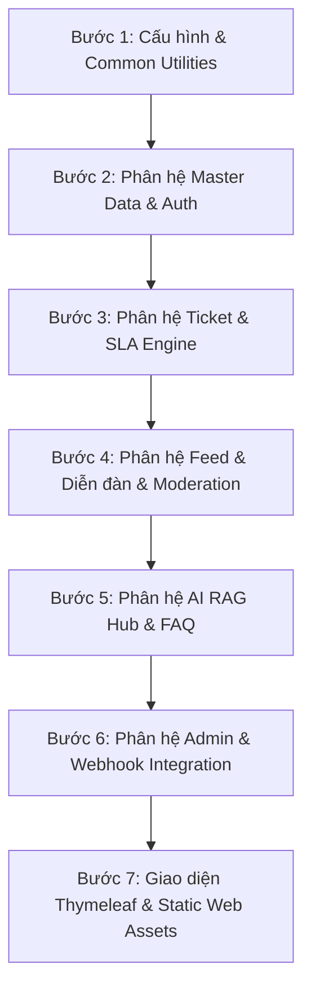

# LỘ TRÌNH CHUYỂN GIAO FILE TỪ `doancuoiki_demo1` SANG `HCMUTE-Support-Portal` THEO TỪNG CHỨC NĂNG

> **Mục tiêu**: Chuyển giao code an toàn, không bị lỗi thiếu phụ thuộc (Missing dependencies/compile errors), chia nhỏ theo từng chức năng độc lập để dễ kiểm tra và tích hợp Git.

---

## 1. NGUYÊN TẮC CHUYỂN GIAO FILE (DEPENDENCY ORDER)

Trong dự án Spring Boot đa tầng (Layered Architecture), bạn **bắt buộc** phải tuân theo thứ tự phụ thuộc từ dưới lên:

---

## 2. CHI TIẾT CÁC BƯỚC VÀ DANH SÁCH FILE CẦN CHUYỂN

### 🚀 BƯỚC 1: Cấu hình Nền tảng, Dependencies & Thư viện dùng chung (Common)
*Mục đích: Đảm bảo project build được Maven, có đầy đủ thư viện (Security, JWT, Mail, Thymeleaf layout) và các class Base.*

1. **File cấu hình dự án**:
   - `pom.xml` (Đồng bộ các dependencies: `spring-boot-starter-security`, `spring-boot-starter-mail`, `jjwt`, `pdfbox`, `poi-ooxml`, `thymeleaf-extras-springsecurity6`).
   - `src/main/resources/application.yml` (hoặc `application.properties`: Cấu hình Datasource, JPA, Mail SMTP, File Upload Limits, JWT Secret, Gemini/Dify API Keys).
   - `.env` / `.env.example`
2. **Gói dùng chung (`com.school.counseling.common`)**:
   - `common/ApiResponse.java`
   - `common/AppException.java`
   - `common/GlobalExceptionHandler.java` & `common/exception/GlobalMvcExceptionHandler.java`
   - `common/DateTimeUtils.java`
   - `common/FileUploadValidator.java`
   - `common/SlugUtils.java`
3. **Cấu hình hệ thống (`com.school.counseling.config`)**:
   - `config/SecurityConfig.java` (Cấu hình Spring Security, PasswordEncoder, CSRF, URL Authorization, Custom Login/Logout handler)
   - `config/WebMvcConfig.java` (Resource handlers cho thư mục uploads/attachments)
   - `config/AsyncConfig.java` (Cấu hình @EnableAsync cho gửi mail nền)

---

### 🚀 BƯỚC 2: Phân hệ Xác thực Người dùng & Phân quyền (Auth & RBAC)
*Mục đích: Quản lý Roles, Departments, Users, Đăng nhập, Đăng ký, Quên mật khẩu OTP, Quản lý Profile cá nhân.*

1. **Các file cần chuyển**:
   - **Entity**:
     - `module/auth/entity/Role.java`
     - `module/auth/entity/Department.java`
     - `module/auth/entity/User.java`
   - **Repository**:
     - `module/auth/repository/RoleRepository.java`
     - `module/auth/repository/DepartmentRepository.java`
     - `module/auth/repository/UserRepository.java`
   - **DTO**:
     - `module/auth/dto/LoginRequest.java`, `RegisterRequest.java`, `AuthResponse.java`
     - `module/auth/dto/UserProfileDto.java`, `UpdateProfileRequest.java`, `ChangePasswordRequest.java`
   - **Service**:
     - `module/auth/service/CustomUserDetailsService.java`
     - `module/auth/service/AuthService.java`
     - `module/auth/service/ProfileService.java`
     - `module/auth/service/OtpService.java`
   - **Controller**:
     - `module/auth/controller/AuthRestController.java` & `AuthWebController.java`
     - `module/auth/controller/ProfileRestController.java` & `ProfileWebController.java`

---

### 🚀 BƯỚC 3: Phân hệ Quản lý Phiếu Hỗ trợ (Tickets & SLA Engine)
*Mục đích: Tiếp nhận ticket của Sinh viên/Guest, phân luồng theo Khoa/Phòng ban, tự động tính hạn chót SLA, điều phối xử lý và đánh giá CSAT.*

1. **Các file cần chuyển**:
   - **Entity**:
     - `module/ticket/entity/Ticket.java`
     - `module/ticket/entity/TicketHistory.java`
   - **Repository**:
     - `module/ticket/repository/TicketRepository.java`
     - `module/ticket/repository/TicketHistoryRepository.java`
   - **DTO**:
     - `module/ticket/dto/CreateTicketRequest.java`, `TicketReplyRequest.java`
     - `module/ticket/dto/TicketResponseDto.java`, `TicketSummaryDto.java`, `TicketTriageResponseDto.java`
   - **Service**:
     - `module/ticket/service/TicketService.java`
     - `module/ticket/service/SlaSchedulerService.java` (Cron job quét vé quá hạn SLA)
   - **Controller**:
     - `module/ticket/controller/TicketRestController.java` & `TicketWebController.java` (Dành cho Sinh viên & Khách)
     - `module/ticket/controller/StaffTicketController.java` & `StaffTicketWebController.java` (Dành cho Cán bộ tư vấn)

---

### 🚀 BƯỚC 4: Phân hệ Bảng tin, Diễn đàn & Kiểm duyệt (Feed, Forum & Moderation)
*Mục đích: Đăng thông báo chính thức có đính kèm tệp PDF/Video, diễn đàn thảo luận sinh viên, bình luận, like, báo cáo vi phạm và duyệt bài.*

1. **Các file cần chuyển**:
   - **Entity**:
     - `module/feed/entity/Post.java`
     - `module/feed/entity/PostAttachment.java`
     - `module/feed/entity/PostReport.java`
     - `module/feed/entity/Comment.java`
     - `module/feed/entity/Like.java`
   - **Repository**:
     - `module/feed/repository/PostRepository.java`
     - `module/feed/repository/PostAttachmentRepository.java`
     - `module/feed/repository/PostReportRepository.java`
     - `module/feed/repository/CommentRepository.java`
     - `module/feed/repository/LikeRepository.java`
   - **DTO**:
     - `module/feed/dto/CreatePostRequest.java`, `PostResponseDto.java`, `CommentDto.java`, `ReportRequestDto.java`
   - **Service**:
     - `module/feed/service/PostService.java`
     - `module/feed/service/CommentService.java`
     - `module/feed/service/ModerationService.java`
   - **Controller**:
     - `module/feed/controller/FeedRestController.java` & `FeedWebController.java`
     - `module/feed/controller/ModerationController.java`

---

### 🚀 BƯỚC 5: Phân hệ Trợ lý AI, RAG Knowledge Hub & FAQ
*Mục đích: Chatbot RAG trả lời tự động dựa trên tài liệu PDF quy chế, nạp tri thức vector, tra cứu câu hỏi thường gặp FAQ.*

1. **Các file cần chuyển**:
   - **Entity**:
     - `module/ai/entity/KnowledgeDocument.java`
     - `module/ai/entity/KnowledgeChunk.java`
     - `module/ai/entity/Faq.java`
   - **Repository**:
     - `module/ai/repository/KnowledgeDocumentRepository.java`
     - `module/ai/repository/KnowledgeChunkRepository.java`
     - `module/ai/repository/FaqRepository.java`
   - **Service & Utils**:
     - `module/ai/service/RagChatbotService.java`
     - `module/ai/service/RagKnowledgeService.java`
     - `module/ai/service/SmartFaqMatcherService.java`
     - `module/ai/service/BatchDocumentIngestionService.java`
     - `module/ai/service/GeminiApiClient.java` / `DifyAiApiClient.java`
     - `module/ai/service/PdfExtractorUtils.java`, `VectorMathUtils.java`, `AcademicAbbreviationUtils.java`
   - **Controller**:
     - `module/ai/controller/RagChatRestController.java`
     - `module/ai/controller/AdminKnowledgeHubWebController.java` & `AdminKnowledgeController.java`
     - `module/ai/controller/FaqWebController.java`
   - **Python AI Engine (nếu có)**:
     - Thư mục `python-ai-engine/` (ocr, vision pipeline, classifier, benchmarks).

---

### 🚀 BƯỚC 6: Phân hệ Quản trị Admin, Chat Nội bộ & Email / Webhook
*Mục đích: Quản lý người dùng, dashboard thống kê, tin nhắn chỉ đạo nội bộ Admin-Staff, gửi email tự động và webhook tích hợp video.*

1. **Các file cần chuyển**:
   - **Entity & Repositories**:
     - `module/admin/entity/InternalStaffAdminMessage.java`
     - `module/admin/repository/InternalStaffAdminMessageRepository.java`
   - **Service**:
     - `module/admin/service/AdminUserService.java`
     - `module/admin/service/InternalMessageService.java`
     - `module/notification/service/EmailAsyncService.java`
     - `module/integration/service/VideoIntegrationService.java`
   - **Controller**:
     - `module/admin/controller/AdminWebController.java`
     - `module/admin/controller/InternalMessageRestController.java`
     - `module/integration/controller/NodejsWebhookController.java`

---

### 🚀 BƯỚC 7: Toàn bộ Giao diện (Thymeleaf Templates & Static Assets)
*Mục đích: Hoàn thiện toàn bộ giao diện HTML, CSS, JavaScript, Font Awesome, hình ảnh minh họa.*

1. **Templates (`src/main/resources/templates/`)**:
   - `layout/`: `main.html`, `navbar.html`, `footer.html`, `portal-header.html`
   - `home.html`
   - `auth/`: `login.html`, `register.html`, `forgot-password.html`, `profile.html`
   - `ticket/`: `create.html`, `detail.html`, `my-tickets.html`, `staff-dashboard.html`
   - `feed/`: `official-list.html`, `official-detail.html`, `forum.html`, `create-official-post.html`, `edit-official-post.html`
   - `moderation/`: `pending-posts.html`, `reports-list.html`
   - `admin/`: `dashboard.html`, `knowledge/documents.html`, `knowledge/visualizer.html`
   - `ai/`: `chat-widget.html`
   - `faq/`: `search.html`
2. **Static Assets (`src/main/resources/static/` hoặc `static/`)**:
   - `css/`, `js/`, `images/`, `fonts/`

---

## 3. CHECKLIST KIỂM TRA SAU MỖI BƯỚC

- [ ] Chạy lệnh `mvn clean compile` trong thư mục đích xem có lỗi cú pháp không.
- [ ] Chạy ứng dụng `mvn spring-boot:run` và kiểm tra log khởi động.
- [ ] Mở trình duyệt kiểm tra các đường dẫn tương ứng với chức năng vừa chuyển.
- [ ] Tiến hành Commit và Merge Git theo hướng dẫn ở file `03_QUY_TRINH_GIT_FEATURE_BRANCH_VA_MERGE.md`.
