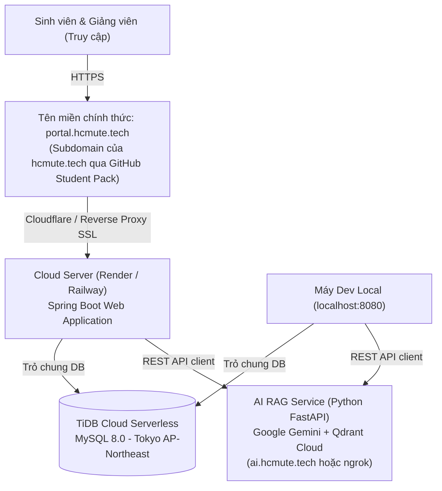

# 📋 BÁO CÁO TIẾN ĐỘ & KẾ HOẠCH PHÁT TRIỂN: GIAI ĐOẠN 12 (TIENDO 12)
**Dự án:** Cổng thông tin hỗ trợ & tư vấn học vụ HCMUTE (HCMUTE Support Portal - QAUTE)  
**Tác giả:** Dev A (Fullstack & Software Architect) & Dev B (AI & Data Specialist)  
**Thời gian cập nhật:** Tháng 10/2026  

---

## 🎯 1. TỔNG QUAN KẾ HOẠCH GIAI ĐOẠN 12
Giai đoạn 12 tập trung vào việc **chuẩn hóa hạ tầng triển khai (Deployment Infrastructure)**, đồng bộ dữ liệu tập trung, cấu hình bảo mật xác thực Google OAuth 2.0 đa môi trường và xây dựng nhận diện thương hiệu học thuật với tên miền tùy chỉnh **`portal.hcmute.tech`** thông qua chương trình **GitHub Student Developer Pack**.



---

## 🗄️ 2. KẾ HOẠCH HẠ TẦNG DỮ LIỆU: KỊCH BẢN 1 (ĐỒNG BỘ REALTIME LOCAL & CLOUD)

### 2.1. Định hướng triển khai
* **Chiến lược:** Cả môi trường **Local Development** và **Production Cloud** cùng trỏ chung vào cơ sở dữ liệu phân tán **TiDB Cloud Serverless (MySQL 8.0 tương thích)**.
* **Mục tiêu cốt lõi:**
  1. **Đồng bộ dữ liệu tức thì (Zero Latency Sync):** Khi Dev A kiểm thử tạo mới bài đăng diễn đàn, duyệt bài, gửi phiếu hỗ trợ (Ticket), sinh viên đánh giá điểm SLA trên môi trường Local thì trên đường link Cloud triển khai giảng viên và người dùng kiểm thử cũng thấy ngay kết quả mà không cần migrate hay nạp lại dữ liệu.
  2. **Bảo mật biến môi trường:** Tách biệt triệt để mã nguồn (Source Code) và Thông tin bí mật (Secrets). File `.env` chứa thông tin kết nối chỉ lưu trên máy cá nhân (được bảo vệ trong `.gitignore`), khi triển khai lên Cloud sẽ nạp thông qua mục **Environment Variables** của nền tảng PaaS.

### 2.2. Thông số kết nối TiDB Cloud chuẩn hóa
* **Host:** `gateway01.ap-northeast-1.prod.aws.tidbcloud.com`
* **Port:** `4000`
* **Database:** `test`
* **Username:** `2DAAeHS9ypVrW2e.root`
* **JDBC URL:**
  ```properties
  DB_URL=jdbc:mysql://gateway01.ap-northeast-1.prod.aws.tidbcloud.com:4000/test?sslMode=VERIFY_IDENTITY&serverTimezone=Asia/Ho_Chi_Minh&characterEncoding=UTF-8&allowPublicKeyRetrieval=true
  DB_USERNAME=2DAAeHS9ypVrW2e.root
  DB_PASS=fFkcxwPIDBS8tgOs
  DB_POOL_MAX=10
  DB_POOL_MIN=2
  ```

---

## 🔐 3. CẤU HÌNH GOOGLE OAUTH 2.0 KHI CHẠY LOCAL VÀ PRODUCTION DOMAIN

Để tính năng **"Đăng nhập bằng tài khoản Google" (Google Sign-In)** hoạt động chính xác đồng thời ở cả hai môi trường `http://localhost:8080` và `https://portal.hcmute.tech`:

### 3.1. Cấu hình tại Google Cloud Console (Credentials)
1. Truy cập [Google Cloud Console - Credentials](https://console.cloud.google.com/apis/credentials).
2. Chọn dự án OAuth 2.0 Web Client hiện tại (`Client ID: 421445209284-pa969lv3mo2u9i35dppq9g9uqsfqkps1...`).
3. Cập nhật các trường cấu hình như sau:

| Mục thiết lập | Giá trị cấu hình | Ý nghĩa |
| :--- | :--- | :--- |
| **Authorized JavaScript origins** | • `http://localhost:8080`<br/>• `https://portal.hcmute.tech` | Các domain được phép khởi chạy pop-up đăng nhập Google |
| **Authorized redirect URIs** | • `http://localhost:8080/login/oauth2/code/google`<br/>• `https://portal.hcmute.tech/login/oauth2/code/google` | Endpoint callback sau khi người dùng xác thực Google thành công |

### 3.2. Cấu hình Backend Spring Boot (Đã chuẩn hóa)
Trong `application.yml`, hệ thống đã được tích hợp bộ tiền xử lý Header chuyển tiếp:
```yaml
server:
  port: 8080
  forward-headers-strategy: framework # Tự động nhận diện HTTPS & Domain portal.hcmute.tech từ Proxy
  servlet:
    session:
      cookie:
        secure: ${COOKIE_SECURE:false} # Mặc định false ở local, gán true trên production HTTPS

spring:
  security:
    oauth2:
      client:
        registration:
          google:
            client-id: ${GOOGLE_CLIENT_ID}
            client-secret: ${GOOGLE_CLIENT_SECRET}
            redirect-uri: "{baseUrl}/login/oauth2/code/{registrationId}"
```
* Khi truy cập `http://localhost:8080`, `{baseUrl}` tự động là `http://localhost:8080`.
* Khi truy cập qua tên miền `https://portal.hcmute.tech`, nhờ cờ `forward-headers-strategy: framework`, `{baseUrl}` sẽ tự động bảo toàn giao thức bảo mật `https://portal.hcmute.tech` mà không bị lỗi `redirect_uri_mismatch`.

---

## 🌐 4. KẾ HOẠCH ĐĂNG KÝ TÊN MIỀN `portal.hcmute.tech` QUA GITHUB STUDENT PACK

### 4.1. Lợi ích gói GitHub Student Developer Pack & Chiến lược Subdomain
* **Quyền lợi sinh viên:** Miễn phí 1 năm đăng ký tên miền cao cấp `.tech` từ đối tác **Name.com** dành cho sinh viên trường ĐH Sư phạm Kỹ thuật TP.HCM (email `@student.hcmute.edu.vn`).
* **Chiến lược tên miền chuyên nghiệp:**
  - Đăng ký **Tên miền gốc (Root Domain):** **`hcmute.tech`** (chi phí $0).
  - Khởi tạo **Tên miền con (Subdomain):**
    * **`portal.hcmute.tech`**: Dành cho Cổng thông tin hỗ trợ sinh viên chính (Spring Boot).
    * **`ai.hcmute.tech`**: Dành cho Microservice Chatbot AI RAG (Python FastAPI của Dev B khi deploy Render).

### 4.2. Quy trình nhận và cấu hình Domain:
1. **Bước 1 - Kích hoạt quyền lợi:**
   - Đăng nhập tài khoản GitHub Student tại: [education.github.com/pack](https://education.github.com/pack).
   - Tìm thẻ dịch vụ **Name.com** $\rightarrow$ Nhận Voucher / Free Promo Code cho domain `.tech`.
2. **Bước 2 - Đăng ký tên miền gốc:**
   - Tìm kiếm `hcmute.tech` $\rightarrow$ Áp mã ưu đãi sinh viên $\rightarrow$ Thanh toán $0.
3. **Bước 3 - Cấu hình Bản ghi DNS (DNS Records) cho Subdomain `portal`:**
   * Vào Render Dashboard $\rightarrow$ Web Service `HCMUTE-Support-Portal` $\rightarrow$ Mục **Settings** $\rightarrow$ **Custom Domains** $\rightarrow$ Thêm `portal.hcmute.tech`.
   * Trên trang quản lý DNS của Name.com, thêm bản ghi:
     - **Type:** `CNAME`
     - **Host:** `portal` *(hệ thống tự động hiểu là `portal.hcmute.tech`)*
     - **Answer / Target:** `tên-web-dự-án-của-bạn.onrender.com`
   * Render và Cloudflare sẽ tự động cấp chứng chỉ bảo mật **SSL/TLS (HTTPS)** miễn phí hoàn toàn tự động trong 5-10 phút.

---

## 🤖 5. TÍCH HỢP CHATBOT AI VÀ MICROSERVICE (DEV B)

* **Kiến trúc:** Spring Boot (Dev A) giao tiếp thông qua client REST HTTP tới AI Microservice FastAPI (Dev B) qua đường truyền ngrok tĩnh `https://clamor-gradation-alphabet.ngrok-free.dev/api/chat` (hoặc `https://ai.hcmute.tech/api/chat` khi deploy).
* **Cơ chế chịu lỗi (Fail-Safe Mechanism):**
  - Đã tích hợp header `ngrok-skip-browser-warning: true` trong Java `AiChatbotService` để tránh trang cảnh báo của ngrok free.
  - Khi service AI của Dev B online: Chatbot trả lời câu hỏi học phí 2026, quy chế học vụ qua mô hình RAG E5 + Qdrant Cloud + Gemini Flash.
  - Khi service AI offline: Hệ thống tự động kích hoạt bộ Smart FAQ nội bộ và quy trình hướng dẫn ticket học vụ, đảm bảo trải nghiệm sinh viên luôn liền mạch.

---

## 📅 6. LỘ TRÌNH THỰC HIỆN TIẾP THEO

| STT | Nhiệm vụ | Người phụ trách | Hạn hoàn thành | Trạng thái |
| :---: | :--- | :--- :---: | :---: | :---: |
| 1 | Cấu hình TiDB Cloud & test kết nối Spring Boot Local | Dev A | 26/10/2026 | ✅ Đã hoàn thành |
| 2 | Tích hợp Client Spring Boot gọi AI Service qua ngrok | Dev A | 26/10/2026 | ✅ Đã hoàn thành |
| 3 | Cấu hình `forward-headers-strategy: framework` cho OAuth2 | Dev A | 26/10/2026 | ✅ Đã hoàn thành |
| 4 | Đăng ký domain `hcmute.tech` qua GitHub Student Pack | Dev A | 27/10/2026 | ⏳ Đang tiến hành |
| 5 | Cập nhật Authorized URI tại Google Cloud Console | Dev A | 27/10/2026 | ⏳ Đang tiến hành |
| 6 | Deploy Spring Boot lên PaaS (Render) và gắn subdomain `portal.hcmute.tech` | Dev A | 28/10/2026 | ⏳ Chờ domain |
| 7 | Đánh giá toàn diện chức năng trước ngày báo cáo cuối kỳ | Dev A & Dev B | 30/10/2026 | 📋 Dự kiến |
