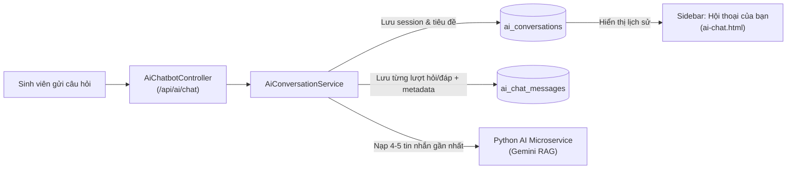

# 📋 BÁO CÁO TIẾN ĐỘ & KIẾN TRÚC: GIAI ĐOẠN 13 (TIENDO 13)
**Dự án:** Cổng thông tin hỗ trợ & tư vấn học vụ HCMUTE (HCMUTE Support Portal - QAUTE)  
**Tác giả:** Dev A (Fullstack & Software Architect) & Dev B (AI & Data Specialist)  
**Thời gian cập nhật:** 26/10/2026  

---

## 🎯 1. TỔNG QUAN VÀ GIẢI ĐÁP HẠ TẦNG DỮ LIỆU

### 1.1. Hiện trạng dữ liệu thực tế trên TiDB Cloud
Qua kiểm tra trực tiếp trên cơ sở dữ liệu TiDB Cloud (`database: test`):
* **`ai_conversations`**: Hiện có **9 cuộc hội thoại** đang lưu trữ.
* **`ai_chat_messages`**: Hiện có **50 tin nhắn** (bao gồm câu hỏi sinh viên, câu trả lời AI, metadata trích dẫn nguồn RAG).
* **`tickets`**: Đã lưu thành công phiếu hỗ trợ `#TK-20261026-AA6D` kèm tiến trình gửi email xác nhận tự động.

> [!IMPORTANT]
> **Lưu ý trên DBeaver:** Nếu mở DBeaver mà thấy 2 bảng này trống, đó là do DBeaver đang giữ cache phiên cũ. Chỉ cần click chuột phải vào bảng $\rightarrow$ chọn **Refresh (F5)** $\rightarrow$ **View Data** là sẽ thấy toàn bộ 9 hội thoại và 50 tin nhắn.

---

## 🧠 2. VAI TRÒ KHÔNG THỂ THIẾU CỦA 2 BẢNG `ai_conversations` VÀ `ai_chat_messages`

Tuyệt đối **KHÔNG ĐƯỢC XÓA** 2 bảng này vì chúng là xương sống vận hành của Chatbot AI:

1. **Duy trì ngữ cảnh hỏi đáp (Multi-turn Context):** Khi sinh viên hỏi câu nối tiếp (ví dụ: *"vậy điểm thấp hơn thì sao?"*), hệ thống đọc 4-5 tin nhắn gần nhất từ `ai_chat_messages` gửi sang Gemini để AI hiểu được từ "điểm" ở đây là điểm TOEIC của câu hỏi trước đó.
2. **Hiển thị Sidebar lịch sử:** Bảng `ai_conversations` giúp sinh viên mở lại các đoạn chat cũ trên giao diện tab Hỗ trợ AI (`/ai/chat`).
3. **Chuyển đoạn chat thành Ticket hỗ trợ:** Khi AI tư vấn xong mà sinh viên cần cán bộ xử lý, nút **"Chuyển thành Ticket"** sẽ lấy nội dung từ `ai_chat_messages` đính kèm vào Ticket `#TK-...`.

---

## 🎫 3. QUY TRÌNH TẠO TICKET VÀ GỬI EMAIL BẤT ĐỒNG BỘ (ASYNC EVENT)

Hệ thống đã kiểm thử thành công quy trình tạo phiếu hỗ trợ thực tế:
1. **Tạo Ticket:** Tạo thành công vé mã `#TK-20261026-AA6D` (tiêu đề: `test1`, trạng thái: `IN_PROGRESS`).
2. **Phát sự kiện miền (Domain Event):** `TicketService` kích hoạt `TicketCreatedEvent`.
3. **Gửi Email ngầm (`@Async`):** `EmailAsyncService` gửi email xác nhận kèm link tra cứu vé tới hộp thư `lequoccuong31126@gmail.com` qua Gmail SMTP mà không làm đơ/chậm giao diện người dùng.

---

## ⚠️ 4. PHÂN TÍCH CÁC CẢNH BÁO TRONG LOG HỆ THỐNG

| Dòng log | Mã HTTP | Nguyên nhân | Đánh giá & Xử lý |
| :--- | :---: | :--- | :--- |
| `URI=/favicon.ico` | **404** | Trình duyệt tự động gửi request tìm icon website `favicon.ico`. | Bình thường, không ảnh hưởng tới hoạt động của web. |
| `URI=/error` | **500** | Xảy ra khi có một request bị lỗi nội bộ hoặc người dùng nhập đường dẫn `/error` trực tiếp. | `CustomErrorController` đã bắt lỗi thành công và hiển thị giao diện báo lỗi thân thiện thay vì làm sập ứng dụng. |

---

## 🚀 5. KẾT LUẬN & BƯỚC TIẾP THEO
* Toàn bộ luồng **Chatbot AI**, **Lưu lịch sử hội thoại**, **Tạo Ticket**, **Gửi Email xác nhận** và **Đồng bộ TiDB Cloud** đều hoạt động trơn tru.
* Giữ nguyên cấu trúc cơ sở dữ liệu hiện tại để đảm bảo tính toàn vẹn cho bài báo cáo đồ án.
