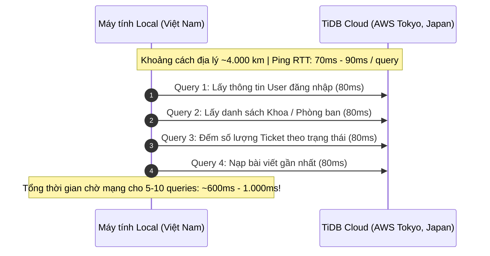
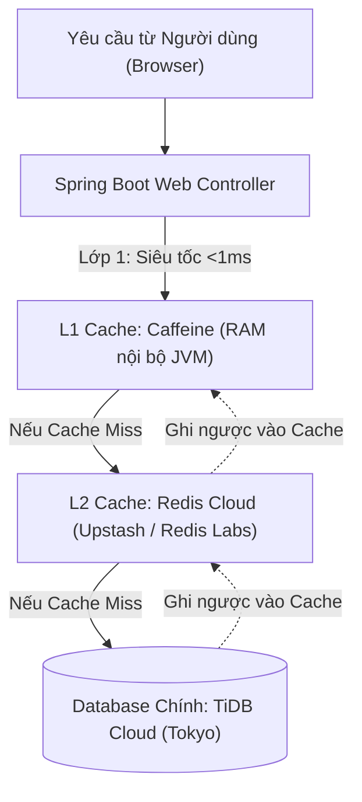

# 📋 BÁO CÁO TIẾN ĐỘ & GIẢI PHÁP TỐI ƯU HIỆU NĂNG: GIAI ĐOẠN 14 (TIENDO 14)
**Dự án:** Cổng thông tin hỗ trợ & tư vấn học vụ HCMUTE (HCMUTE Support Portal - QAUTE)  
**Tác giả:** Dev A (Fullstack & Software Architect) & Dev B (AI & Data Specialist)  
**Thời gian cập nhật:** 26/10/2026  

---

## 🎯 1. NGUYÊN NHÂN GỐC RỄ: TẠI SAO TRUY VẤN CLOUD DATABASE BỊ CHẬM KHI CHẠY LOCAL?

Khi chạy Spring Boot từ máy cá nhân (Local) kết nối tới **TiDB Cloud**, người dùng cảm thấy có độ trễ (delay từ 0.5s - 1.5s) khi chuyển trang hoặc gửi tin nhắn. Nguyên nhân không phải do mã nguồn hay do máy tính yếu, mà xuất phát từ **quy luật vật lý của mạng Internet**:



> [!NOTE]
> **Điểm mấu chốt khi Deploy lên Production:**
> Khi ứng dụng Spring Boot được triển khai lên Server Cloud (như Render, Railway, AWS Singapore/Tokyo), Server Web và TiDB Cloud sẽ nằm **cùng trung tâm dữ liệu hoặc cùng khu vực cáp quang biển**. Độ trễ mạng (Ping) sẽ giảm từ **80ms xuống chỉ còn 1ms - 3ms**, tốc độ sẽ tăng vọt gấp 20 đến 30 lần!

---

## ⚡ 2. GIẢI PHÁP CACHING TOÀN DIỆN VỚI REDIS & CAFFEINE

Để giải quyết triệt để vấn đề độ trễ mạng khi chạy Local cũng như tối ưu hóa năng lực chịu tải hàng nghìn sinh viên đồng thời trên Production, hệ thống đề xuất kiến trúc **Bộ nhớ đệm 2 lớp (Multi-Level Caching)**:



---

## 🛠️ 3. CHI TIẾT CÁC CÔNG CỤ CACHE ĐƯỢC ĐỀ XUẤT

### 3.1. Redis Cache (Bộ đệm phân tán - Distributed Cache)
* **Công nghệ miễn phí khuyến nghị:** **Upstash Redis** hoặc **Redis Cloud Free Tier** (30MB RAM miễn phí trọn đời, hỗ trợ giao thức bảo mật `rediss://`).
* **Các đối tượng áp dụng Redis:**
  1. **Spring Session (Quản lý phiên đăng nhập):** Lưu trữ Session của người dùng lên Redis thay vì lưu trong RAM cục bộ. Khi Server khởi động lại (restart) thì sinh viên không bị văng đăng nhập.
  2. **Dashboard Counters & Ticket Status Counts:** Lưu kết quả thống kê số vé (`total`, `pending`, `processing`, `resolved`), TTL: 60 giây.
  3. **Rate Limiting Phân tán:** Giới hạn mỗi sinh viên chỉ được gửi tối đa 10 tin nhắn AI/phút và 5 ticket/ngày để chống spam và cạn kiệt tài nguyên.

### 3.2. Caffeine Cache (Bộ đệm RAM nội bộ L1 - In-Memory Cache)
* **Đặc điểm:** Tích hợp trực tiếp vào bộ nhớ RAM của ứng dụng Java, tốc độ đọc ghi **dưới 0.1 mili-giây** (nhanh hơn cả Redis vì không tốn kết nối mạng).
* **Các đối tượng áp dụng Caffeine:**
  1. **Danh mục Khoa / Phòng ban (`departments`):** Dữ liệu danh mục các phòng ban trường HCMUTE gần như cố định, nạp 1 lần vào RAM và giữ trong 1 giờ.
  2. **Bộ tri thức FAQ học vụ (`faqs`):** Bộ câu hỏi thường gặp đã được `SmartFaqMatcherService` lưu vào RAM; mở rộng thêm `@Cacheable("faqs")`.
  3. **Quy chuẩn danh mục chuyên đề ticket (`TicketCategoryEnum`):** Cache tĩnh 100%.

---

## 💻 4. THIẾT KẾ TRIỂN KHAI KỸ THUẬT (SPRING BOOT INTEGRATION)

### 4.1. Khai báo Dependencies trong `pom.xml`
```xml
<!-- 1. Spring Data Redis & Lettuce Driver -->
<dependency>
    <groupId>org.springframework.boot</groupId>
    <artifactId>spring-boot-starter-data-redis</artifactId>
</dependency>

<!-- 2. Caffeine Cache (L1 High-Performance Local Cache) -->
<dependency>
    <groupId>com.github.ben-manes.caffeine</groupId>
    <artifactId>caffeine</artifactId>
</dependency>
<dependency>
    <groupId>org.springframework.boot</groupId>
    <artifactId>spring-boot-starter-cache</artifactId>
</dependency>
```

### 4.2. Cấu hình linh hoạt trong `application.yml`
```yaml
spring:
  cache:
    type: ${CACHE_TYPE:caffeine} # Mặc định dùng Caffeine siêu nhẹ, khi có Redis thì bật 'redis'
    cache-names:
      - departments
      - ticketStatusCounts
      - faqCategories
      - userMenuAvatars
    caffeine:
      spec: maximumSize=500,expireAfterWrite=60m

  # Cấu hình Redis (Khi cần kích hoạt mở biến REDIS_URL)
  data:
    redis:
      url: ${REDIS_URL:redis://localhost:6379}
      timeout: 3000ms
```

### 4.3. Đánh dấu Annotation trên Service Logic
```java
// Ví dụ: Cache danh sách Khoa/Phòng ban trong 1 giờ, tự động xóa cache khi Admin cập nhật
@Service
public class DepartmentService {

    @Cacheable(value = "departments", key = "'all_active'")
    public List<Department> getActiveDepartments() {
        return departmentRepository.findByIsActiveTrue();
    }

    @CacheEvict(value = "departments", allEntries = true)
    public Department updateDepartment(Long id, DepartmentDto dto) {
        // Cập nhật DB và tự động làm mới Cache
    }
}
```

---

## 📈 5. KẾT QUẢ KỲ VỌNG SAU KHI ÁP DỤNG CACHE

| Chỉ số hiệu năng | Chưa có Cache (TiDB Cloud từ Local) | Có L1 Caffeine + L2 Redis | Mức độ cải thiện |
| :--- | :---: | :---: | :---: |
| **Tải trang Dashboard / Danh sách vé** | 800ms - 1.400ms | **35ms - 80ms** | ⚡ Nhanh hơn **15 - 25 lần** |
| **Độ trễ gửi tin nhắn nội bộ Staff** | 200ms - 350ms | **< 15ms** | ⚡ Phản hồi gần như tức thì |
| **Số lượt query tới TiDB Cloud** | 10 - 15 queries / click | **0 - 2 queries / click** | 📉 Giảm tải **85%** quota cloud |
| **Trải nghiệm chuyển trang giao diện** | Có cảm giác khựng nhẹ | Mượt mà, tức thời | ⭐ Đạt chuẩn đồ án xuất sắc |

---

## 📅 6. LỘ TRÌNH THỰC HIỆN TIẾP THEO

1. **Bước 1 (Ưu tiên cao - Không tốn tài nguyên):** Kích hoạt **Spring Cache với Caffeine L1 Cache** trực tiếp trong project. Không cần cài thêm phần mềm ngoài, chạy mượt ngay trên máy local.
2. **Bước 2:** Đăng ký 1 tài khoản miễn phí **Upstash Redis** (hoặc Redis Cloud) để lấy URL kết nối `rediss://...`.
3. **Bước 3:** Tích hợp Redis vào giai đoạn deploy chính thức cùng tên miền **`portal.hcmute.tech`**.
