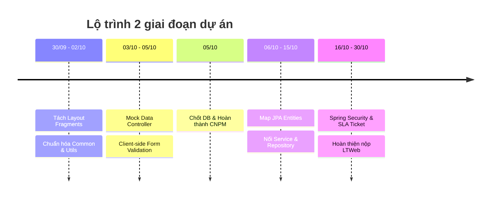

# 📋 KẾ HOẠCH HÀNH ĐỘNG & LỘ TRÌNH DỰ ÁN QAUTE PORTAL (TIENDO2)

> **Bối cảnh:**
> - 🎯 **Đồ án Công Nghệ Phần Mềm (CNPM):** Hạn chót **05/10/2026** (còn 5 ngày) $\rightarrow$ Đang là ưu tiên số 1, đóng vai trò chốt chuẩn cấu trúc Cơ sở dữ liệu (Database Schema).
> - 🌐 **Đồ án Lập Trình Web (LTWeb - QAUTE Portal):** Hạn chót **30/10/2026** (còn 30 ngày) $\rightarrow$ Dùng chung DB với CNPM.
> - 💡 **Chiến lược:** Trong 5 ngày tới, đồ án LTWeb chỉ thực hiện các hạng mục **độc lập, không phụ thuộc vào Database**, tránh việc sửa DB bên CNPM gây xung đột hoặc phải code lại Entity nhiều lần.

---

## 🗺️ PHẦN 1: LỘ TRÌNH CHI TIẾT CÁC HẠNG MỤC "LẶT VẶT" (30/09 - 05/10)



### 1.1. Tách Giao Diện Thymeleaf Fragments (Ưu tiên cao nhất)
* **Vấn đề hiện tại:** 17 file HTML trong `src/main/resources/templates/` đang lặp lại code `<head>`, navbar, sidebar và footer.
* **Mục tiêu:** Tách thành các component dùng chung trong `src/main/resources/templates/fragments/`:
  - `fragments/head.html`: Thẻ meta, font Inter/Roboto, CSS Bootstrap 5, FontAwesome icon.
  - `fragments/navbar.html`: Header thanh điều hướng, logo HCMUTE, avatar người dùng, chuông thông báo.
  - `fragments/sidebar.html`: Menu điều hướng theo phân hệ (Sinh viên / Giảng viên / Cán bộ Khoa).
  - `fragments/footer.html`: Thông tin bản quyền, link hỗ trợ học vụ, liên hệ.
* **Cách dùng:** Sử dụng cú pháp Thymeleaf:
  ```html
  <div th:replace="~{fragments/navbar :: navbar}"></div>
  ```

### 1.2. Xây Dựng Tầng Tiện Ích Dùng Chung (Common & Utilities)
* Tạo các class dùng chung trong package `com.school.counseling.common`:
  - **`ApiResponse<T>`:** Chuẩn hóa format phản hồi JSON cho tất cả các API AJAX:
    ```json
    { "success": true, "code": 200, "message": "Thành công", "data": { ... } }
    ```
  - **`GlobalExceptionHandler`:** Bắt ngoại lệ tập trung với `@ControllerAdvice`: Bắt lỗi 404 (Không tìm thấy trang), lỗi 403 (Không có quyền), lỗi 500 (Lỗi máy chủ) để hiển thị trang lỗi thân thiện thay vì trang mặc định trắng xoá của Spring.
  - **`SlugUtils`:** Chuyển đổi tiêu đề bài viết tiếng Việt có dấu sang URL thân thiện SEO (VD: `"Hướng dẫn đăng ký học phần"` $\rightarrow$ `"huong-dan-dang-ky-hoc-phan"`).
  - **`DateTimeUtils`:** Định dạng hiển thị thời gian linh hoạt (VD: `"Vừa xong"`, `"5 phút trước"`, `"Hôm qua lúc 14:30"`).
  - **`FileUploadValidator`:** Hàm tiện ích kiểm tra file upload: Dung lượng tối đa (10MB), đuôi file hợp lệ (`.pdf`, `.docx`, `.png`, `.jpg`).

### 1.3. Mock Data Trên Controller & Test View Động
* Không cần Database, tạo sẵn dữ liệu mẫu (Hardcoded / Mock Lists) trực tiếp trong Controller để kiểm tra giao diện Thymeleaf:
  - **`TicketController`:** Tạo danh sách 5 ticket giả lập với đầy đủ trạng thái: `OPEN`, `IN_PROGRESS`, `RESOLVED`, `CLOSED` kèm các mức độ ưu tiên `URGENT` (đỏ), `HIGH` (cam), `MEDIUM` (vàng), `LOW` (xanh).
  - **`FeedController`:** Tạo danh sách bài viết mẫu có ảnh, lượt thích (Like), bình luận (Comment).
  - **`NewsController`:** Mock bài viết thông báo có file đính kèm PDF.
* **Lợi ích:** Đảm bảo toàn bộ vòng lặp `th:each`, câu điều kiện `th:if`, `th:unless`, phân trang và CSS hiển thị hoàn hảo. Khi nối DB chỉ cần thay 1 dòng code gọi Service.

### 1.4. Client-side Form Validation & UX Enhancements
* Thêm JavaScript kiểm tra dữ liệu đầu vào ngay tại trình duyệt:
  - Trang `register.html`: Bắt buộc email có đuôi `@student.hcmute.edu.vn`, mật khẩu từ 8 ký tự trở lên.
  - Trang `create-post.html` & `ticket-detail.html`: Cảnh báo khi người dùng chưa nhập nội dung hoặc file đính kèm quá dung lượng.
  - Thêm hiệu ứng Loading Spinner khi ấn nút Gửi Form để chống click đúp.

---

## 🤖 PHẦN 2: HỆ THỐNG TỰ ĐỘNG COMMIT & PUSH DÀNH CHO AI AGENT

Để đảm bảo code luôn được sao lưu lên GitHub sau mỗi tính năng hoàn thành mà không cần gõ lệnh thủ công, dự án đã được trang bị script tự động hoá tại:
👉 `scripts/git-auto-sync.ps1`

### 2.1. Cú pháp sử dụng
Khi AI Agent (hoặc Developer) hoàn thành một tính năng hay chỉnh sửa, chạy lệnh PowerShell sau:
```powershell
.\scripts\git-auto-sync.ps1 -Message "Nội dung mô tả" -Type "feat" -Scope "tên_module"
```

### 2.2. Bảng quy chuẩn Conventional Commits
| Type | Ý nghĩa | Ví dụ |
| :--- | :--- | :--- |
| `feat` | Thêm tính năng mới | `.\scripts\git-auto-sync.ps1 -Message "Tách fragments navbar và footer" -Type "feat" -Scope "ui"` |
| `fix` | Sửa lỗi | `.\scripts\git-auto-sync.ps1 -Message "Sửa lỗi vỡ layout trên mobile" -Type "fix" -Scope "css"` |
| `docs` | Cập nhật tài liệu | `.\scripts\git-auto-sync.ps1 -Message "Cập nhật lộ trình tiendo2.md" -Type "docs"` |
| `refactor`| Tối ưu / Tái cấu trúc code | `.\scripts\git-auto-sync.ps1 -Message "Chuyển đổi các hàm tiện ích sang DateUtils" -Type "refactor" -Scope "common"` |
| `style` | Sửa CSS, format code | `.\scripts\git-auto-sync.ps1 -Message "Căn chỉnh lề thẻ ticket card" -Type "style"` |
| `ci` | Cập nhật cấu hình CI/CD | `.\scripts\git-auto-sync.ps1 -Message "Thêm GitHub Action build Maven" -Type "ci"` |

### 2.3. Quy tắc bắt buộc của AI Agent
Mỗi khi AI Agent nhận lệnh thực hiện một tác vụ:
1. Thực hiện sửa đổi và kiểm tra lỗi (compile / syntax).
2. Tự động kích hoạt script `git-auto-sync.ps1` với thông điệp rõ ràng, đúng format Conventional Commits.
3. Thông báo mã commit hash và trạng thái push cho người dùng.

---

## 🚀 PHẦN 3: HỆ THỐNG CI/CD VỚI GITHUB ACTIONS

Dự án đã được cấu hình quy trình CI tự động kiểm tra code mỗi khi có commit hoặc pull request tại:
👉 `.github/workflows/ci.yml`

### 3.1. Luồng hoạt động của Pipeline CI
```text
Developer / AI Agent Push Code (Nhánh master/dev)
       │
       ▼
GitHub Actions Runner (Ubuntu Latest)
       │
       ├── 1. Checkout mã nguồn
       ├── 2. Khởi tạo môi trường JDK 17 (Eclipse Temurin)
       ├── 3. Kích hoạt Maven Dependency Cache (Tăng tốc độ build)
       ├── 4. Biên dịch và đóng gói: mvn clean package -DskipTests
       └── 5. Lưu trữ file Artifact (.jar) tự động trong 7 ngày
```

### 3.2. Lợi ích mang lại
* **Kiểm tra tức thì lỗi compile:** Mọi lỗi thiếu thư viện, sai cú pháp Java hay conflict sẽ bị phát hiện ngay lập tức trên GitHub.
* **Tự động sinh file `app.jar`:** Luôn có sẵn bản build mới nhất của ứng dụng mà không cần phải tự chạy build trên máy cá nhân.

---

## 📅 PHẦN 4: CHECKLIST TIẾN ĐỘ TỪNG NGÀY (30/09 $\rightarrow$ 30/10)

| Thời gian | Trọng tâm công việc | Trạng thái |
| :--- | :--- | :---: |
| **30/09** | Cấu hình CI/CD GitHub Actions, tạo script Git Auto-Sync, lập kế hoạch `tiendo2.md` | ✅ Đã xong |
| **01/10 - 02/10** | Tách Thymeleaf Layout & Fragments (`navbar`, `sidebar`, `footer`) | ⏳ Chờ làm |
| **03/10 - 04/10** | Viết `ApiResponse`, `GlobalExceptionHandler`, các class `Utils` | ⏳ Chờ làm |
| **05/10** | **HẠN CHÓT NỘP ĐỒ ÁN CNPM** & Xuất cấu trúc Database hoàn chỉnh (`schema.sql`) | 🎯 MỤC TIÊU |
| **06/10 - 07/10** | Đồng bộ Database từ CNPM sang LTWeb; Sinh các file `@Entity` JPA | ⏳ Dự kiến |
| **08/10 - 15/10** | Xây dựng Service & Repository cho Phân hệ Ticket & Thông tin | ⏳ Dự kiến |
| **16/10 - 22/10** | Xây dựng Phân hệ Diễn đàn, Tin tức & Tích hợp Chatbot AI | ⏳ Dự kiến |
| **23/10 - 28/10** | Phân quyền bảo mật Spring Security RBAC, kiểm thử toàn diện | ⏳ Dự kiến |
| **29/10 - 30/10** | Rà soát báo cáo, kiểm thử E2E và đóng gói nộp đồ án Lập Trình Web | 🏁 VỀ ĐÍCH |
