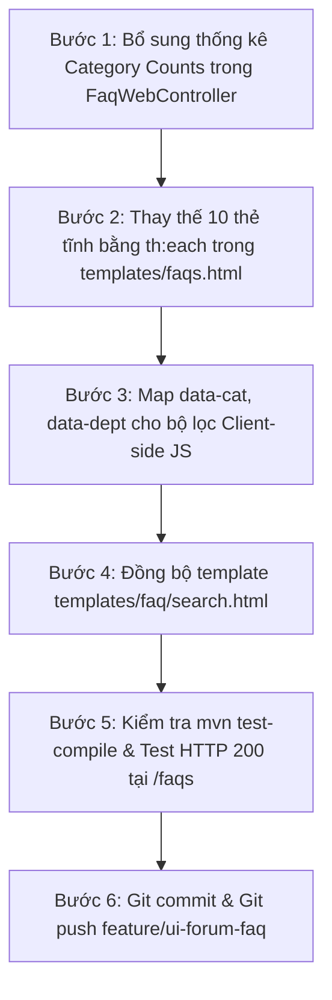

# 📋 KẾ HOẠCH HÀNH ĐỘNG & TIẾN ĐỘ THỰC HIỆN (TIENDO3)
**Dự án:** HCMUTE Support Portal (QAUTE Portal)  
**Ngày lập kế hoạch:** 22/10/2026  
**Nhánh Git:** `feature/ui-forum-faq`  
**Chủ đề:** Tích hợp & Đồng bộ động 349 câu hỏi thường gặp (FAQ) từ Database lên Giao diện Tra cứu

---

## 🎯 1. BỐI CẢNH & HIỆN TRẠNG HỆ THỐNG

| Thành phần | Trạng thái hiện tại | Đánh giá |
| :--- | :--- | :--- |
| **Dataset gốc** | [faq_dataset_curated.json](file:///d:/HK5/LapTrinhWeb/doancuoiki/ban2/docs/dataset/faq_dataset_curated.json) chứa đúng **349 câu hỏi** thực tế từ trường HCMUTE | ✅ Đầy đủ |
| **Database (MySQL)** | `DataInitializer.java` đã nạp thành công 349 bản ghi vào bảng `faqs` | ✅ Đã nạp |
| **AI Matcher Service** | `SmartFaqMatcherService` và API `/api/v1/faqs/match` phản hồi chính xác score 0.85/0.7 | ✅ Hoạt động tốt |
| **Controller** | `FaqWebController.java` (`GET /faqs`) đã query lấy toàn bộ `faqs` (349 records) và truyền vào `Model` | ✅ Đã có dữ liệu trong Model |
| **Giao diện View** | [templates/faqs.html](file:///d:/HK5/LapTrinhWeb/doancuoiki/ban2/src/main/resources/templates/faqs.html) đang chứa **10 card HTML tĩnh mẫu** (`<!-- Item 1 -->` tới `<!-- Item 10 -->`) | ❌ Chưa có vòng lặp Thymeleaf `th:each` |

---

## 📁 2. DANH SÁCH CÁC FILE CẦN THAY ĐỔI

### 1. [src/main/java/com/school/counseling/module/ai/controller/FaqWebController.java](file:///d:/HK5/LapTrinhWeb/doancuoiki/ban2/src/main/java/com/school/counseling/module/ai/controller/FaqWebController.java)
- **Mục tiêu:** Bổ sung tổng hợp số lượng câu hỏi theo từng danh mục (category counts) và phân loại phòng ban vào `Model`.
- **Nội dung thay đổi:**
  - Tính toán số lượng cho từng danh mục: `countHocVu`, `countHocPhi`, `countQuyChe`, `countNgoaiNgu`, `countTaiKhoan`, `countDichVu`.
  - Đưa Map `categoryCounts` hoặc các biến đếm cụ thể vào `Model` để các pill danh mục trên giao diện hiển thị đúng con số thực tế trong 349 câu thay vì số tĩnh (3, 2, 2, 1, 1, 1).

### 2. [src/main/resources/templates/faqs.html](file:///d:/HK5/LapTrinhWeb/doancuoiki/ban2/src/main/resources/templates/faqs.html)
- **Mục tiêu:** Chuyển đổi khối danh sách câu hỏi `#faq-list` từ HTML tĩnh sang Thymeleaf động 100%.
- **Nội dung thay đổi:**
  - Thay thế 10 block tĩnh (dòng 460 - dòng 755) bằng cấu trúc vòng lặp:
    ```html
    <div th:each="f, stat : ${faqs}" 
         class="faq-item rounded-2xl bg-white border border-[#e2e8f0] shadow-sm transition-all overflow-hidden"
         th:attr="data-cat=${f.category == 'Học phí' or f.category == 'Học bổng' ? 'hoc-phi' : (f.category == 'Ngoại ngữ' ? 'ngoai-ngu' : (f.category == 'Xét tốt nghiệp' or f.category == 'Quy chế học vụ' ? 'quy-che' : (f.category == 'Tài khoản' ? 'tai-khoan' : 'hoc-vu')))}, data-dept=${f.department != null ? ('dept-' + f.department.id) : 'all'}, data-type='all'">
    ```
  - Map tiêu đề câu hỏi: `th:text="${f.question}"`.
  - Map nội dung trả lời: `th:text="${f.answer}"` (giữ định dạng xuống dòng và liên kết nếu có).
  - Map badge danh mục & đơn vị phụ trách: `th:text="${f.category}"` và `th:text="${f.department != null ? f.department.name : 'Phòng Đào tạo & CTSV'}"`.
  - Hiển thị ngày đăng/cập nhật định dạng chuẩn Việt Nam: `dd/MM/yyyy`.
  - Cơ chế Accordion: Item đầu tiên (`stat.first`) mở sẵn (`expanded`), các item tiếp theo đóng mặc định để giao diện gọn gàng, mượt mà.
  - Cập nhật số đếm trên badge:
    ```html
    <span id="faq-counter-badge" th:text="${(totalCount != null ? totalCount : 349) + ' CÂU HỎI'}">349 CÂU HỎI</span>
    ```
  - Cập nhật số đếm trên các pill danh mục: `id="count-hoc-vu"`, `id="count-hoc-phi"`, `id="count-quy-che"`, `id="count-ngoai-ngu"`, `id="count-tai-khoan"`, `id="count-dich-vu"` theo dữ liệu từ Model.

### 3. [src/main/resources/templates/faq/search.html](file:///d:/HK5/LapTrinhWeb/doancuoiki/ban2/src/main/resources/templates/faq/search.html)
- **Mục tiêu:** Đồng bộ cấu trúc vòng lặp tương tự để đảm bảo tính nhất quán nếu hệ thống điều hướng qua URL nhánh `search.html`.

---

## 🚀 3. LỘ TRÌNH TRIỂN KHAI THEO CÁC BƯỚC (STEP-BY-STEP)



### Chi tiết các bước:
1. **Bước 1 (Backend Controller):**
   - Mở `FaqWebController.java`, viết logic tính `Map<String, Long> categoryCounts` gom nhóm từ danh sách 349 FAQ (`Stream API` gom nhóm theo `category`).
   - Đẩy `categoryCounts` vào `Model`.

2. **Bước 2 (Frontend View faqs.html):**
   - Xóa bỏ 10 item mock tĩnh từ dòng 460 đến 755.
   - Thêm thẻ `th:each="f, stat : ${faqs}"` chuẩn UI Bootstrap/Tailwind HCMUTE.
   - Giữ nguyên cơ chế tương tác: Nút bấm Like/Helpful, nút mở/gập Accordion, nút Gửi ticket hỗ trợ nếu chưa tìm thấy giải đáp.

3. **Bước 3 (Khớp nối Bộ lọc JavaScript):**
   - Đảm bảo các attribute `data-cat`, `data-dept`, `data-type` khớp với script filter hiện có trong `faqs.html` để việc gõ từ khóa vào ô tìm kiếm hoặc chọn phòng ban sẽ tự động lọc tức thì 349 câu hỏi mà không cần reload trang.

4. **Bước 4 (Đồng bộ search.html):**
   - Cập nhật tương tự cho `templates/faq/search.html`.

5. **Bước 5 (Kiểm thử):**
   - Biên dịch: `mvn test-compile`.
   - Kiểm tra request: `curl -I http://localhost:8080/faqs` đảm bảo HTTP 200 OK.
   - Kiểm tra số lượng item render thực tế trên DOM: `grep -c "faq-item"`.

6. **Bước 6 (Tự động hóa Git):**
   - `git add src/main/java/.../FaqWebController.java src/main/resources/templates/faqs.html src/main/resources/templates/faq/search.html docs/tiendo/tiendo3.md`
   - `git commit -m "feat(faq): bind dynamic 349 curated faqs and category counters to view"`
   - `git push origin feature/ui-forum-faq`

---

## 📌 4. BẢNG THEO DÕI TIẾN ĐỘ CÔNG VIỆC

| STT | Hạng mục công việc | Người thực hiện | Dự kiến hoàn thành | Trạng thái |
| :---: | :--- | :---: | :---: | :---: |
| 1 | Xác định dataset 349 câu hỏi & trạng thái Database MySQL | Dev A / AI | 22/10/2026 | ✅ Hoàn thành |
| 2 | Lập tài liệu kế hoạch `tiendo3.md` | Dev A / AI | 22/10/2026 | ✅ Hoàn thành |
| 3 | Bổ sung đếm Category trong `FaqWebController.java` | Dev A / AI | 22/10/2026 | ⏳ Chờ triển khai |
| 4 | Cải tạo `templates/faqs.html` (Vòng lặp `th:each` 349 FAQs) | Dev B / AI | 22/10/2026 | ⏳ Chờ triển khai |
| 5 | Đồng bộ `templates/faq/search.html` | Dev B / AI | 22/10/2026 | ⏳ Chờ triển khai |
| 6 | Test biên dịch `mvn test-compile` & Kiểm tra HTTP 200 | Dev A / AI | 22/10/2026 | ⏳ Chờ triển khai |
| 7 | Git commit & Push nhánh `feature/ui-forum-faq` | Dev A / AI | 22/10/2026 | ⏳ Chờ triển khai |
