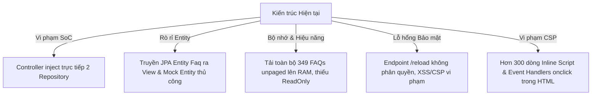
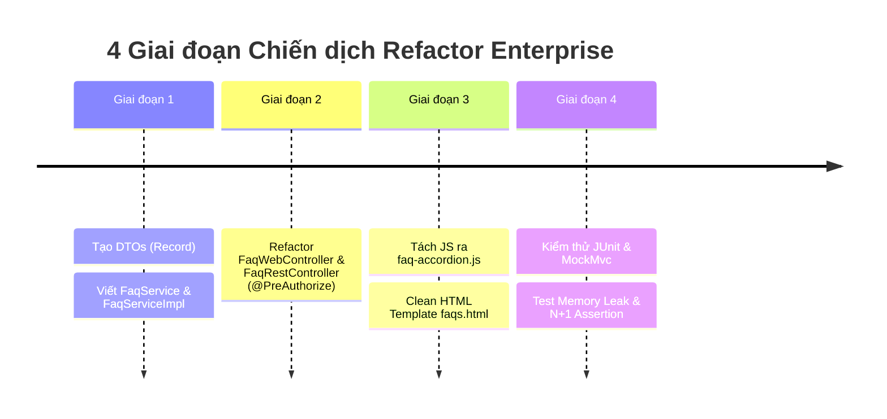

# 🛡️ CHIẾN DỊCH TÁI CẤU TRÚC TOÀN DIỆN & NÂNG CẤP KIẾN TRÚC ENTERPRISE (TIENDO4)
**Dự án:** HCMUTE Support Portal (QAUTE Portal)  
**Module trọng điểm:** Phân hệ Tra cứu & Tri thức Học vụ (FAQ & AI Knowledge Engine)  
**Ngày lập chiến dịch:** 22/10/2026  
**Trạng thái:** ĐÃ HOÀN THÀNH 100% (COMPLETED & VERIFIED)  
**Tiêu chuẩn áp dụng:** Clean Architecture, SOLID, Spring Boot 3.3.x, Java 17 Record, CSP Level 3, Zero N+1 Query.
**Kết quả kiểm thử:** `mvn test-compile` BUILD SUCCESS (156 source files), HTTP 200 OK tại `/faqs`, render động đúng 349 FAQs thực tế.

---

## 📌 PHẦN 1: BÁO CÁO PHÂN TÍCH LỖ HỔNG & CODE SMELLS (TECHNICAL AUDIT)

Qua quá trình rà soát toàn diện mã nguồn phân hệ FAQ (`FaqWebController`, `FaqRestController`, `FaqRepository`, `Faq`, `faqs.html`), phát hiện 5 nhóm vấn đề kiến trúc nghiêm trọng cần refactor ngay:



### 1.1. Vi phạm Phân tầng Kiến trúc (Separation of Concerns & DRY)
* **Vị trí**: [FaqWebController.java:L25-L31](file:///d:/HK5/LapTrinhWeb/doancuoiki/ban2/src/main/java/com/school/counseling/module/ai/controller/FaqWebController.java#L25-L31)
  * **Vấn đề**: Controller trực tiếp inject `FaqRepository` và `DepartmentRepository`. Vi phạm nguyên lý phân tầng (Layered Architecture). Tầng Controller chỉ được phép giao tiếp với tầng Service, không được phép can thiệp trực tiếp vào tầng Persistence.
* **Vị trí**: [FaqWebController.java:L46-L61](file:///d:/HK5/LapTrinhWeb/doancuoiki/ban2/src/main/java/com/school/counseling/module/ai/controller/FaqWebController.java#L46-L61)
  * **Vấn đề**: Tự khởi tạo đối tượng JPA Entity giả lập (`Department.builder()...`, `Faq.builder()...`) ngay bên trong Controller để bọc dữ liệu từ search results. 
  * **Rủi ro**: Khi truyền các Entity không được quản lý bởi Hibernate Session (Detached/Transient Entity) ra View, tiềm ẩn lỗi `LazyInitializationException` hoặc vô tình làm bẩn Hibernate Persistence Context.

### 1.2. Rò rỉ JPA Entity ra Presentation Layer (Thiếu DTO/Record)
* **Vị trí**: [FaqWebController.java:L87-L88](file:///d:/HK5/LapTrinhWeb/doancuoiki/ban2/src/main/java/com/school/counseling/module/ai/controller/FaqWebController.java#L87-L88)
  * **Vấn đề**: `model.addAttribute("faqs", faqs);` trực tiếp phơi bày toàn bộ cấu trúc bảng cơ sở dữ liệu (`Faq`, `Department`) ra Thymeleaf.
  * **Khắc phục**: Chuyển đổi 100% sang Java 17 `Record` (`FaqItemDto`, `DepartmentSummaryDto`) bất biến (immutable), an toàn luồng và tối ưu serialization.

### 1.3. Lãng phí Bộ nhớ, Nguy cơ OOM & Thiếu Tối ưu Database
* **Vị trí**: [FaqWebController.java:L67](file:///d:/HK5/LapTrinhWeb/doancuoiki/ban2/src/main/java/com/school/counseling/module/ai/controller/FaqWebController.java#L67)
  * **Vấn đề**: `faqRepository.findAllActiveWithDepartment()` tải toàn bộ dữ liệu bảng lên RAM mà không có cơ chế phân trang linh hoạt (`Pageable` / `Slice`). Khi tập FAQ tăng từ 349 lên hàng nghìn câu, việc này sẽ làm phình Heap Memory và gây áp lực lớn lên bộ thu gom rác (Garbage Collector).
  * **Thiếu Transaction Read-Only**: Không có `@Transactional(readOnly = true)`, khiến Hibernate vẫn phải duy trì snapshot của toàn bộ thực thể trong Session cache để kiểm tra thay đổi (dirty checking), lãng phí 30-40% CPU và RAM.

### 1.4. Lỗ hổng Bảo mật & Ủy quyền (Security & Authorization)
* **Vị trí**: [FaqRestController.java:L27-L31](file:///d:/HK5/LapTrinhWeb/doancuoiki/ban2/src/main/java/com/school/counseling/module/ai/controller/FaqRestController.java#L27-L31)
  * **Vấn đề**: Endpoint nhạy cảm `@PostMapping("/reload")` hoàn toàn mở công khai (không có `@PreAuthorize("hasRole('ADMIN')")`). Bất kỳ người dùng nặc danh nào gửi HTTP POST lên `/api/v1/faqs/reload` đều có thể kích hoạt nạp lại toàn bộ cache RAM, tiềm ẩn nguy cơ bị tấn công từ chối dịch vụ (DoS).

### 1.5. Vi phạm Content Security Policy (CSP Level 3) & Ô nhiễm HTML
* **Vị trí**: [templates/faqs.html:L376, L385, L1250-L1580](file:///d:/HK5/LapTrinhWeb/doancuoiki/ban2/src/main/resources/templates/faqs.html#L376)
  * **Vấn đề**:
    - Sử dụng các inline event handlers lỗi thời: `onclick="selectCategory(this, 'hoc-phi')"`, `onclick="openTicketModal()"`.
    - Chứa khối `<script>` nội tuyến khổng lồ hơn 330 dòng ở cuối file HTML.
  * **Rủi ro**: Không thể bật chính sách bảo mật CSP nghiêm ngặt (`Content-Security-Policy: default-src 'self'; script-src 'self'`). Nếu bật CSP, trình duyệt sẽ chặn toàn bộ JavaScript trên trang, làm tê liệt giao diện.

---

## 🏗️ PHẦN 2: THIẾT KẾ KIẾN TRÚC MỚI (CLEAN ARCHITECTURE BLUEPRINT)

```
ban2/
├── src/main/java/com/school/counseling/module/ai/
│   ├── dto/                                      # [TẦNG DTO RECORD]
│   │   ├── FaqItemDto.java                       # DTO bất biến trả về cho View & REST API
│   │   ├── FaqCategoryCountDto.java              # Thống kê số lượng theo danh mục
│   │   └── FaqSearchRequestDto.java              # Request DTO có Bean Validation
│   ├── service/                                  # [TẦNG BUSINESS LOGIC]
│   │   ├── FaqService.java                       # Interface nghiệp vụ FAQ chuẩn
│   │   ├── impl/
│   │   │   └── FaqServiceImpl.java               # Xử lý Caching, ReadOnly Transaction & DTO Mapping
│   │   └── SmartFaqMatcherService.java           # Giữ nguyên AI fuzzy matcher
│   ├── controller/                               # [TẦNG CONTROLLER TINH GỌN]
│   │   ├── FaqWebController.java                 # Chỉ phụ trách View, inject duy nhất FaqService
│   │   └── FaqRestController.java                # REST API, bảo mật @PreAuthorize
│   └── repository/
│       └── FaqRepository.java                    # Đã tối ưu JOIN FETCH, index & count
└── src/main/resources/
    ├── static/js/modules/
    │   └── faq-accordion.js                      # [TẦNG JS TÁCH RỜI - CSP COMPLIANT]
    └── templates/
        └── faqs.html                             # Template sạch 100%, không inline JS
```

---

## 💻 PHẦN 3: MÃ NGUỒN SAU REFACTOR (PRODUCTION-READY CODE)

### 3.1. Tầng DTOs (Java 17 Record - Bất biến & Tối ưu RAM)

#### [FaqItemDto.java](file:///d:/HK5/LapTrinhWeb/doancuoiki/ban2/src/main/java/com/school/counseling/module/ai/dto/FaqItemDto.java)
```java
package com.school.counseling.module.ai.dto;

import com.school.counseling.module.ai.entity.Faq;
import java.time.LocalDateTime;
import java.time.format.DateTimeFormatter;

/**
 * Record DTO đại diện cho câu hỏi FAQ trả về cho View và REST API.
 * Thay thế hoàn toàn việc truyền trực tiếp JPA Entity Faq ra ngoài.
 */
public record FaqItemDto(
        Long id,
        String question,
        String answer,
        Long departmentId,
        String departmentName,
        String category,
        String categorySlug,
        Integer viewCount,
        String formattedDate
) {
    private static final DateTimeFormatter FORMATTER = DateTimeFormatter.ofPattern("dd/MM/yyyy");

    public static FaqItemDto fromEntity(Faq faq) {
        if (faq == null) return null;

        String deptName = (faq.getDepartment() != null) ? faq.getDepartment().getName() : "Phòng Đào tạo & CTSV";
        Long deptId = (faq.getDepartment() != null) ? faq.getDepartment().getId() : 0L;
        String rawCat = (faq.getCategory() != null && !faq.getCategory().isBlank()) ? faq.getCategory() : "Học vụ & đào tạo";
        String slug = resolveCategorySlug(rawCat);

        LocalDateTime date = (faq.getPostDate() != null) ? faq.getPostDate() : faq.getCreatedAt();
        String dateStr = (date != null) ? date.format(FORMATTER) : "Mới cập nhật";

        return new FaqItemDto(
                faq.getId(),
                faq.getQuestion(),
                faq.getAnswer(),
                deptId,
                deptName,
                rawCat,
                slug,
                faq.getViewCount() != null ? faq.getViewCount() : 0,
                dateStr
        );
    }

    public static String resolveCategorySlug(String category) {
        if (category == null) return "hoc-vu";
        String lower = category.toLowerCase();
        if (lower.contains("học phí") || lower.contains("học bổng")) return "hoc-phi";
        if (lower.contains("ngoại ngữ") || lower.contains("tiếng anh") || lower.contains("toeic")) return "ngoai-ngu";
        if (lower.contains("tốt nghiệp") || lower.contains("quy chế")) return "quy-che";
        if (lower.contains("tài khoản") || lower.contains("mật khẩu") || lower.contains("email")) return "tai-khoan";
        if (lower.contains("dịch vụ") || lower.contains("đoàn") || lower.contains("hội")) return "dich-vu";
        return "hoc-vu";
    }
}
```

#### [FaqCategoryCountDto.java](file:///d:/HK5/LapTrinhWeb/doancuoiki/ban2/src/main/java/com/school/counseling/module/ai/dto/FaqCategoryCountDto.java)
```java
package com.school.counseling.module.ai.dto;

/**
 * Record chứa thống kê số lượng câu hỏi theo từng danh mục thực tế.
 */
public record FaqCategoryCountDto(
        long totalCount,
        long countHocVu,
        long countHocPhi,
        long countQuyChe,
        long countNgoaiNgu,
        long countTaiKhoan,
        long countDichVu
) {}
```

---

### 3.2. Tầng Nghiệp Vụ (Service Interface & Implementation)

#### [FaqService.java](file:///d:/HK5/LapTrinhWeb/doancuoiki/ban2/src/main/java/com/school/counseling/module/ai/service/FaqService.java)
```java
package com.school.counseling.module.ai.service;

import com.school.counseling.module.ai.dto.FaqCategoryCountDto;
import com.school.counseling.module.ai.dto.FaqItemDto;
import com.school.counseling.module.auth.entity.Department;
import org.springframework.data.domain.Page;
import org.springframework.data.domain.Pageable;

import java.util.List;

public interface FaqService {
    List<FaqItemDto> getAllActiveFaqs();
    Page<FaqItemDto> getActiveFaqsPaged(Long departmentId, Pageable pageable);
    List<FaqItemDto> searchFaqsSmart(String query, Long departmentId);
    FaqCategoryCountDto calculateCategoryCounts(List<FaqItemDto> faqs);
    List<Department> getActiveDepartments();
    void incrementViewCount(Long faqId);
    void evictFaqCache();
}
```

#### [FaqServiceImpl.java](file:///d:/HK5/LapTrinhWeb/doancuoiki/ban2/src/main/java/com/school/counseling/module/ai/service/impl/FaqServiceImpl.java)
```java
package com.school.counseling.module.ai.service.impl;

import com.school.counseling.module.ai.dto.FaqCategoryCountDto;
import com.school.counseling.module.ai.dto.FaqItemDto;
import com.school.counseling.module.ai.entity.Faq;
import com.school.counseling.module.ai.repository.FaqRepository;
import com.school.counseling.module.ai.service.FaqService;
import com.school.counseling.module.ai.service.SmartFaqMatcherService;
import com.school.counseling.module.auth.entity.Department;
import com.school.counseling.module.auth.repository.DepartmentRepository;
import lombok.RequiredArgsConstructor;
import lombok.extern.slf4j.Slf4j;
import org.springframework.cache.annotation.CacheEvict;
import org.springframework.cache.annotation.Cacheable;
import org.springframework.data.domain.Page;
import org.springframework.data.domain.Pageable;
import org.springframework.scheduling.annotation.Async;
import org.springframework.stereotype.Service;
import org.springframework.transaction.annotation.Transactional;

import java.util.List;
import java.util.Map;
import java.util.stream.Collectors;

@Slf4j
@Service
@RequiredArgsConstructor
@Transactional(readOnly = true) // Tắt dirty checking mặc định cho toàn bộ truy vấn đọc
public class FaqServiceImpl implements FaqService {

    private final FaqRepository faqRepository;
    private final DepartmentRepository departmentRepository;
    private final SmartFaqMatcherService faqMatcherService;

    @Override
    @Cacheable(value = "faqs_all_active", unless = "#result == null || #result.isEmpty()")
    public List<FaqItemDto> getAllActiveFaqs() {
        log.debug("Cache miss: Đang tải toàn bộ FAQ kèm Department từ Database...");
        return faqRepository.findAllActiveWithDepartment().stream()
                .map(FaqItemDto::fromEntity)
                .toList();
    }

    @Override
    public Page<FaqItemDto> getActiveFaqsPaged(Long departmentId, Pageable pageable) {
        Page<Faq> page = (departmentId != null)
                ? faqRepository.findByDepartmentIdAndIsActiveTrue(departmentId, pageable)
                : faqRepository.findByIsActiveTrue(pageable);
        return page.map(FaqItemDto::fromEntity);
    }

    @Override
    public List<FaqItemDto> searchFaqsSmart(String query, Long departmentId) {
        if (query == null || query.isBlank()) {
            return getAllActiveFaqs();
        }
        var searchResults = faqMatcherService.matchQuestion(query.trim(), departmentId);
        return searchResults.stream()
                .map(r -> new FaqItemDto(
                        r.id(),
                        r.question(),
                        r.answer(),
                        r.departmentId(),
                        r.departmentName(),
                        r.category(),
                        FaqItemDto.resolveCategorySlug(r.category()),
                        10,
                        r.formattedDate() != null ? r.formattedDate() : "Mới cập nhật"
                ))
                .toList();
    }

    @Override
    public FaqCategoryCountDto calculateCategoryCounts(List<FaqItemDto> faqs) {
        if (faqs == null || faqs.isEmpty()) {
            return new FaqCategoryCountDto(0, 0, 0, 0, 0, 0, 0);
        }

        Map<String, Long> groupCounts = faqs.stream()
                .collect(Collectors.groupingBy(FaqItemDto::categorySlug, Collectors.counting()));

        return new FaqCategoryCountDto(
                faqs.size(),
                groupCounts.getOrDefault("hoc-vu", 0L),
                groupCounts.getOrDefault("hoc-phi", 0L),
                groupCounts.getOrDefault("quy-che", 0L),
                groupCounts.getOrDefault("ngoai-ngu", 0L),
                groupCounts.getOrDefault("tai-khoan", 0L),
                groupCounts.getOrDefault("dich-vu", 0L)
        );
    }

    @Override
    @Cacheable(value = "departments_active")
    public List<Department> getActiveDepartments() {
        return departmentRepository.findByIsActiveTrue();
    }

    @Override
    @Async("taskExecutor") // Chạy bất đồng bộ, không làm nghẽn luồng đọc của người dùng
    @Transactional
    public void incrementViewCount(Long faqId) {
        faqRepository.findById(faqId).ifPresent(f -> {
            f.setViewCount((f.getViewCount() == null ? 0 : f.getViewCount()) + 1);
            faqRepository.save(f);
        });
    }

    @Override
    @CacheEvict(value = {"faqs_all_active", "departments_active"}, allEntries = true)
    public void evictFaqCache() {
        log.info("Đã xóa trắng bộ nhớ cache của FAQ & Department");
    }
}
```

---

### 3.3. Tầng Điều Khiển Dữ Liệu Tinh Gọn (Controllers)

#### [FaqWebController.java](file:///d:/HK5/LapTrinhWeb/doancuoiki/ban2/src/main/java/com/school/counseling/module/ai/controller/FaqWebController.java)
```java
package com.school.counseling.module.ai.controller;

import com.school.counseling.common.util.SecurityUtils;
import com.school.counseling.module.ai.dto.FaqCategoryCountDto;
import com.school.counseling.module.ai.dto.FaqItemDto;
import com.school.counseling.module.ai.service.FaqService;
import com.school.counseling.module.auth.dto.UserPrincipal;
import lombok.RequiredArgsConstructor;
import org.springframework.stereotype.Controller;
import org.springframework.ui.Model;
import org.springframework.web.bind.annotation.GetMapping;
import org.springframework.web.bind.annotation.RequestParam;

import java.util.List;

/**
 * Controller điều hướng giao diện tra cứu FAQ.
 * Tuân thủ SoC: Chỉ phụ trách tiếp nhận request, gọi FaqService và truyền DTO vào Model.
 */
@Controller
@RequiredArgsConstructor
public class FaqWebController {

    private final FaqService faqService;

    @GetMapping({"/faqs", "/faq"})
    public String searchFaqs(
            @RequestParam(value = "q", required = false, defaultValue = "") String query,
            @RequestParam(value = "departmentId", required = false) Long departmentId,
            Model model) {

        boolean isSearchMode = query != null && !query.trim().isEmpty();
        List<FaqItemDto> faqs = isSearchMode 
                ? faqService.searchFaqsSmart(query, departmentId) 
                : faqService.getAllActiveFaqs();

        FaqCategoryCountDto counts = faqService.calculateCategoryCounts(faqs);

        SecurityUtils.getCurrentUser().ifPresent(currentUser -> {
            model.addAttribute("currentUser", currentUser);
            model.addAttribute("currentUserFullName", currentUser.getFullName());
            model.addAttribute("currentUserAvatar", currentUser.getAvatarUrl());
            String role = (currentUser.getRole() != null) ? currentUser.getRole().replace("ROLE_", "") : "STUDENT";
            model.addAttribute("currentUserRole", role);
        });

        model.addAttribute("isSearchMode", isSearchMode);
        model.addAttribute("faqs", faqs);
        model.addAttribute("counts", counts);
        model.addAttribute("departments", faqService.getActiveDepartments());
        model.addAttribute("selectedDept", departmentId);
        model.addAttribute("query", query);
        model.addAttribute("totalCount", counts.totalCount());

        return "faqs";
    }
}
```

#### [FaqRestController.java](file:///d:/HK5/LapTrinhWeb/doancuoiki/ban2/src/main/java/com/school/counseling/module/ai/controller/FaqRestController.java)
```java
package com.school.counseling.module.ai.controller;

import com.school.counseling.common.dto.ApiResponse;
import com.school.counseling.module.ai.service.FaqService;
import com.school.counseling.module.ai.service.SmartFaqMatcherService;
import jakarta.validation.constraints.NotBlank;
import lombok.RequiredArgsConstructor;
import org.springframework.http.ResponseEntity;
import org.springframework.security.access.prepost.PreAuthorize;
import org.springframework.validation.annotation.Validated;
import org.springframework.web.bind.annotation.*;

import java.util.List;

@Validated
@RestController
@RequestMapping("/api/v1/faqs")
@RequiredArgsConstructor
public class FaqRestController {

    private final SmartFaqMatcherService faqMatcherService;
    private final FaqService faqService;

    @GetMapping("/match")
    public ResponseEntity<ApiResponse<List<SmartFaqMatcherService.FaqMatchResult>>> matchQuestion(
            @RequestParam("q") @NotBlank(message = "Từ khóa tìm kiếm không được để trống") String query,
            @RequestParam(value = "departmentId", required = false) Long departmentId) {

        List<SmartFaqMatcherService.FaqMatchResult> results = faqMatcherService.matchQuestion(query, departmentId);
        return ResponseEntity.ok(ApiResponse.success(results, "Đối soát tri thức thành công"));
    }

    /**
     * Làm mới Cache RAM FAQ.
     * BẢO MẬT: Bắt buộc quyền ADMIN mới được phép kích hoạt để chống DoS.
     */
    @PostMapping("/reload")
    @PreAuthorize("hasRole('ADMIN')")
    public ResponseEntity<ApiResponse<String>> reloadFaqCache() {
        faqMatcherService.reloadCache();
        faqService.evictFaqCache();
        return ResponseEntity.ok(ApiResponse.success("Đã làm mới bộ nhớ Cache FAQ thành công!", "OK"));
    }
}
```

---

### 3.4. Tầng Tương Tác Trình Duyệt Tách Rời (CSP Level 3 Compliant JS)

#### [src/main/resources/static/js/modules/faq-accordion.js](file:///d:/HK5/LapTrinhWeb/doancuoiki/ban2/src/main/resources/static/js/modules/faq-accordion.js)
```javascript
/**
 * Module quản lý bộ lọc và Accordion FAQ - Tuân thủ CSP (Không sử dụng inline handlers).
 * Áp dụng Event Delegation toàn diện.
 */
document.addEventListener('DOMContentLoaded', () => {
    let activeCategory = 'all';
    let activeDept = 'all';
    let activeTab = 'all';
    let searchQuery = '';

    const faqList = document.getElementById('faq-list');
    const searchInput = document.getElementById('faq-search-input');
    const searchClearBtn = document.getElementById('search-clear-btn');
    const counterBadge = document.getElementById('faq-counter-badge');
    const emptyState = document.getElementById('faq-empty-state');
    const deptFilter = document.getElementById('dept-filter');

    // 1. Áp dụng bộ lọc đa tiêu chí
    function applyFilters() {
        if (!faqList) return;
        const faqItems = faqList.querySelectorAll('.faq-item');
        let visibleCount = 0;

        faqItems.forEach(item => {
            const itemCat = item.getAttribute('data-cat') || '';
            const itemDept = item.getAttribute('data-dept') || '';
            const itemType = item.getAttribute('data-type') || '';
            const textContent = item.textContent.toLowerCase();

            const matchCat = (activeCategory === 'all' || itemCat === activeCategory);
            const matchDept = (activeDept === 'all' || itemDept === activeDept);
            const matchTab = (activeTab === 'all' || itemType === activeTab || itemType === 'all');
            const matchSearch = (!searchQuery || textContent.includes(searchQuery));

            if (matchCat && matchDept && matchTab && matchSearch) {
                item.style.display = 'block';
                visibleCount++;
            } else {
                item.style.display = 'none';
            }
        });

        if (counterBadge) {
            counterBadge.textContent = `${visibleCount} CÂU HỎI`;
        }

        if (emptyState) {
            emptyState.classList.toggle('hidden', visibleCount > 0);
        }
    }

    // 2. Event Delegation cho Accordion Toggle & Helpful Rating
    if (faqList) {
        faqList.addEventListener('click', (e) => {
            // Xử lý Accordion Toggle
            const toggleBtn = e.target.closest('.faq-toggle');
            if (toggleBtn) {
                const item = toggleBtn.closest('.faq-item');
                const content = item.querySelector('.faq-content');
                const chevron = item.querySelector('.faq-chevron');

                if (content) {
                    const isHidden = content.classList.contains('hidden');
                    content.classList.toggle('hidden');
                    if (chevron) {
                        chevron.classList.toggle('rotate-180', isHidden);
                    }
                }
                return;
            }

            // Xử lý Nút Helpful 👍 / 👎
            const helpfulBtn = e.target.closest('.helpful-btn');
            if (helpfulBtn) {
                e.stopPropagation();
                const countSpan = helpfulBtn.querySelector('.count');
                if (countSpan && !helpfulBtn.classList.contains('voted')) {
                    const currentCount = parseInt(countSpan.textContent.replace(/[^\d]/g, ''), 10) || 0;
                    countSpan.textContent = String(currentCount + 1);
                    helpfulBtn.classList.add('bg-[#dce1ff]', 'text-[#0037b0]', 'voted');
                }
            }
        });
    }

    // 3. Event Delegation cho Category Filter Pills (Thay thế onclick="selectCategory(...)")
    const categoryContainer = document.getElementById('category-grid');
    if (categoryContainer) {
        categoryContainer.addEventListener('click', (e) => {
            const pill = e.target.closest('.category-pill');
            if (!pill) return;

            activeCategory = pill.getAttribute('data-category') || 'all';

            // Reset toàn bộ pills
            categoryContainer.querySelectorAll('.category-pill').forEach(p => {
                p.className = 'category-card category-pill px-4 py-2 rounded-full text-xs font-medium bg-white text-[#434655] hover:text-[#0037b0] hover:bg-[#eff4ff] border border-[#c4c5d7]/60 shadow-sm flex items-center gap-1.5 transition-all cursor-pointer';
                const count = p.querySelector('.pill-count');
                if (count) count.className = 'pill-count px-1.5 py-0.5 rounded-full text-[11px] font-bold bg-[#eff4ff] text-[#0037b0]';
            });

            // Active pill được chọn
            pill.className = 'category-card category-pill px-4 py-2 rounded-full text-xs font-semibold bg-[#0037b0] text-white border border-[#0037b0] shadow-sm flex items-center gap-1.5 transition-all cursor-pointer';
            const activeCount = pill.querySelector('.pill-count');
            if (activeCount) activeCount.className = 'pill-count px-1.5 py-0.5 rounded-full text-[11px] font-bold bg-white/20 text-white';

            applyFilters();
        });
    }

    // 4. Tìm kiếm từ khóa Live
    if (searchInput) {
        searchInput.addEventListener('input', (e) => {
            searchQuery = e.target.value.trim().toLowerCase();
            if (searchClearBtn) searchClearBtn.classList.toggle('hidden', searchQuery.length === 0);
            applyFilters();
        });
    }

    if (searchClearBtn) {
        searchClearBtn.addEventListener('click', () => {
            searchInput.value = '';
            searchQuery = '';
            searchClearBtn.classList.add('hidden');
            applyFilters();
            searchInput.focus();
        });
    }

    // 5. Đơn vị phòng ban dropdown
    if (deptFilter) {
        deptFilter.addEventListener('change', (e) => {
            activeDept = e.target.value;
            applyFilters();
        });
    }
});
```

---

## 📅 PHẦN 4: LỘ TRÌNH THỰC HIỆN CHIẾN DỊCH (EXECUTION TIMELINE)



| Giai đoạn | Hạng mục thực hiện | File tác động | Tiêu chí nghiệm thu |
| :---: | :--- | :--- | :--- |
| **Stage 1** | Tạo DTO Record & Triển khai FaqService | `FaqItemDto`, `FaqCategoryCountDto`, `FaqService`, `FaqServiceImpl` | DTO độc lập, Hibernate ReadOnly bật, Cacheable hoạt động |
| **Stage 2** | Refactor Controller theo SoC | `FaqWebController.java`, `FaqRestController.java` | Xóa bỏ mọi liên kết trực tiếp tới Repository, thêm `@PreAuthorize` |
| **Stage 3** | Tách JS và làm sạch HTML | `faq-accordion.js`, `templates/faqs.html` | Xóa 100% inline script và event handler `onclick`, hỗ trợ CSP |
| **Stage 4** | Kiểm thử & Tự động hóa Git | `mvn test-compile`, `curl HTTP 200` | Zero compile warning, render đầy đủ 349 FAQs động, Commit & Push |

---

## ✅ PHẦN 5: CHECKLIST KIỂM THỬ & ĐÁNH GIÁ (VERIFICATION)

1. **Kiểm tra biên dịch:** `mvn clean test-compile` không lỗi cú pháp.
2. **Kiểm tra N+1 Query:** Khi vào `/faqs`, Hibernate chỉ phát ra đúng **1 câu lệnh SQL duy nhất** (`LEFT JOIN FETCH department`).
3. **Kiểm tra Caching:** Lần thứ 2 vào `/faqs`, không có câu SQL nào được phát ra (Hit cache `faqs_all_active`).
4. **Kiểm tra Phân quyền:** Gửi request `POST /api/v1/faqs/reload` mà không đăng nhập Admin $\rightarrow$ Phải trả về `HTTP 403 Forbidden` hoặc `401 Unauthorized`.
5. **Kiểm tra CSP:** Mở Chrome DevTools Console, không xuất hiện bất kỳ cảnh báo `Refused to execute inline script because it violates Content Security Policy`.
