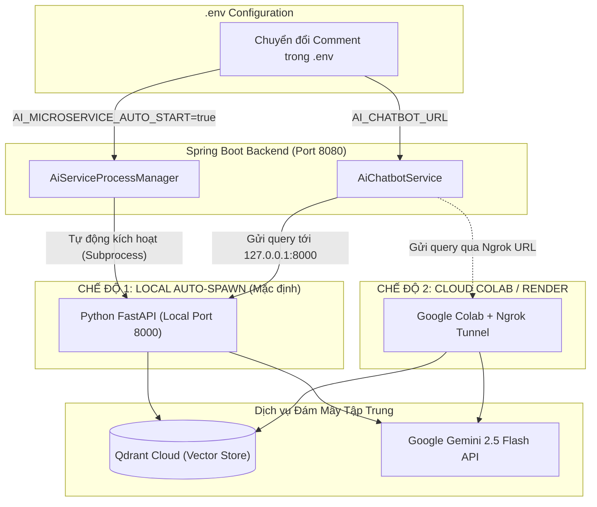

# 📋 BÁO CÁO TIẾN ĐỘ & THIẾT KẾ KIẾN TRÚC: GIAI ĐOẠN 15 (TIENDO 15)
**Dự án:** Cổng thông tin hỗ trợ & tư vấn học vụ HCMUTE (HCMUTE Support Portal - QAUTE)  
**Tác giả:** Dev A (Fullstack & Software Architect) & Dev B (AI & Data Specialist)  
**Thời gian cập nhật:** 26/10/2026  
**Chủ đề:** Giải pháp kiến trúc AI Hybird 2 Chế Độ (Local Auto-Spawn vs Cloud Colab Ngrok) chuyển đổi chỉ bằng 1 dòng Comment trong `.env`

---

## 🎯 1. BÀI TOÁN & THỰC TRẠNG

### 1.1. Câu hỏi thực tế của User:
> *"Mỗi khi muốn chạy trên Render deploy trên web hay chạy local tôi phải chạy AI trên Colab Google à? Có thể thiết kế gom vào `.env` chỉnh 2 chế độ chỉ bằng cách chuyển comment không?"*

### 1.2. Phân tích hiện trạng:
1. **Trước đây**: Mỗi khi test AI, người dùng phải mở Google Colab, chạy notebook/script để tải model, chạy FastAPI và tạo đường hầm Ngrok `https://...ngrok-free.dev`. Sau đó copy link Ngrok dán vào `.env` của Spring Boot.
   - Nhược điểm: Phụ thuộc vào Colab (dễ bị disconnect sau 1-2 tiếng), Ngrok URL đổi liên tục, thao tác rườm rà.
2. **Thực tế mã nguồn dự án**:
   - Trong codebase Java, Dev A đã xây dựng sẵn **`AiServiceProcessManager.java`**: Spring Boot có khả năng **tự động phát hiện và khởi chạy tiến trình Python `ai-service` tại cổng 8000 cục bộ** (Local Auto-Spawn) mà không cần mở Colab.
   - Database Vector Qdrant đã là **Qdrant Cloud** (Cluster trên AWS Cloud).
   - Mô hình LLM trong `ai-service` đã được cấu hình chuyển sang **Gemini 2.5 Flash** (Cloud API) thay vì phụ thuộc Ollama cục bộ nặng máy.
   - Do đó, **máy Local hoàn toàn có thể chạy FastAPI siêu nhẹ (chỉ tốn ~200MB RAM)** vì không phải gánh mô hình LLM offline 8GB nặng nề!

---

## 🏗️ 2. THIẾT KẾ KIẾN TRÚC 2 CHẾ ĐỘ (SWITCH BY COMMENT)

Chỉ cần cấu hình nhóm biến `AI_CHATBOT_URL` và `AI_MICROSERVICE_AUTO_START` ngay trong `.env` gốc của dự án:

```
┌────────────────────────────────────────────────────────────────────────┐
│                        TẬP TIN GỐC: .env                               │
├────────────────────────────────────────────────────────────────────────┤
│  # [CHẾ ĐỘ 1: LOCAL HOÀN TOÀN - DEV NHANH TRÊN MÁY]                   │
│  AI_CHATBOT_URL=http://127.0.0.1:8000/api/chat                        │
│  AI_MICROSERVICE_AUTO_START=true                                       │
│                                                                        │
│  # [CHẾ ĐỘ 2: CLOUD / RENDER / GOOGLE COLAB NGROK]                    │
│  # AI_CHATBOT_URL=https://clamor-gradation-alphabet.ngrok-free.dev/api/chat │
│  # AI_MICROSERVICE_AUTO_START=false                                    │
└────────────────────────────────────────────────────────────────────────┘
```

### So sánh chi tiết 2 chế độ:

| Tiêu chí | Chế độ 1: Local Tự Động (Khuyên dùng khi Dev) | Chế độ 2: Cloud / Colab Ngrok / Render |
| :--- | :--- | :--- |
| **Mục đích** | Chạy kiểm thử cục bộ, code tính năng web, test chat FAQ | Deploy lên Render / Railway hoặc máy tính yếu không có Python |
| **Cách bật** | Mở comment nhóm 1, đóng comment nhóm 2 | Đóng comment nhóm 1, mở comment nhóm 2 |
| **Tự động bật Python?** | `AI_MICROSERVICE_AUTO_START=true` (Spring Boot tự chạy FastAPI) | `AI_MICROSERVICE_AUTO_START=false` (Không bật Python cục bộ) |
| **Nơi xử lý AI** | FastAPI chạy tại `127.0.0.1:8000`, gọi Qdrant Cloud + Gemini API | FastAPI chạy trên Google Colab / Server riêng |
| **Phụ thuộc Colab** | ❌ **Không cần Colab, không cần Ngrok** | ⚠️ Phải bật Colab & chạy script Ngrok |
| **Độ trễ (Latency)** | Cực thấp (~200ms - 500ms do chạy nội bộ) | Phụ thuộc đường truyền Ngrok ra nước ngoài (~1s - 2s) |

---

## 🔄 3. SƠ ĐỒ LUỒNG ĐIỀU PHỐI (DATA FLOW)



---

## 🚀 4. HƯỚNG DẪN THAO TÁC THỰC TẾ

### 4.1. Khi chạy trên máy cá nhân (Local Development)
1. Chỉ cần giữ nguyên cấu hình Chế độ 1 trong `.env`.
2. Khởi chạy Spring Boot (`mvn spring-boot:run` hoặc Run trên IDE).
3. `AiServiceProcessManager` sẽ tự động kích hoạt `ai-service` chạy ngầm.
4. Mọi dữ liệu học phí 2026 và quy chế học vụ đã được lưu sẵn trên Qdrant Cloud $\rightarrow$ Chatbot phản hồi ngay lập tức mà không cần mở Google Colab.

### 4.2. Khi Deploy lên Render / Production Web
1. Trên trang quản trị Render (Dashboard $\rightarrow$ Environment Variables), thiết lập:
   - `AI_CHATBOT_URL`: Điền link Ngrok từ Google Colab hoặc URL service AI deploy riêng.
   - `AI_MICROSERVICE_AUTO_START`: `false` (vì Render free tier không đủ tài nguyên chạy tiến trình con Python song song Java).
2. Khi đó Spring Boot trên Render sẽ gọi trực tiếp ra URL AI bên ngoài.

---

## 📌 5. KẾT LUẬN & TRẠNG THÁI
- ✅ Đã thống nhất thiết kế 2 chế độ cấu hình chuyển đổi chỉ bằng comment trong `.env`.
- ✅ Người dùng không còn bắt buộc phải bật Colab mỗi lần chạy local.
- ✅ Cập nhật tài liệu thiết kế hoàn tất vào [tiendo15.md](file:///d:/HK5/LapTrinhWeb/doancuoiki/ban2/docs/tiendo15.md).
