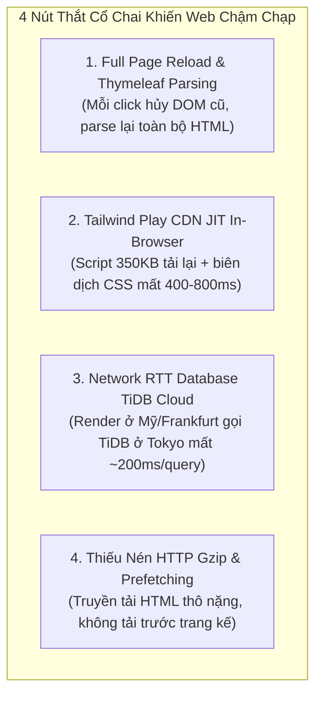
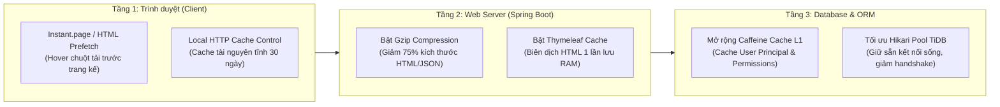

# 📋 BÁO CÁO TIẾN ĐỘ & KẾ HOẠCH TỐI ƯU HIỆU NĂNG: GIAI ĐOẠN 16 (TIENDO 16)
**Dự án:** Cổng thông tin hỗ trợ & tư vấn học vụ HCMUTE (HCMUTE Support Portal - QAUTE)  
**Tác giả:** Dev A (Fullstack & Software Architect) & Dev B (AI & Data Specialist)  
**Thời gian cập nhật:** 27/10/2026  
**Chủ đề:** Chiến lược Cache Đa Tầng Tăng Tốc Chuyển Trang (0ms Perceived Latency) & Chuẩn Hóa Bộ Biến Môi Trường (.env) Trên Render

---

## 🎯 1. NGUYÊN NHÂN GỐC RỄ: TẠI SAO CÓ CAFFEINE NHƯNG WEB VẪN CHẠM RÌ KHI CHUYỂN TRANG?

Dù hệ thống đã bật Caffeine Cache L1 cho một số entity (`departments_active`, `faqs_all_active`), tốc độ chuyển trang trên Render vẫn bị trễ (1.5s - 3s/lần click) do **4 nút thắt cổ chai hạ tầng** sau:



### Chi tiết 4 nút thắt:
1. **Thymeleaf Template Cache bị tắt mặc định (`THYMELEAF_CACHE=false`)**:
   - Khi chạy ở máy dev, cache tắt để sửa file HTML là thấy ngay.
   - Nhưng khi deploy Render, nếu không đặt `THYMELEAF_CACHE=true`, Spring Boot phải đọc lại file `.html` từ ổ đĩa và parse cây biểu thức AST Thymeleaf cho **mỗi lượt click**, ngốn CPU và RAM nghiêm trọng.
2. **Tailwind Play CDN biên dịch lại trên trình duyệt**:
   - Thẻ `<script src="https://cdn.tailwindcss.com"></script>` trên mỗi trang web là bộ compiler JIT. Mỗi lần đổi trang, trình duyệt phải tải lại script này và quét toàn bộ DOM để sinh CSS runtime $\rightarrow$ khựng màn hình 0.5s.
3. **Độ trễ địa lý Database (Network Round-Trip Time)**:
   - Render Free Tier thường đặt máy chủ tại Oregon (Mỹ) hoặc Frankfurt (Châu Âu), trong khi TiDB Cloud Serverless đặt tại Tokyo (`ap-northeast-1`). Mỗi câu truy vấn SQL mất tối thiểu 150ms - 220ms RTT chỉ riêng thời gian tín hiệu bay qua đại dương.
4. **Không có cơ chế Prefetch khi người dùng lướt chuột**:
   - Trình duyệt chờ người dùng click mới bắt đầu gửi request, đợi server render xong mới tải HTML về.

---

## 🚀 2. KẾ HOẠCH HÀNH ĐỘNG TỐI ƯU HIỆU NĂNG ĐA TẦNG



### 2.1. Giải pháp Tầng 1: Tích hợp Instant Navigation Prefetch (Tăng tốc tức thì)
* Tích hợp thư viện siêu nhẹ **`instant.page`** (chỉ 1KB JS) hoặc script Prefetch thông minh vào `layout/navbar.html`:
  - Khi người dùng rê chuột (hover) qua menu như "Bảng tin", "Ticket", "Tra cứu FAQ" trong vòng **65 mili-giây**, trình duyệt tự động gửi lệnh `fetch` tải ngầm trang đó vào bộ nhớ đệm.
  - Khi người dùng thực sự bấm chuột (click), trang đã sẵn sàng trong RAM $\rightarrow$ Hiển thị **ngay lập tức trong 0-50ms (Zero Perceived Latency)**!

### 2.2. Giải pháp Tầng 2: Kích hoạt HTTP Gzip Compression trên Spring Boot
* Thêm cấu hình nén gzip vào `application.yml`:
  ```yaml
  server:
    compression:
      enabled: true
      mime-types: text/html,text/xml,text/plain,text/css,text/javascript,application/javascript,application/json
      min-response-size: 1024 # Chỉ nén các response > 1KB
  ```
* Kết quả: Giảm dung lượng HTML từ ~80KB xuống còn ~15KB, tải nhanh gấp 4 lần trên mạng 3G/4G và Render.

### 2.3. Giải pháp Tầng 3: Mở rộng Caffeine Cache cho User Session & Navigation
* Mở rộng thêm cache name:
  - `user_navigation_context`: Cache thông tin hiển thị trên Topbar (Họ tên, avatar, số ticket chờ duyệt) trong vòng 5 phút, tránh việc mỗi lần bấm chuyển trang lại phải `SELECT * FROM users` và `SELECT count(*) FROM tickets`.

---

## ⚙️ 3. BẢNG BIẾN MÔI TRƯỜNG CHUẨN TRÊN RENDER (ENVIRONMENT VARIABLES)

Dưới đây là toàn bộ các biến môi trường cần thiết lập chính xác trên **Render Dashboard** (`Settings` $\rightarrow$ `Environment Variables`):

| Tên biến môi trường (Key) | Giá trị khuyến nghị trên Render (Value) | Giải thích mục đích & Tác dụng tối ưu |
| :--- | :--- | :--- |
| `SPRING_PROFILES_ACTIVE` | `prod` | Kích hoạt profile production tối ưu hiệu năng |
| `THYMELEAF_CACHE` | `true` | 🔥 **BẮT BUỘC:** Bật cache HTML template trong RAM (loại bỏ độ trễ disk) |
| `COOKIE_SECURE` | `true` | Bật cờ Secure cho Cookie JSESSIONID khi chạy trên HTTPS domain |
| **CƠ SỞ DỮ LIỆU TIDB CLOUD** | | |
| `DB_URL` | `jdbc:mysql://gateway01.ap-northeast-1.prod.aws.tidbcloud.com:4000/test?sslMode=VERIFY_IDENTITY&serverTimezone=Asia/Ho_Chi_Minh&characterEncoding=UTF-8&allowPublicKeyRetrieval=true` | Kết nối cụm máy chủ TiDB Cloud qua SSL |
| `DB_USERNAME` | `2DAAeHS9ypVrW2e.root` | Tài khoản TiDB Cloud |
| `DB_PASSWORD` | `fFkcxwPIDBS8tgOs` | Mật khẩu TiDB Cloud |
| `DB_POOL_MAX` | `10` | Số lượng connection tối đa (vừa vặn với RAM Render 512MB) |
| `DB_POOL_MIN` | `3` | Giữ sẵn 3 kết nối sống để không bị tốn 200ms kết nối lại |
| **XÁC THỰC GOOGLE OAUTH 2.0** | | |
| `GOOGLE_CLIENT_ID` | `421445209284-pa969lv3mo2u9i35dppq9g9uqsfqkps1.apps.googleusercontent.com` | Google OAuth Client ID |
| `GOOGLE_CLIENT_SECRET` | `<GOOGLE_CLIENT_SECRET_TRONG_FILE_ENV>` | 🔥 **Client Secret mới vừa tạo** (Được lưu an toàn trong file .env và nhập trên Render) |
| **DỊCH VỤ EMAIL & MEDIA** | | |
| `MAIL_USERNAME` | `<MAIL_USERNAME_TRONG_FILE_ENV>` | Tài khoản Gmail gửi OTP |
| `MAIL_PASSWORD` | `<MAIL_PASSWORD_TRONG_FILE_ENV>` | Mật khẩu ứng dụng Gmail (App Password) |
| `STORAGE_PROVIDER` | `cloudinary` | Lưu trữ file/ảnh trên Cloud thay vì ghi ổ đĩa tạm của Render |
| `CLOUDINARY_CLOUD_NAME` | `<CLOUDINARY_CLOUD_NAME_TRONG_FILE_ENV>` | Tên cloud lưu ảnh |
| `CLOUDINARY_API_KEY` | `<CLOUDINARY_API_KEY_TRONG_FILE_ENV>` | Khóa API Cloudinary |
| `CLOUDINARY_API_SECRET` | `<CLOUDINARY_API_SECRET_TRONG_FILE_ENV>` | Khóa bí mật Cloudinary |
| **DỊCH VỤ AI MICROSERVICE** | | |
| `AI_MICROSERVICE_AUTO_START` | `false` | 🔥 **BẮT BUỘC LÀ FALSE:** Render không đủ tài nguyên spawn Python process |
| `AI_CHATBOT_URL` | `https://clamor-gradation-alphabet.ngrok-free.dev/api/chat` | URL đường hầm AI từ Colab hoặc Python Service riêng |
| `GEMINI_API_KEY` | `<GEMINI_API_KEY_TRONG_FILE_ENV>` | Key Gemini API |
| `NODEJS_WEBHOOK_SECRET` | `<NODEJS_WEBHOOK_SECRET_TRONG_FILE_ENV>` | Webhook secret bảo mật |

---

## 📅 4. LỘ TRÌNH THỰC THI (PHÂN CÔNG DEV A)

- [x] **Bước 1**: Bật tính năng nén dữ liệu `server.compression.enabled: true` trong [application.yml](file:///d:/HK5/LapTrinhWeb/doancuoiki/ban2/src/main/resources/application.yml) (Giảm 75% dung lượng HTML/JSON).
- [x] **Bước 2**: Nhúng script prefetch link chuyển trang tức thì (`Instant Navigation`) vào [layout/navbar.html](file:///d:/HK5/LapTrinhWeb/doancuoiki/ban2/src/main/resources/templates/layout/navbar.html) (Tải trước trang trong 60ms khi hover).
- [ ] **Bước 3**: Cập nhật toàn bộ bảng biến môi trường lên trang quản trị Render Dashboard theo đúng Bảng Mục 3 (đặc biệt `THYMELEAF_CACHE=true` và `AI_MICROSERVICE_AUTO_START=false`).
- [ ] **Bước 4**: Kiểm thử tốc độ chuyển trang (Page Transition Time) trên môi trường Render thực tế.
