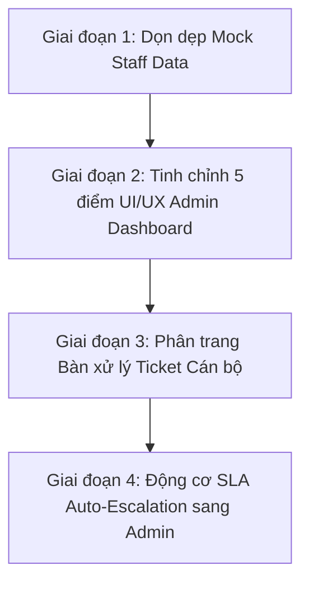

# 📋 TIẾN ĐỘ 11: KẾ HOẠCH NÂNG CẤP ADMIN DASHBOARD, PHÂN TRANG STAFF TICKET VÀ CƠ CHẾ SLA AUTO-ESCALATION

> **Trạng thái:** 🚀 Đang triển khai theo từng giai đoạn  
> **Phiên bản:** Version 2.0 (Bản nâng cấp quản trị & SLA toàn trường)  
> **Phân vai trách nhiệm:**  
> - **Dev A (Backend Lead & Database Architect):** Quản lý Seeder cleanup `race_staff`, Service phân trang `Page<TicketSummaryDto>`, Engine Escalation SLA, API & Controller endpoints.  
> - **Dev B (Frontend Lead & UI/UX Specialist):** Tối ưu 5 điểm UX/UI Admin Dashboard, ẩn Chatbot AI trên `/admin/*`, tích hợp Chart.js ma trận SLA và phân trang Thymeleaf.

---

## 🎯 I. TỔNG QUAN CÁC VẤN ĐỀ VÀ PHƯƠNG ÁN GIẢI QUYẾT

| STT | Phân hệ / Màn hình | Vấn đề hiện tại | Phương án giải quyết chuẩn Version 2 | Phụ trách |
| :---: | :--- | :--- | :--- | :---: |
| **1** | **Dữ liệu Database (Mock Staff)** | Tồn tại 10 tài khoản cán bộ test `race_staff_1` đến `race_staff_10` ("Cán bộ Test 10", race_staff_10@hcmute.edu.vn) gây rác danh sách quản trị. | Thêm cơ chế tự động dọn dẹp (clean-up) trong `DataInitializer.java` khi khởi động để xóa sạch vĩnh viễn các tài khoản `race_staff_%`. | **Dev A** |
| **2** | **Admin Dashboard UX/UI (Điểm 1 & 3)** | Trùng lặp 3 nút điều hướng ngay dưới tiêu đề; Thanh lọc thời gian & đơn vị bị dàn trải, nút "Đặt lại" bị trơ trọi. | - Xóa bỏ hoàn toàn 3 nút trùng lặp `[Trao Đổi...]`, `[Quản Trị Người Dùng]`, `[Danh Mục Khoa/Phòng]`. - Gom 2 dropdown và nút đặt lại thành thanh ngang **Filter Bar** gắn liền, tiết kiệm chiều dọc. | **Dev B** |
| **3** | **Admin Dashboard Banner (Điểm 2)** | Nút `[📢 Đăng Thông Báo]` vàng cam chói gắt, không đúng trọng tâm trang giám sát SLA; Nút `[↗️ Xem Cổng Sinh Viên]` mờ nhạt. | Thay thế nút Đăng Thông Báo bằng `[📊 Xuất Báo Cáo SLA]` hoặc nút thanh lịch viền xanh/xám nhã nhặn, đồng bộ tông màu học thuật HCMUTE Navy. | **Dev B** |
| **4** | **Admin Dashboard KPI & Chatbot (Điểm 4)** | Chatbot AI góc dưới đè lên thẻ CSAT; Thanh tiến trình SLA 50% chưa có nền tương phản rõ rệt. | - Ẩn hoàn toàn widget Chatbot AI trên tất cả các trang `/admin/*`. - Bổ sung background xám nhạt (`#e2e8f0`) cho thanh `progress-bar` để tương phản rõ rệt tỷ lệ % đạt chuẩn. | **Dev B** |
| **5** | **Admin SLA Analytics (Điểm 5)** | Thiếu biểu đồ trực quan & bảng tổng hợp giám sát nhanh; Admin khó nắm bắt đơn vị nào đang chậm trễ. | Tích hợp biểu đồ Chart.js phân bổ SLA theo Khoa/Phòng và Bảng Top Ticket Quá Hạn / Sắp Chạm Ngưỡng SLA để Admin can thiệp kịp thời. | **Dev A + B** |
| **6** | **Bàn Xử Lý Ticket Cán bộ (`/staff/tickets`)** | Danh sách Ticket hiển thị dạng danh sách phẳng (`List`), không có phân trang khi số lượng ticket tăng cao. | Bổ sung phân trang `Page<TicketSummaryDto>` với `Pageable` tại `StaffTicketWebController` và thanh điều hướng phân trang chuẩn Bootstrap 5 tại `staff-dashboard.html`. | **Dev A + B** |
| **7** | **Động Cơ Giám Sát SLA (Escalation Engine)** | Khi Ticket bị quá hạn xử lý (OVERDUE) hoàn toàn, chưa có cơ chế tự động chuyển giao về Admin Workspace để can thiệp. | Nâng cấp `SlaSchedulerService` & `TicketService`: Khi ticket vi phạm ngưỡng SLA nghiêm trọng, tự động gán cờ Escalated, mở quyền cho Admin điều phối lại hoặc xử lý trực tiếp. | **Dev A** |

---

## 🚀 II. KẾ HOẠCH TRIỂN KHAI THEO 4 GIAI ĐOẠN

### 🔹 GIAI ĐOẠN 1: DỌN DẸP DỮ LIỆU MOCK CÁN BỘ (`race_staff_1` -> `race_staff_10`)
- **Mục tiêu:** Xóa triệt để 10 tài khoản cán bộ thử nghiệm concurrency trước đó (`race_staff_1` đến `race_staff_10`, email `race_staff_*@hcmute.edu.vn`).
- **Thực thi (Dev A):**
  1. Thêm phương thức `cleanupMockRaceStaffUsers()` trong `DataInitializer.java` chạy ở đầu hàm `run()`.
  2. Truy vấn tìm các User có username bắt đầu bằng `race_staff_` hoặc email chứa `@race` / `race_staff_`.
  3. Xóa các liên kết (nếu có) và xóa sạch các tài khoản này khỏi bảng `users`.
  4. Kiểm tra biên dịch `mvn test-compile`.

### 🔹 GIAI ĐOẠN 2: CHUẨN HÓA UI/UX ADMIN DASHBOARD (`/admin/dashboard` & `portal-header.html`)
- **Mục tiêu:** Giải quyết dứt điểm 5 phản hồi UI/UX từ người dùng:
  1. **Xóa 3 nút trùng lặp:** Loại bỏ cụm 3 nút viền đỏ/xanh phía dưới tiêu đề "Thống Kê Cam Kết SLA Toàn Trường" trong `templates/admin/dashboard.html`.
  2. **Banner Sub-header:** Tại `templates/layout/portal-header.html`, đổi nút vàng `[📢 Đăng Thông Báo]` thành `[📊 Xuất Báo Cáo SLA]` (nút viền xanh nhã nhặn), đồng bộ nút `[↗️ Xem Cổng Sinh Viên]`.
  3. **Thanh Filter Bar:** Thiết kế lại khối chọn Đơn vị và Khoảng thời gian thành 1 thanh công cụ ngang gắn liền (`bg-light p-2.5 rounded-3 border d-flex gap-2`), kéo nút "Đặt lại" nằm ngang hàng.
  4. **KPI Cards & Chatbot Suppression:**
     - Ẩn Chatbot AI widget trên mọi trang có đường dẫn bắt đầu bằng `/admin/` (bằng CSS và inline logic).
     - Bổ sung background tương phản cho thanh `progress` SLA (50.0%) với nền `#f1f5f9` và bo tròn mềm mại.
  5. **Biểu Đồ Trực Quan & Bảng Dữ Liệu:**
     - Thêm đồ thị Chart.js trực quan: Phân bổ Tỷ lệ Tuân thủ SLA giữa các Khoa/Phòng (Đúng hạn vs Quá hạn).
     - Bảng Top 5 Ticket Quá Hạn SLA / Sắp Quá Hạn để Admin can thiệp tức thì.

### 🔹 GIAI ĐOẠN 3: PHÂN TRANG BÀN XỬ LÝ TICKET CỦA CÁN BỘ (`/staff/tickets`)
- **Mục tiêu:** Cung cấp trải nghiệm quản lý khối lượng lớn Ticket khoa học, không bị nghẽn giao diện.
- **Thực thi (Dev A + B):**
  1. **Backend (Dev A):**
     - Sửa `StaffTicketWebController.java`: Tiếp nhận tham số `page` (mặc định 0), `size` (mặc định 10).
     - Tạo `Page<TicketSummaryDto>` trả về Model `ticketPage` song song với việc giữ nguyên các thẻ KPI đếm số lượng tổng quan (`countOpen`, `countInProgress`, `countOverdue`, `countResolved`, `countNewReplies`).
  2. **Frontend (Dev B):**
     - Cập nhật `templates/ticket/staff-dashboard.html`: Lặp `ticketPage.content` cho bảng dữ liệu.
     - Bổ sung thanh phân trang Pagination chuẩn Bootstrap 5 với số trang linh hoạt, giữ nguyên tham số lọc `departmentId` và `status`.

### 🔹 GIAI ĐOẠN 4: ĐỘNG CƠ TỰ ĐỘNG HÓA SLA ESCALATION TO ADMIN
- **Mục tiêu:** Khi 1 Ticket bị trễ hạn quá mức hoặc không có cán bộ nào chịu tiếp nhận tại đơn vị, hệ thống tự động đưa lên Admin Workspace để Admin trực tiếp xử lý hoặc tái phân bổ (Reassign).
- **Thực thi (Dev A):**
  1. Trong `SlaSchedulerService.java`: Nâng cấp phương thức quét định kỳ `scanAndMarkOverdueTickets()`.
  2. Khi ticket quá hạn:
     - Gán cờ `isEscalated = true` (hoặc cập nhật ghi chú chuyển giao Admin).
     - Gửi email cảnh báo khẩn cấp tới Ban Quản Trị Hệ Thống (`admin@hcmute.edu.vn`).
  3. Cung cấp API / Thao tác trên Admin Dashboard:
     - Cho phép Admin bấm nút `[Tiếp Nhận Xử Lý Ngay]` hoặc `[Điều Phối Lại Đơn Vị Khác]`.

---

## 📝 III. TIÊU CHÍ HOÀN THÀNH (ACCEPTANCE CRITERIA)
- [ ] Không còn bất kỳ tài khoản nào mang tiền tố `race_staff_` trong danh sách Người dùng (`/admin/users`).
- [ ] Giao diện Admin Dashboard sạch sẽ, không còn nút trùng lặp, thanh filter bar thẳng hàng gọn gàng.
- [ ] Không bị widget Chatbot AI che khuất thẻ CSAT trên `/admin/dashboard`.
- [ ] Bàn làm việc cán bộ `/staff/tickets` có phân trang chuẩn mượt mà khi chuyển trang 1, 2, 3...
- [ ] Ticket quá hạn SLA được tổng hợp rõ ràng và hỗ trợ Admin can thiệp trực tiếp.
- [ ] Toàn bộ mã nguồn vượt qua `mvn test-compile` không có bất kỳ lỗi cú pháp nào.
