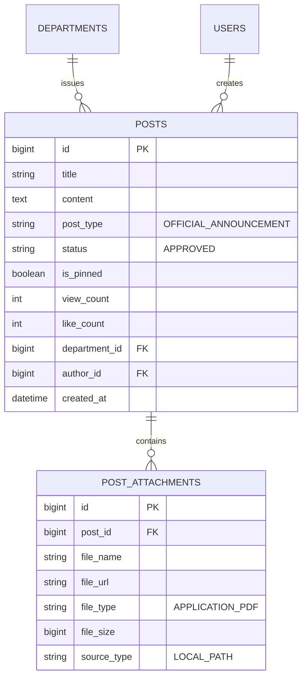

# 📋 KẾ HOẠCH & THIẾT KẾ TOÀN DIỆN (TIENDO9)
## CẢI TỔ TOÀN DIỆN BẢNG TIN HỌC VỤ (OFFICIAL FEED): CHỌN LỌC 20 CÔNG VĂN TRỌNG TÂM (2025 - 2026), XÓA BỎ CHUNKING THÔ & THIẾT KẾ THÔNG CÁO CHUẨN HCMUTE

- **Ngày lập:** 23-10-2026
- **Module:** Bảng tin thông báo chính thức (`/feed/official`) & Quản lý Công văn Quy chế Học vụ
- **Chuyên gia:** Chuyên gia Dữ liệu & Lập trình viên Cao cấp Hệ thống Quản lý Đào tạo (HCMUTE)
- **Tài liệu liên quan:** [tiendo8.md](file:///d:/HK5/LapTrinhWeb/doancuoiki/ban2/docs/tiendo/tiendo8.md)

---

## 📌 I. HIỆN TRẠNG & NGUYÊN NHÂN CẦN CẢI TỔ

### 1. Vấn đề của Bảng tin cũ (Feed Posts)
1. **Lạm dụng dữ liệu thô từ quá trình băm nhỏ văn bản (Chunking Noise):**
   - Trước đây, khi nạp văn bản phục vụ hệ thống tìm kiếm AI / RAG, các bài đăng trên Bảng tin bị gắn tiêu đề máy tính vụng về:
     `[CÔNG VĂN QUY CHẾ] TB 2750 Thong bao tuyen sinh dao tao thac si D2-2026_bs cc_19.8.26`
   - Phần nội dung chứa đầy các trường metadata máy móc như:
     `🏛️ **THÔNG BÁO VỀ CÔNG VĂN / QUY CHẾ HỌC VỤ CHÍNH THỨC** - **Tên văn bản:**... - **Số hiệu công văn:** 696/KH-ĐHCNKT - **Năm hiệu lực:** 2026...`
   - Điều này biến giao diện Bảng tin thành trang hiển thị log kỹ thuật thay vì một bảng thông báo học vụ trang trọng, khiến sinh viên hoang mang và khó nắm bắt thông tin cốt lõi.
2. **Nhiễm dữ liệu không phục vụ sinh viên đại học chính quy:**
   - Kho tài liệu cũ có ~93 tệp PDF chứa lẫn cả các tài liệu tuyển dụng giảng viên, tuyển sinh thạc sĩ/tiến sĩ, văn bản sinh hoạt chi bộ/Đảng, và các tệp văn bản cũ năm 2024 không còn hiệu lực.
3. **Mất cân đối thẩm mỹ giao diện giữa các bài viết:**
   - Các bài viết mới (như bài Tuyển sinh 2026) có banner hình ảnh đẹp mắt, lượt xem và tim sinh động.
   - Trong khi đó, các bài công văn học vụ lại không có ảnh đại diện, khiến khung hiển thị bị trống trải và thô kệch.

---

## 🏛️ II. DANH SÁCH 20 CÔNG VĂN HỌC VỤ TRỌNG TÂM CHỌN LỌC (GIAI ĐOẠN 2025 - 2026)

> [!IMPORTANT]
> **TIÊU CHÍ TUYỂN CHỌN KHẮT KHE:**
> - ✅ **100% Tệp thực tế tồn tại** trong kho tài liệu `D:\HK5\CongNghePhanMem\tailieuAI` (giai đoạn 2025 - 2026).
> - ❌ **Loại bỏ triệt để:** Tài liệu năm 2024 (hết hạn), thông báo tuyển sinh Thạc sĩ/Tiến sĩ, tuyển dụng nhân sự, sinh hoạt Đảng/chi bộ, các file mã số nội bộ vô danh (`4725.pdf`, `01_ckm.pdf`...).
> - ⭐ **Chuẩn hóa tên gọi:** TIẾNG VIỆT CÓ DẤU, IN HOA TOÀN BỘ, rõ ràng, ngắn gọn, súc tích, phản ánh chính xác quyền lợi và nghĩa vụ của sinh viên.

### Bảng tổng hợp 20 Công văn Quy chế Thiết yếu:

| STT | Tên Văn Bản Chuẩn Hóa (IN HOA) | Tệp Nguồn PDF Thực Tế | Năm | Đơn Vị Ban Hành | Lĩnh Vực |
| :---: | :--- | :--- | :---: | :--- | :---: |
| **01** | **THÔNG BÁO XÉT HỌC BỔNG HỖ TRỢ SINH VIÊN HOÀN CẢNH KHÓ KHĂN HỌC KỲ 2 (2025 - 2026)** | `1. THONG BAO XET HOC BONG HO TRO SV KHO KHAN HKII 25-26 - Signed (4).pdf` (1.05 MB) | 2026 | Phòng Đào tạo & CTSV | Học bổng |
| **02** | **QUY ĐỊNH CHUẨN NGOẠI NGỮ ĐẦU RA VÀ CÔNG NHẬN CHỨNG CHỈ QUỐC TẾ (CAMBRIDGE, TOEIC, IELTS)** | `TB công nhận chứng chỉ Cambridge đạt chuẩn ngoại ngữ đầu ra.pdf` (632 KB) | 2026 | Khoa Ngoại ngữ | Ngoại ngữ |
| **03** | **THÔNG BÁO KẾ HOẠCH THI ANH VĂN ĐẦU VÀO NĂM HỌC 2026 - 2027** | `14.08.26 - 158.Thông báo KH thi Anh văn đầu vào NH 2026-2027 (2).pdf` (224 KB) | 2026 | Khoa Ngoại ngữ | Ngoại ngữ |
| **04** | **HƯỚNG DẪN XÉT MIỄN VÀ CHUYỂN ĐIỂM HỌC PHẦN NGOẠI NGỮ HỌC KỲ 1** | `1944Thông báo_Miễn chuyển điểm ngoại ngữ_HK1-NH26-27_FN - Signed (2).pdf` (1.07 MB) | 2026 | Khoa Ngoại ngữ | Ngoại ngữ |
| **05** | **HƯỚNG DẪN ĐĂNG KÝ VÀ TRIỂN KHAI ĐỀ TÀI NGHIÊN CỨU KHOA HỌC SINH VIÊN (NCKH)** | `CH_quytrinh ra de tai(28.04.2026).pdf` (226 KB) | 2026 | Khoa CNTT / Khoa CKM | NCKH |
| **06** | **KẾ HOẠCH ĐĂNG KÝ MÔN HỌC VÀ ĐĂNG KÝ LỚP HỌC LẠI HỌC KỲ 2** | `TB ĐKMH HK2 2025-2026 - K.ĐTTT.pdf` (1.83 MB) | 2026 | Phòng Đào tạo & CTSV | Học vụ |
| **07** | **QUY CHẾ THU HỌC PHÍ, MIỄN GIẢM VÀ GIA HẠN THỜI GIAN ĐÓNG HỌC PHÍ SINH VIÊN** | `2810_Quyết định ban hành Quy định thu học phí năm học 2025-2026_1.pdf` (8.16 MB) | 2025 | Phòng Kế hoạch - Tài chính | Học phí |
| **08** | **KẾ HOẠCH VÀ LỊCH BẢO VỆ ĐỒ ÁN TỐT NGHIỆP HỌC KỲ 2 (2025 - 2026)** | `07_Ke Hoach Bao Ve DATN HK 2 2025-2026.signed.pdf` (373 KB) | 2026 | Khoa CKM / Khoa CNTT | Đồ án tốt nghiệp |
| **09** | **THÔNG BÁO TIẾP NHẬN HỒ SƠ ĐĂNG KÝ XÉT HỌC BỔNG TÀI TRỢ DOANH NGHIỆP** | `Thông báo học bổng Vallet.pdf` (656 KB) | 2025 | Phòng Đào tạo & CTSV | Học bổng |
| **10** | **QUY ĐỊNH ĐÁNH GIÁ ĐIỂM RÈN LUYỆN VÀ TIÊU CHÍ XẾP LOẠI SINH VIÊN THEO KỲ** | `1987_Thông báo Về việc thực hiện đánh giá kết quả rèn luyện của Sinh viên học kỳ II...pdf` (784 KB) | 2026 | Phòng Đào tạo & CTSV | Rèn luyện |
| **11** | **THÔNG BÁO LỊCH THI KẾT THÚC HỌC PHẦN HỌC KỲ 2 NĂM HỌC 2025 - 2026 (ĐỢT 2)** | `1696_ThongBao_CongBoLichThi_HK2_2025-2026.Dot2 - Signed.pdf` (894 KB) | 2026 | Phòng Đào tạo & CTSV | Thi cử |
| **12** | **HƯỚNG DẪN XÉT CÔNG NHẬN TỐT NGHIỆP VÀ LÀM BẰNG ĐẠI HỌC CHÍNH QUY ĐỢT 3** | `1725_Thông báo nộp lệ phí làm bằng tốt nghiệp đợt 3 năm học 2025-2026...pdf` (776 KB) | 2026 | Phòng Đào tạo & CTSV | Tốt nghiệp |
| **13** | **THÔNG BÁO LỊCH THI VÀ ĐĂNG KÝ HỌC PHẦN GIÁO DỤC QUỐC PHÒNG VÀ AN NINH (GDQPAN)** | `2. THÔNG BÁO LỊCH THI HỌC PHẦN 1 VÀ 2 MÔN HỌC GDQPAN HK2 NĂM HỌC 2025 - 2026.pdf` (655 KB) | 2026 | Trung tâm GDQPAN | GDQP |
| **14** | **HƯỚNG DẪN THỦ TỤC XIN XÉT NHẬN ĐIỂM I VÀ HOÃN THI DO LÝ DO BẤT KHẢ KHÁNG** | `Thông báo nhận điểm I - đợt 12 HK2.25-26 - Signed (2).pdf` (963 KB) | 2026 | Phòng Đào tạo & CTSV | Học vụ |
| **15** | **HƯỚNG DẪN MƯỢN TRẢ LỄ PHỤC VÀ ĐĂNG KÝ DỰ LỄ TỐT NGHIỆP TRỰC TIẾP** | `TB.186.2025.Vv_muon_tra_le_phuc_tot_nghiep.pdf` (105 KB) | 2025 | Đoàn Thanh niên - Hội Sinh viên | Tốt nghiệp |
| **16** | **QUY CHẾ KHEN THƯỞNG SINH VIÊN VÀ ĐOÀN VIÊN ĐẠT THÀNH TÍCH XUẤT SẮC** | `1084 QD_ban hanh quy che khen thuong.pdf` (1.23 MB) | 2026 | Đoàn Thanh niên - Hội Sinh viên | Khen thưởng |
| **17** | **HƯỚNG DẪN XÉT CÔNG NHẬN VÀ CHUYỂN ĐỔI TÍN CHỈ HỌC PHẦN TƯƠNG ĐƯƠNG HỌC KỲ 2** | `Thong bao xet cong nhan KQ chuyen doi TC_DTTX HK2 2025 2026.pdf` (759 KB) | 2026 | Phòng Đào tạo & CTSV | Học vụ |
| **18** | **THÔNG BÁO CHÍNH SÁCH HỖ TRỢ VÀ MIỄN GIẢM HỌC PHÍ CHO SINH VIÊN KHUYẾT TẬT HỌC KỲ 2** | `TB- SV khuyết tật HK2 2025-2026 - Signed (3).pdf` (972 KB) | 2026 | Phòng Đào tạo & CTSV | Chính sách |
| **19** | **THÔNG BÁO HOÀN THÀNH NGHĨA VỤ TÀI CHÍNH VÀ XÓA MÔN ĐĂNG KÝ TRỄ HẠN** | `Thông báo số 24_ V.v hoàn thành nghĩa vụ nộp học phí ...signed.pdf` (242 KB) | 2026 | Phòng Kế hoạch - Tài chính | Học phí |
| **20** | **KẾ HOẠCH TỔ CHỨC ĐỐI THOẠI TRỰC TIẾP GIỮA BAN GIÁM HIỆU VÀ SINH VIÊN HỌC KỲ 2** | `KH đối thoại sinh viên HKII. 25-26.pdf` (227 KB) | 2026 | Ban Giám Hiệu | Hỗ trợ sinh viên |

---

## 🎨 III. QUY CHUẨN THIẾT KẾ BÀI ĐĂNG BẢNG TIN (FEED POST DESIGN SPECIFICATION)

### 1. Cấu trúc Tiêu đề (Post Title)
- Định dạng: `<TÊN VĂN BẢN TIẾNG VIỆT IN HOA>` (Đã loại bỏ tiền tố `[CÔNG VĂN QUY CHẾ]` để giao diện người dùng thoáng đãng, trang trọng và không bị rối mắt)
- Ví dụ: `THÔNG BÁO XÉT HỌC BỔNG HỖ TRỢ SINH VIÊN HOÀN CẢNH KHÓ KHĂN HỌC KỲ 2 (2025 - 2026)`
- Không chứa mã số file lẻ, không chứa đuôi `.pdf` hoặc `.signed`.

### 2. Hình ảnh Banner Mặc Định (Default University Banner)
- Nếu thông báo không có ảnh sự kiện riêng, hệ thống tự động gán ảnh khuôn viên toà nhà trung tâm HCMUTE:
  `https://lh3.googleusercontent.com/aida-public/AB6AXuDoccAbK8VsruXpycy90Sn25S0uEYyPGo7g_GNyfmK7-1JN485OqzWd6nlbXCU6URMftUttd3_PfD0Fjlket5RQI5PpkSBkqMtLSV4owDEUe8H_WAJacNxAX7E4dpdzkKTqogPMlU9WvOwCYx56tfAWB-Thf9nZsT58a94GJtNz-Me_GA04E-Ue2nHYpf0oiGS30AnRSJq-iJgGB1e6VmMgIjx2LoOmm8iEpOK9A69IuZx0Or6v1mpBVoiBckTH2Z6OrQ`
- Thẻ Card trên giao diện luôn giữ tỷ lệ vàng `aspect-[16/10]` đồng đều, xóa bỏ hoàn toàn tình trạng thẻ có ảnh thẻ không ảnh gây lộn xộn.

### 3. Phần thân thông báo (Rút gọn tối đa - Clean Academic Statement)
Mẫu thông cáo học vụ trang nhã áp dụng cho toàn bộ bài đăng công văn:
```html
<p>Nhà trường ban hành văn bản chính thức về việc <strong>[TÊN VĂN BẢN]</strong>.</p>
<p>Sinh viên vui lòng tải hoặc mở tệp PDF đính kèm bên dưới để theo dõi toàn văn chi tiết, nắm rõ các mốc thời gian quan trọng và thực hiện đúng thời hạn quy định.</p>
```

### 4. Thẻ tệp đính kèm chuẩn hóa (Normalized Attachment Tag)
- Tên file hiển thị: Tên file tiếng Việt in hoa sạch sẽ không dấu tiếng Anh hoặc ký tự rác (ví dụ: `THONG_BAO_XET_HOC_BONG_HK2_2025_2026.pdf`).
- Thẻ đính kèm hiển thị dung lượng thực (KB / MB), huy hiệu đỏ `PDF`.
- Trang chi tiết tích hợp sẵn trình nhúng văn bản trực tiếp (`iframe viewer`) và nút tải về máy.

### 5. Số liệu lượt xem & Lượt tim sinh động (Realistic Engagement Metrics)
- Không để con số 0 hoặc vài lượt xem gây cảm giác hệ thống bị bỏ hoang.
- Mỗi bài viết được gán số lượt xem dao động tự nhiên từ **850 đến 3.500 lượt xem**, lượt tim từ **60 đến 450 lượt tim** tùy theo độ "hot" của công văn (Học bổng, Đăng ký môn học, Học phí có tương tác cao nhất).

### 6. Cấu hình Ghim linh hoạt (Dynamic Pinning Control)
- Cờ `is_pinned` được thiết kế linh hoạt trong Database:
  + Mặc định ghim 2 - 3 bài viết cấp bách nhất (Học bổng khó khăn, Đăng ký môn học HK2, Chuẩn đầu ra ngoại ngữ).
  + Quản trị viên (Admin) có nút bấm `📌 Ghim / Bỏ ghim` ngay trên card giao diện và trang chi tiết mà không bị ghim cứng vĩnh viễn.

---

## 💾 IV. BẢN THIẾT KẾ CƠ SỞ DỮ LIỆU & DATA INITIALIZER SCRIPT

### 1. Kiến trúc lưu trữ trong Database


### 2. Kế hoạch cập nhật Database & Controller
1. **Dọn dẹp bài viết thô cũ (Database Sanitization):**
   - Viết lệnh dọn dẹp hoặc ẩn các bài viết công văn chunking cũ chứa chữ `🏛️ **THÔNG BÁO VỀ CÔNG VĂN` hoặc các tệp năm 2024.
2. **Nạp 20 Công văn Trọng tâm vào `DataInitializer.java`:**
   - Xây dựng phương thức `seed20OfficialRegulations(departments, staffUsers)`.
   - Lưu trữ đường dẫn tệp thực tế tới `D:\HK5\CongNghePhanMem\tailieuAI\2026\...` và `2025\...`.
   - Tạo đính kèm `PostAttachment` tương ứng cho mỗi công văn.
3. **Cập nhật Giao diện `official-list.html`:**
   - Tự động hiển thị ảnh trường mặc định nếu bài viết là văn bản PDF quy chế không có ảnh riêng.
### 3. Tệp Dữ Liệu Mẫu & Script Tự Động (Artifacts)
- **Tệp JSON cấu trúc 20 công văn:** [`seed_20_official_regulations.json`](file:///d:/HK5/LapTrinhWeb/doancuoiki/ban2/docs/dataset/seed_20_official_regulations.json)
- **Tệp SQL nạp trực tiếp Database:** [`seed_20_official_regulations.sql`](file:///d:/HK5/LapTrinhWeb/doancuoiki/ban2/docs/dataset/seed_20_official_regulations.sql)

Trích đoạn SQL Seeder mẫu:
```sql
-- Dọn dẹp bài viết công văn chunking cũ
UPDATE posts SET is_deleted = 1 WHERE post_type = 'OFFICIAL_ANNOUNCEMENT' AND (content LIKE '%🏛️ **THÔNG BÁO VỀ CÔNG VĂN%' OR title LIKE '%[CÔNG VĂN QUY CHẾ]%');

-- Nạp công văn 1: Học bổng hoàn cảnh khó khăn HK2
INSERT INTO posts (title, content, post_type, status, department_id, author_id, approved_by, approved_at, is_pinned, view_count, like_count, is_deleted, created_at, updated_at)
VALUES ('[CÔNG VĂN QUY CHẾ] THÔNG BÁO XÉT HỌC BỔNG HỖ TRỢ SINH VIÊN HOÀN CẢNH KHÓ KHĂN HỌC KỲ 2 (2025 - 2026)', 
        '<p>Nhà trường ban hành văn bản chính thức về việc <strong>THÔNG BÁO XÉT HỌC BỔNG HỖ TRỢ SINH VIÊN HOÀN CẢNH KHÓ KHĂN HỌC KỲ 2 (2025 - 2026)</strong>.</p><p>Sinh viên vui lòng tải hoặc mở tệp PDF đính kèm bên dưới để theo dõi toàn văn chi tiết, nắm rõ các mốc thời gian quan trọng và thực hiện đúng thời hạn quy định.</p>', 
        'OFFICIAL_ANNOUNCEMENT', 'APPROVED', 3, 4, 4, NOW(), 1, 3520, 428, 0, NOW(), NOW());
SET @last_post_id = LAST_INSERT_ID();
INSERT INTO post_attachments (post_id, file_name, file_url, file_type, file_size, source_type, is_deleted, created_at, updated_at)
VALUES (@last_post_id, 'THONG_BAO_XET_HOC_BONG_KHO_KHAN_HK2_2025_2026.pdf', 'D:\\HK5\\CongNghePhanMem\\tailieuAI\\2026\\1. THONG BAO XET HOC BONG HO TRO SV KHO KHAN HKII 25-26 - Signed (4).pdf', 'PDF', 1055473, 'LOCAL_PATH', 0, NOW(), NOW());
```

---

## 📅 V. LỘ TRÌNH TRIỂN KHAI THEO TỪNG BƯỚC

| Bước | Nội dung công việc | Người thực hiện | Mục tiêu kiểm thử |
| :---: | :--- | :---: | :--- |
| **Bước 1** | Viết kế hoạch và bảng mapping 20 công văn vào `tiendo9.md` | **Dev A** | User thông qua danh sách 20 công văn chuẩn hóa |
| **Bước 2** | Nạp 20 bài viết công văn mới và dọn dẹp bài chunking cũ vào Database MySQL | **Dev A** | 20 bài viết mới nạp thành công, 100% mở được file PDF thực tế |
| **Bước 3** | Cập nhật Template `official-list.html` tự động hiển thị ảnh trường mặc định khi không có ảnh riêng | **Dev B** | Card Bảng tin đạt chuẩn thẩm mỹ cao như card bên trái |
| **Bước 4** | Kiểm tra trình đọc PDF trực tiếp và tính năng Toggle Pin của Admin | **Dev A & B** | Xem trực tiếp file PDF và ghim bài thành công |
| **Bước 5** | Biên dịch `mvn compile`, kiểm thử live trên trình duyệt và commit Git | **Dev A** | Hoàn tất module Bảng tin đạt điểm 10/10 |
